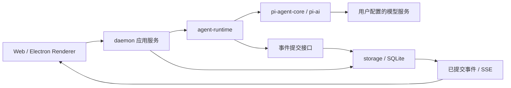

# M1模型与会话

## Spec

状态：M1.1至M1.5实现与macOS本机验证完成，整个M1统一待用户验收。用户已授权连续设计、开发与自测；M0基线为 `4fc2780`。实际检查及未验证项见[统一验证](verify.md)。M1总范围沿用已确认路线图；首条模型链路按用户选择采用OpenAI兼容API，包含DeepSeek与显式自定义地址。

### Intent

本页20个原生工厂矩阵为M1首次交付基线；当前产品保留的六个Provider入口由[Provider与侧栏精简](../202610150900_refactor_provider-navigation/spec.md)接续，不以历史矩阵要求恢复已按用户决定移除的入口。

用户可以配置自己的模型，建立独立会话，发送文字并观察流式回复，停止当前运行；刷新界面或重启服务后能读取已保存的对话。持续输入、排队、编辑重发与其他认证方式逐步补齐，内部逐步验证，用户统一验收，最终达到整个M1范围。

M1先建立持久事实与运行语义，再建立界面。Pi负责Agent loop与模型适配，本项目负责Session/Run、授权、持久化、恢复、跨端协议和产品交互；不复制pi-harness实现，也不借用Pi内部harness或其他项目数据目录。

### Constraints

- 保留Electron main/preload、共享Web和独立Node daemon；Renderer不持有Pi对象、数据库或可回读的保存凭据。专用设置表单仅短暂接收用户输入的Key，经专用写请求提交后清除，不进入通用Store/Query/持久化/日志；OAuth Token只留服务侧。
- 第一条路径为Chat Completions兼容文字对话，明确API类型、Base URL、modelId、能力/上下文限制与参数；不能把所有兼容服务假设成完全等价。原生Provider、OAuth和三种自定义协议属于已实现M1范围，首条链路不限制总功能。
- 配置默认值由解析所有者决定；保存模型配置不证明网络/认证可用，连接验证与真实运行分别显示结果。远端地址使用HTTPS，本机模型/测试地址只能在显式配置的回环目标使用HTTP。
- SQLite durable events是执行事实唯一持久来源，JSONL不参与实时双写。已提交事件追加记录；消息编辑通过新修订/分支表达，不能覆盖历史输入或回复。
- 先提交输入、运行和上下文事实，再发起模型请求；对客户端公开的流式进度也先提交，再经SSE发布。服务异常退出后恢复已提交内容，不从不完整状态自动重发模型请求。
- 新建/修改配置、会话、发送与停止均是受保护的本机副作用；HTTP授权、Host/Origin检查及CSRF规则先于这些接口开放，不能以回环监听或CORS代替认证。
- 不增加本机文件、Shell、MCP、子Agent、记忆或Computer Use工具；M1运行的工具集合为空，能力分别由后续里程碑拥有。

### Acceptance Criteria

| ID    | 可验收结果                                                                                                          | 子步骤 |
| ----- | ------------------------------------------------------------------------------------------------------------------- | ------ |
| AC-01 | Pi适配器通过锁定版本的公开接口工作；有效输入、Provider错误、取消和监听清理均有真实语义验证                          | M1.1   |
| AC-02 | 配置、会话、运行、输入和事件有持久记录；单会话seq、原子写入、迁移与异常重启恢复验证通过                             | M1.1   |
| AC-03 | 受保护HTTP/SSE支持发送、状态、停止、事件重放；同Session单活跃Run，非法来源/授权、重复发送、断线与重放竞争被实际检查 | M1.1   |
| AC-04 | 设置页面支持兼容API、凭据引用与模型配置；文字聊天流式呈现，失败、取消、空态和重新打开会话表现明确                   | M1.2   |
| AC-05 | 持续输入、队列修改、停止、编辑重发和分支历史有持久可恢复语义；引导不误结束整个Run                                   | M1.3   |
| AC-06 | 补齐下方Provider/认证矩阵及可选GitHub应用登录，验证OAuth登录/刷新/撤销；项目未实现不能当作上游不支持                | M1.4   |
| AC-07 | 浏览器与Electron共享同一会话事实；keyless端到端、可选真实API与随包Node/native资源验证分别记录                       | M1.5   |

## UseCase

| UC                   | 前置条件与操作                                                     | 预期与异常                                                                          |
| -------------------- | ------------------------------------------------------------------ | ----------------------------------------------------------------------------------- |
| UC-01 配置模型       | 完成本机授权，填写兼容地址、modelId、参数和API Key，保存并验证连接 | 配置与验证状态分别呈现；Key不进入公开响应/日志/URL，错误配置不会静默切换模型        |
| UC-02 新会话对话     | 选择有效模型，新建会话并发送文字                                   | 先接受持久输入，再开始Run；进度随提交事件呈现，完成、失败、取消状态可区分           |
| UC-03 停止与持续输入 | Run进行中，再次发送或停止                                          | 按明确队列/引导模式处理；停止幂等并等待真正结束，不把HTTP返回或SSE断线当停止完成    |
| UC-04 刷新与重启     | 回复进行中刷新页面，或服务异常退出后重新启动                       | 重放已提交事件无缺失/重复；残留Run标为interrupted，保留部分回复，不自动继续收费请求 |
| UC-05 编辑重发       | 编辑已有用户输入并重新运行                                         | 新建修订/分支，模型上下文来自所选分支；原历史保留，旧分支后续回复不会混入新请求     |
| UC-06 更换认证       | 切换模型、删除Key或退出OAuth                                       | 新Run按新的凭据状态检查；已启动Run使用明确快照，撤销是否取消当前请求按认证协议定义  |
| UC-07 非可信请求     | 外站、子frame或未授权本机客户端尝试调用写接口或订阅私有事件        | 真实入口拒绝，不泄露会话或凭据；另一个可信页面只能访问实际授予的本机会话范围        |

## 实现设计

以下为M1实施设计。公开DTO以packages/protocol为准，数据库DDL由storage拥有，Pi对象仅留在agent-runtime。

### 模块职责

| 模块位置                                   | 拥有的职责                                                                   | 依赖限制                                          |
| ------------------------------------------ | ---------------------------------------------------------------------------- | ------------------------------------------------- |
| `packages/agent-runtime`                   | Pi适配、Run状态与取消、模型上下文准备、标准化事件；通过明确存储/凭据接口工作 | 不依赖Electron、React、Fastify请求或SQL实现       |
| `packages/storage`                         | SQLite连接、Drizzle schema、迁移、事务、Session事件与投影repository          | 只在Node宿主使用；不调用模型、Pi loop或窗口       |
| `apps/daemon/src/features/models`          | 模型配置、连接验证、凭据解析与Provider装配                                   | 秘密留在服务；公共DTO只含配置和credentialRef/状态 |
| `apps/daemon/src/features/sessions`        | API用例、Runtime/存储装配、序列化命令与SSE重放                               | 路由只校验、授权和调用服务；不内嵌Pi loop         |
| `apps/web/src/features/models`、`sessions` | 设置、会话导航、聊天与交互；Query快照和实时事件投影                          | 共用protocol和HTTP/SSE客户端，不复制服务事实      |

只在真实实现职责出现时创建这些目录和包，禁止先创建无实现空壳。凭据先作为models内有明确接口的适配器，不预建万能credentials/shared包。

### 事实、运行与恢复

- 一个数据目录/profile只允许一个daemon持有运行所有权，先取得所有权再迁移和恢复；另一实例不能同时接管相同Run或重复调用模型。浏览器与Electron访问同一所有者，独立profile使用独立数据目录；陈旧所有权恢复必须验证真正失联，不能仅凭时间或PID猜测。
- Session持有模型选择与分支。立即执行的输入在创建Run时冻结模型、参数与system prompt；队列接受时只保存输入、模式与明确模型配置ID，消费创建Run时才解析该配置最新已提交版本。每次真正模型请求从已提交分支事实冻结上下文，以包含前轮回复；运行中设置变更不改当前Run参数。
- 事件至少关联eventId、sessionId、runId（适用时）、单会话seq、类型、版本和时间。唯一约束与同一事务维护seq和投影，不能用时间戳代替顺序。
- 同一Session的命令序列化并单独占有活跃Run，重复发送通过幂等键返回同一接受结果；运行中的普通send返回409，不接受第二个并行Run；follow-up/steer进入持久队列。不同Session能独立运行。停止幂等，终态只提交一次；请求Abort与SDK真正空闲分别观察。
- Pi事件映射为本项目事件，不能直接将整个AgentState/Model对象作为HTTP或数据库格式。模型上下文所需的Provider签名和原始字段用私有、版本化codec保存；UI DTO只包含所需公开内容。
- 已接受输入先持久化，但初始Agent历史不含本次输入，再prompt一次；prepareRequest核对最终请求只含一次输入和一份system prompt。不能同时在initialState与prompt重复注入。SDK共享可变partial立即抽取为不可变delta，不能把原对象放入异步写队列。
- steer只中断当前模型请求，消费新输入后仍在所属应用Run继续；用户停止才结束Run。新模型选择不能偷偷改变当前Run，必要时等待创建下一Run。旧暂停队列只由显式resume激活，要求原分支及保存的Provider/model，不会被普通send或编辑重发带着执行。
- 持久化订阅接收SDK事件后先完成事务，再发布事件；不能在 `agent_end` 监听器内等待SDK idle，否则可能等待自身。Host结合已受理的取消意图/原因、最终消息stopReason、SDK真正空闲与持久化结果判定Run结果；auth/lazy阶段取消可能产生SDK error，不能机械误归类，也不能把prompt Promise resolve当作成功。
- 数据库写入失败时停用对应Runtime并取消运行，以服务错误公开持久化失败；丢弃Pi已更新但未提交的临时state，不继续请求或广播假完成。无法提交终态时不声称Run已持久结束，重启按已提交事实恢复为interrupted；重新运行不使用SDK缓存覆盖SQLite。
- SSE先订阅已提交事件，再同步分页补读并发送快照；单Node所有者的这组操作不包含await，后续进度32ms合并发送。测试证明查询与订阅之间不漏事件。慢客户端只影响自己的连接，不阻塞Run持久化，超限断开后允许按seq恢复。
- 崩溃遗留active Run转为interrupted；已提交部分保留。恢复会话与继续运行是两个操作，不能仅凭最后started推断网络请求没有发生。

### 本机授权与凭据

同源HttpOnly会话cookie承接HTTP与EventSource授权，秘密不放SSE URL。Electron所有者通过私有启动链建立页面授权；浏览器入口通过用户可见的一次性配对流程建立授权。配对/启动秘密不进入health、普通日志或通用preload返回值；握手、过期和撤销以[模型与会话协议](../../03_API/model-session.md)及行为测试为准。

credentialRef写入普通模型配置；API Key与OAuth Token由Node宿主的系统凭据适配器保存，SQLite不存明文Key。平台凭据能力不可用时明确失败，不能默默落盘明文。测试注入临时凭据替身，真实系统存取另做目标平台验证；不自动读取用户已有的 `~/.pi` 或其他项目认证数据。

providerKind、配置实例ID与credentialRef分别表达厂商/方言、账户/端点实例和秘密引用；SDK注册ID按实例映射，避免两个同厂商账号串用Key。凭据适配支持按引用串行modify以保存旋转Token，不能用独立get/set模拟原子刷新。兼容适配使用显式Model的id/baseUrl/compat与对应API，不只覆盖Provider默认地址；准入用两个端点/账户验证实际请求路径、model、headers和凭据隔离。

### Provider与认证矩阵

对齐基线为2026-10-13标杆暴露的20个内置Provider ID加自定义Provider；这里只记录功能名称与认证能力，不复用其加载实现。下表认证项按Pi官方v1.1.0对应Provider声明核对，目录与认证入口已实现，20个原生工厂及SDK认证协调已做keyless验证。真实供应商账号、厂商环境及Windows平台仍未验证，不能把工厂测试等同真实供应商验收。首条Chat Completions不代表自定义Provider全部覆盖。上游未提供的认证与本项目未实现必须分别标记，后者不能关闭完成标准。[官方Provider目录](https://github.com/earendil-works/pi/tree/v1.1.0/packages/ai/src/providers)

| Provider ID            | 上游声明的认证入口           | 首次覆盖 |
| ---------------------- | ---------------------------- | -------- |
| 自定义Chat Completions | 显式API Key/本机服务认证配置 | M1.2     |
| deepseek               | API Key                      | M1.2     |
| openai                 | API Key、OAuth               | M1.4     |
| openai-codex           | OAuth                        | M1.4     |
| anthropic              | API Key、OAuth               | M1.4     |
| google                 | API Key                      | M1.4     |
| xai                    | API Key、OAuth               | M1.4     |
| github-copilot         | Token、OAuth                 | M1.4     |
| openrouter             | API Key、OAuth               | M1.4     |
| kimi-coding            | API Key、OAuth               | M1.4     |
| moonshotai             | API Key                      | M1.4     |
| moonshotai-cn          | API Key                      | M1.4     |
| minimax                | API Key                      | M1.4     |
| minimax-cn             | API Key                      | M1.4     |
| qwen-token-plan        | API Key                      | M1.4     |
| qwen-token-plan-cn     | API Key                      | M1.4     |
| zai                    | API Key                      | M1.4     |
| zai-coding-cn          | API Key                      | M1.4     |
| xiaomi                 | API Key                      | M1.4     |
| xiaomi-token-plan-cn   | API Key                      | M1.4     |
| opencode               | API Key                      | M1.4     |

本机配对/桌面所有者授权与模型OAuth用途独立。为完整对齐，M1.4也提供可选GitHub应用身份登录：Web授权码/PKCE与桌面Device Flow分别实现并做受控协议验证，不将GitHub应用注册作为个人本机使用的强制前提。OAuth检查按实际grant类型选择state/PKCE或device code、有效期及轮询；不能要求Device Flow携带不存在的授权码字段。

### 界面与状态

会话页采用左侧导航、中心时间线、底部输入栏；中心区域独立纵向滚动，输入栏固定在页面布局内，长内容不扩大横向窗口。模型设置为明确页面/面板，不将密钥嵌入聊天消息。

Query拥有模型列表、Session列表及当前分支完整快照；历史分页界面留待长会话专项，M1用虚拟时间线与有界SSE控制呈现。会话投影快照与snapshotSeq同事务读取。HTTP与SSE经过同一Query合并入口，按Session/分支和seq处理，旧refetch不能覆盖较新事实；重复事件去重，缺口补读，分支切换丢弃过期请求，持久事件重放按seq分页。模型列表及Session列表使用各自配置版本/失效规则，不沿用单会话seq。Zustand只保存选中项、草稿、编辑状态和待确认操作；已接受队列内容、顺序及执行状态由服务与Query投影拥有。流式增量批量呈现，loading/error/empty、停止中、interrupted和未配置模型均有可观察状态。

### 依赖准入

2026-10-13核对到Pi core/ai最新1.2.0为前一UTC日刚发布，本地参考仓库也是1.2.0；不能直接将本地main视为长期观察版本。采用1.1.0公开接口，core/ai锁定同线且定向override阻止范围依赖混入1.2。[Agent Registry](https://registry.npmjs.org/@earendil-works%2fpi-agent-core)、[AI Registry](https://registry.npmjs.org/@earendil-works%2fpi-ai)

存储沿用better-sqlite3与Drizzle稳定线；采用better-sqlite3 13.0.3、Drizzle 0.45.3及keyring 2.1.0；资源与系统错误语义分别验证。原生模块面向随包Node24构建，不能按Electron ABI重建daemon依赖。[SQLite包](https://registry.npmjs.org/better-sqlite3)、[Drizzle包](https://registry.npmjs.org/drizzle-orm)

Pi公开接口事实以锁定版本为准：[Agent文档](https://github.com/earendil-works/pi/blob/main/packages/agent/README.md)、[AI文档](https://github.com/earendil-works/pi/blob/main/packages/ai/README.md)用于调研，不替代所选版本的类型和准入检查。

## Tasks

| Step                    | 实施与内部验证                                                                                                                     | 状态                                 |
| ----------------------- | ---------------------------------------------------------------------------------------------------------------------------------- | ------------------------------------ |
| M1.1 运行与持久化基础   | 锁定Pi与存储版本；实现Session/Run/event、迁移、受保护本机API、文字模型适配、取消与恢复、事件重放；先用受控Provider/keyless边界验证 | 已实现                               |
| M1.2 配置与流式聊天     | 系统凭据适配、兼容API设置、模型选择、会话导航、时间线、输入/停止、批量流式渲染；补首条可选真实API检查                              | 已实现                               |
| M1.3 输入与历史交互     | 持久队列、引导与follow-up策略、队列增改删、编辑重发与分支上下文、并发冲突和重启队列恢复                                            | 已实现                               |
| M1.4 Provider与认证覆盖 | 按矩阵补原生Provider、模型能力与OAuth及可选GitHub应用登录；检查登录、刷新、取消、撤销和无凭据路径                                  | 已实现                               |
| M1.5 M1整体验收         | 双入口、重放与恢复、真实Provider分类、随包SQLite/凭据资源、平台及M0回归；未执行项明确保留                                          | 本机验证完成；Windows/真实账号待验证 |

- [x] 接收首条链路偏好，整理M1边界、模块和分步建议。
- [x] M1.1定稿公开schema、DDL、授权握手、SDK准入和行为验证清单。
- [x] 连续实施M1.1至M1.5并进行内部验证，提供整个M1的verify。
- [ ] 用户完成整个M1的实际体验验收；Windows与真实供应商账号分别补证据。

## Issues

已修正运行接受后的初始化残留、暂停队列被新Run消费、旧Run清理新Run、OAuth旋转凭据关闭竞争、存储故障错误状态以及Windows入口默认目录不一致。对应回归与已执行证据见verify。真实供应商账号、Windows实际安装运行及正式签名仍是未验证项，不在本次结果中宣称通过。
