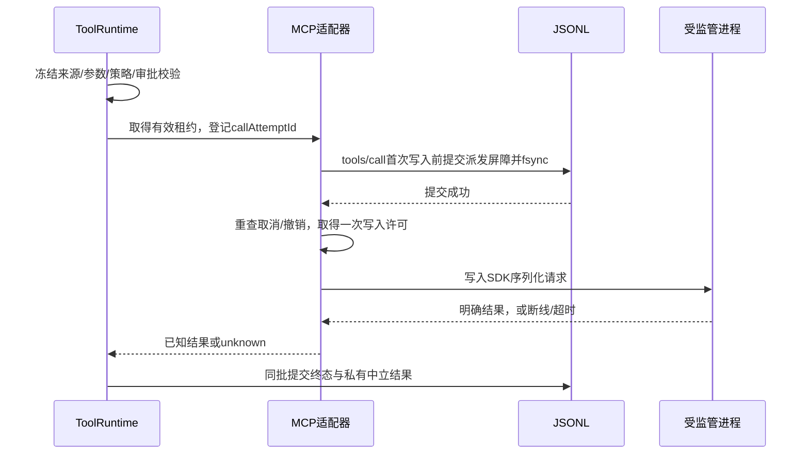

# 本地MCP协议与生命周期设计

## Spec

状态：基于0.6.4提交0755d79实现M4.1本地MCP；L2–L4已落地，真实SDK/Pi及浏览器链路已通过，本轮验证和产物/平台边界见[verify](verify.md)。L1历史证据见[首批验证](local-mcp-verify.md)。本页拥有冻结授权、派发屏障和恢复规则，不扩大M4.2–M4.9范围。

### Roadmap Alignment

属于M4.1本地MCP闭环。先完成有限工具选择和一次可靠stdio调用；目录搜索、Run内动态加载、远端HTTP/OAuth、Skills和插件继续归后续模块。

### Intent

用户在设置保存本地Server、确认启动范围并发现工具，在输入框选用后，经原有审批执行。模型声明、调用身份和结果可由JSONL重建；无法确认副作用时保留未知事实，不自动重试。

### 1. 模块与数据归属

| 所有者              | 实施位置与职责                                                                                        |
| ------------------- | ----------------------------------------------------------------------------------------------------- |
| protocol            | 新增mcp领域schema；扩展tools、sessions和session-stream共享字段，派生TS类型                            |
| storage             | Server配置/控制状态/秘密引用/启动授权的SQLite仓储；工具派发、结果及输入选择的JSONL事实与投影          |
| execution           | 从shell-process提取真实进程组回收，新增受监管双向持久进程；保留Shell collector                        |
| integrations/mcp    | 随L3实际实现创建包；官方SDK、严格有界stdio适配、目录、连接池及租约；不导入React、Fastify或storage实现 |
| agent-runtime       | 扩展RunToolset、参数/审批、派发持久屏障、结果记录、停止Run、上下文和Todo证据约束                      |
| daemon/features/mcp | 配置/凭据/工作根装配、管理API及显式撤销；services拥有关闭次序                                         |
| web/features/mcp    | 设置、启动确认、目录选择及安全诊断；Query管理宿主事实，composer保存未发送选择                         |

现有锚点包括[工具协议](../../../packages/protocol/src/tools/tools.ts)、[输入协议](../../../packages/protocol/src/sessions/sessions.ts)、[工具执行](../../../packages/agent-runtime/src/tools/runtime.ts)、[日志事务](../../../packages/storage/src/profile/store.ts)、[恢复](../../../packages/storage/src/sessions/interruption.ts)、[进程回收](../../../packages/execution/src/process/collect.ts)及[服务装配](../../../apps/daemon/src/application/services.ts)。storage不导入Pi codec；模型消息由runtime从中立持久结果组装。

### 2. Server、秘密与启动授权

公开DTO与宿主记录分别定义，不将数据库记录直接返回前端。

| 记录                      | 字段与规则                                                                                                                          |
| ------------------------- | ----------------------------------------------------------------------------------------------------------------------------------- |
| McpServerConfig           | id、name、transport=stdio、revision、workspaceId、command、args、publicEnvironment、secretBindings、时间；cwd固定为注册工作区真实根 |
| McpServerControl          | enabled、accessEpoch；与启动配置revision分开。新建默认禁用，停用/撤销递增epoch并使旧授权失效                                        |
| SecretBinding（宿主私有） | slotId、environmentName、credentialRef、credentialEpoch；秘密字节只存系统凭据库                                                     |
| McpStartupGrant           | serverId、配置revision、accessEpoch、工作区/真实根、隔离与网络策略、startupFingerprint、授权用户与时间                              |
| McpServerView             | 安全配置、环境变量名/是否配置、启用/信任/连接状态及诊断；不返回credentialRef、秘密内容、原始错误cause或协议原文                     |

command要求可检查的绝对程序路径，args单独传递，不隐式Shell或安装依赖。启动前由execution重新解析程序与真实根；信任指纹覆盖有效程序/参数、显式入口版本信息、根、普通环境、秘密slot/ref/epoch和隔离/资源/网络策略，不包含秘密内容或其hash。信任授权这组启动配置，不承诺冻结解释器隐式加载的全部磁盘依赖。

配置修改使用expectedRevision CAS并递增revision，旧启动授权失效；忙时编辑、删除及秘密轮换返回409。enabled属于控制状态，启停不伪造新的工具定义版本。启用通过启动确认完成：trust提交同时核对配置revision、accessEpoch和重新解析的指纹，再原子保存匹配作用域授权并启用。不同隔离作用域分别授权；不能因已信任sandboxed就自动授权full-access。

秘密写入独立路由：先写新凭据ref，再CAS保存新引用/epoch，失败删除新ref；不原地改写旧ref。旧引用仅在没有租约使用后删除。显式删除凭据、停用或撤销允许处理忙碌连接：先封禁新租约/写入并持久化撤销，再收束连接，不能等旧请求完成才生效。

秘密表单仅存局部Hook并在提交后清空，不进入Query mutation variables、Zustand或浏览器持久化。已知秘密的直接回显在模型、公开DTO、私有结果、诊断及日志投影前过滤或拒绝；协议原文只在有界内存处理，不另存原始stdout。测试覆盖stderr、分片回显及错误cause；不声称可识别第三方任意编码后的秘密。

### 3. 输入选择与冻结来源

ToolSource改为领域判别联合：session、workspace、mcp。mcp来源至少包含serverId、serverRevision和remoteToolName；每个记录独立保存definitionFingerprint。模型别名由稳定Server ID及原名生成，长度/字符满足实际Provider限制，不能用可改展示名或反向解析别名路由。

McpToolSelection包含serverId、serverRevision、remoteToolName、definitionFingerprint。发送时宿主校验工作区、配置、信任、目录和定义，接受Run前冻结准确模型定义、完整SDK Tool及执行来源；过期选择明确拒绝，不悄悄换成最新版本。秘密、command/env及连接对象不进入模型schema或JSONL选择记录。

宿主私有绑定同时冻结profile owner、启动授权作用域/标识、accessEpoch及credentialEpoch；每次租约和实际派发复核相同绑定。停用后重新信任不能复活旧Run、旧审批或旧队列。接受排队输入时就保存绑定，消费时复核；失效项保留并提示重新选择，不能自动重绑。显式编辑重选以新输入revision保存新绑定。

InputRequest、QueueInput、QueuePatchInput和EditInput贯通有界选择；首发attempt与pending input捕获原选择，重试继续使用同一requestId及同一选择。普通新Run按已提交输入选择解析，不能在消费队列时读取前端或当前全局选择。M4.1运行中选择器锁定为当前Run集合，steer/follow-up不得增删外部工具；显式加载新定义归M4.2。未发送选择按new代际或sessionId保存在composer。

daemon/runtime必须拒绝active Run中不同集合或授权绑定的steer/follow-up，不只禁用界面。自动消费/合组在Provider/model之外还比较完整冻结MCP选择和授权绑定；不相同的输入不能合并进入一个Run。

M4.1本地Server只可用于其注册工作区。ask/auto使用受监管隔离，full-access使用单独授权/连接；Plan及内部read-only默认禁止外部工具，不能靠Server的readOnlyHint绕过。普通执行中的工具审批继续独立区分用户、AI复核和full-access，启动信任不能代替调用审批。

### 4. 派发事实与结果未知

ToolCallRecord新增冻结来源/指纹和派发事实，保留现有展示状态并增加unknown。派发事实采用not_started与may_have_started；后者只表示已持久化允许开始写入的屏障，不声称Server收到或执行成功。

调用绑定使用判别联合：accepted拥有真实冻结来源与指纹；rejected拥有模型请求名称和拒绝原因，没有可执行来源。模型调用未声明别名等执行前拒绝仍有可配对的失败记录，不能伪造session/workspace来源或用空指纹冒充接受定义。

| 可观察情况                                             | 终态与处理                                               |
| ------------------------------------------------------ | -------------------------------------------------------- |
| 用户/策略拒绝                                          | denied，未派发                                           |
| 参数或启动失败，明确没有写入                           | failed，未派发                                           |
| 取消且execution确认未交给stdin                         | cancelled；屏障后取消需另存可证明的未写入结论            |
| 合法普通结果                                           | completed，可能派发事实保留                              |
| 合法MCP isError结果                                    | failed，保留已派发与明确错误；失败不保证副作用回滚       |
| 屏障后取消、超时、断线、坏帧、超限或退出，缺少可靠结果 | unknown；停止本Run，不自动重试或消费后续队列             |
| 日志写入/结果提交失败                                  | 沿用存储写失败冻结机制，中止执行链，不补写假失败继续运行 |

屏障与管道写不存在跨介质原子性：崩溃落在两者之间，恢复保守记unknown。派发事实单向增长；来源、别名、指纹和参数不可更新；unknown必须有派发屏障，已知MCP结果必须关联该次派发；终态不能被晚结果、取消回调或重启改写。

适配器返回明确结果类别，上层不能依据signal.aborted或SDK异常名猜测是否安全。unknown使本Run以非成功结局停止，留住未消费输入；UI展示“结果未知，操作可能已生效，需要核验”，停止spinner且不提供隐式重试。新操作必须是新的明确用户输入，不重放旧attempt。

### 5. 结果原子性、恢复与上下文

L2同时修正当前tool.updated终态与SDK message_end/tool.context分开写入的窗口。runtime将工具终态及中立私有结果在同一JSONL批次提交；SDK结果消息只作一致性关联，不成为另一份可写结果事实。中立结果记录调用/assistant锚点、origin=server或host、有界content及已知/未知语义，storage不生成Pi对象。

重启时未派发活跃项记interrupted，已有屏障但无终态项记unknown，已终态保持不变。恢复追加宿主中断/未知说明和配对结果，不连接Server、不重跑工具。runtime据此组装实际Pi工具结果，不能把缺少SDK结果的整个工具周期静默删掉；context.prepared记录真正发送的内容。

恢复覆盖持久assistant中所有call，包括顺序执行时尚未进入ToolRuntime、没有tool.requested的后续call。以持久调用意图或assistant加Run终态生成明确的host interrupted结果，每个call恰好配对一次；没有派发屏障的调用不能标unknown。已存在结果不重复生成。

文本、图片和structuredContent在适配器有界投影，需要模型推理的结构化值进入content。图片按模型能力与现有受保护附件机制处理；音频/资源链接/嵌入资源不能强转图片或自动读取外部地址。宿主生成的unknown说明明确标注来源，摘要和fallback保留“可能已生效”，不能把所有isError统一摘要成普通失败。

Todo证据仍只允许completed工具，unknown不可引用。未知后停止Run，阻止同轮继续调用update_todos或自动完成任务。completionNote是分析性声明，不是宿主核验过的副作用成功证据；本模块不引入自动语义证明、额外任务关联机制或改写原unknown，后续核验须成为新的可追溯事实。

### 6. 官方SDK与持久stdio

2026-10-20实际核对官方npm client/server 2.3.1发布物及[SDK源码](https://github.com/modelcontextprotocol/typescript-sdk/blob/main/packages/client/src/client/client.ts)，二者Node要求均为>=20。production client与fixture server已在catalog/lockfile锁定同一2.3.1版本，并通过真实TypeScript/Pi/SDK边界测试。

- 使用公开Client、Transport、serializeMessage/deserializeMessage，导入自@modelcontextprotocol/client，不导入dist私有文件。不声明hasPerRequestStream，不自行实现JSON-RPC、请求匹配或取消协议。[官方自定义Transport](https://github.com/modelcontextprotocol/typescript-sdk/blob/main/docs/advanced/custom-transports.md)
- 内置StdioClientTransport的环境继承和leader关闭不满足本项目所有权；自有Transport适配execution的持久进程。官方ReadBuffer会跳过部分坏JSON行，因此接收端补有界LF分帧、严格UTF-8及EOF检查，每帧交官方deserializeMessage校验；不吞掉stdout污染。
- 显式协议模式，不使用会额外启动探测进程的auto；冻结完整SDK Tool并在每次callTool传toolDefinition，避免HeaderMismatch刷新后隐式重发。Client设置inputRequired.autoFulfill=false，不广告sampling、elicitation或roots；不自动履行交互或启动异步任务。
- 使用公开request逐页tools/list，逐页限制数量与累计字节，不等自动聚合完成后才拒绝。目录schema先限制根类型、方言、大小/深度/引用并验证Pi实际可编译，禁止网络引用和只靠TSchema断言；不支持定义标为不可选。
- 每次调用生成非秘密callAttemptId，通过公开params.\_meta的应用命名空间携带；Transport仅对tools/call核对登记的Run/工具/租约/名称/参数/指纹，等待派发屏障后只允许一次写入。SDK wire id不成为业务身份，不读取私有\_requestMessageId。

宿主拥有deadline AbortController，合并Run、租约与截止信号再传SDK；不能仅依赖SDK timeout。SDK提前拒绝时撤销未使用的写许可，并等待该attempt已登记的send任务收束后才确认终态/释放租约，避免请求已报失败但fsync结束后继续写入。

execution持久进程的启动参数是明确程序/args、真实根、白名单环境、冻结隔离和资源限制；spawn前装好stdout/stderr/exit/close观察。返回write(bytes,{signal})、幂等close(reason)、closed完成报告，集成层不持有ChildProcess。写入许可在实际交给stdin前、包括内部排队结束后再次检查取消；epoch撤销同步中止许可，之后才等待drain。写队列有界并处理EPIPE、close和error。

stdout只传协议，stderr单独有界诊断。受控环境不能被配置覆盖PATH/HOME/TMPDIR、NODE_OPTIONS、BASH_ENV等启动控制项；秘密只注入明确授权的子进程。sandboxed沿用macOS受监管路径与默认网络限制，不因Server需要联网而静默放宽；full-access独立明示。Windows/Linux缺少对应受监管实现时明确不可用，平台验收另列。

关闭先拒绝写入/租约，再结算SDK等待、终止所属进程组并确认leader与所有管道关闭，最后删除临时目录。重复close等待同一任务，清理失败显式报告；不能以child.killed、SDK Promise拒绝或leader exit充当完成。

### 7. 租约、停止与登录态

连接key包括profile owner/identity epoch、Server ID/revision、access/credential epoch、真实工作根、隔离/资源/网络策略和协议模式。配置本身不是连接，Run选择也不预占所有连接；发现与调用分别取得可等待释放的租约。最后一个租约释放立即关闭连接，目录缓存独立保留，不引入首版后台重连或空闲连接保活。

后续操作创建新进程时，ready后重新核对接受的工具定义指纹，再允许派发；同配置revision不能证明Server目录不变。不匹配则派发前拒绝，不能读取新定义继续旧Run。冻结保证宿主声明、校验和路由一致，不承诺外部程序业务实现不可变。

正常完成或派发前取消只释放所属租约，不能误关其他Run。已派发取消/超时不能靠SDK取消通知证明副作用停止；需要回收实际进程时使整条连接失效，其上其他未完成调用也逐项结算unknown。连接故障后的新连接只服务新操作，不重放旧请求；不能同时承诺强杀共享进程且其他调用完全不受影响。

普通浏览器logout只撤销该登录会话的新请求和私有展示，不撤销profile级MCP信任、不终止已接受Run或其他客户端。设置关闭取消本次发现/诊断租约。显式Server停用、撤销、凭据删除及profile身份撤销通过MCP所有者失效入口处理；identity epoch不绑定浏览器Cookie session。

daemon关闭先封禁新管理操作/租约，停止Run并提交调用终态/unknown，再等待MCP连接和所属进程关闭，最后关闭依赖凭据与storage。关闭失败聚合报告，不能先关日志再尝试补unknown。

### 8. 管理API与界面

以下路径已由daemon MCP管理模块提供；所有接口沿用当前本机信任、应用登录、Origin/CSRF和schema校验。管理操作带配置revision，控制/信任操作同时核对accessEpoch，冲突返回409；解析错误不回显秘密。

| 方法与/api/mcp/servers相对路径       | 行为                                                     |
| ------------------------------------ | -------------------------------------------------------- |
| GET /、/:id                          | 返回安全配置、状态，不启动进程                           |
| POST /、PUT /:id、DELETE /:id        | 创建、CAS编辑/删除；活动租约时普通变更拒绝               |
| POST /:id/secrets/:slotId            | 专用秘密写入并推进配置/凭据epoch，不返回秘密             |
| DELETE /:id/secrets/:slotId          | 显式撤销凭据，封禁并回收相关连接                         |
| POST /:id/trust-preview              | 解析程序/根/启动范围，返回待确认指纹，不启动             |
| POST /:id/trust                      | 重新校验并记录对应隔离作用域授权，可同时启用；不调用工具 |
| POST /:id/disable、/:id/revoke-trust | 持久撤销、推进accessEpoch，终止相关连接；启用需重新确认  |
| POST /:id/discover、/:id/test        | 明确用户动作，信任通过后取得短租约；可以启动程序         |
| GET /:id/tools                       | 只读当前匹配revision/作用域的目录缓存；无缓存提示先发现  |

设置增加MCP分区，列表显示名称、工作区、启用/信任/连接状态；编辑、秘密、信任、发现/诊断和删除由所属Hook编排。启动确认显示程序/参数、根、环境变量名及隔离/网络范围，文案明确这是运行本机程序的授权。普通GET、Query聚焦或打开设置不能隐式spawn。

输入框加号下MCP选择已发现的实际工具，不提供静态call_tool代理。Server revision/指纹或工作区变化将旧选择标为失效，发送时仍由宿主拒绝过期值；不自动换最新定义。工具行沿用icon、名称、摘要，hover切换展开图标；未知状态与MCP来源在详情可辨。Skill入口保留原状态。

### 9. 首版限制与验证门槛

以下限制已放入执行/集成拥有者并校验；它们是资源边界，不是性能结论。

| 对象       | 首版界限                                                                                                               |
| ---------- | ---------------------------------------------------------------------------------------------------------------------- |
| 输入选择   | 每Run最多16个外部工具，仍受总上下文预算约束                                                                            |
| 目录       | 最多16页、512个工具、累计2MiB；逐页检查重复cursor/名称                                                                 |
| schema     | 单项64KiB、最大深度16、根为object；仅接受能在选定方言与Pi中等价校验的定义                                              |
| 协议       | 单帧/未换行缓冲4MiB、写队列4MiB；非法UTF-8/坏帧/EOF半帧明确失败                                                        |
| 结果与诊断 | 文本预览沿用128000字符，最多128个content块（含structuredContent）、图片合计2MiB；stderr保留64KiB环形缓冲并限制输出速率 |
| 时间       | 启动/发现30秒、工具调用120秒；关闭先TERM等待2秒，再KILL并有界等待5秒，实际组/管道未结束仍报失败                        |

整体资源默认限制为每profile最多8个活动连接，每连接8个在途请求及16个活动租约，超限明确拒绝；stdout速率4MiB/秒、突发8MiB、累计64MiB，stderr速率256KiB/秒、突发512KiB、累计4MiB。合法小帧另限1024帧/秒、突发2048帧、累计65536帧；所有队列有界，超限使连接失效并按派发事实结算调用。

schema采用可由真实TypeBox构造并由Pi校验的draft-07子集；引用、format、正则和不支持方言明确不可选。标准base64且签名匹配的PNG/JPEG/GIF/WebP可投影图片；资源链接只标明未读取，音频/嵌入二进制只说明类型，不抓取外部地址。完整允许集、限额与映射见[integrations](../../../packages/integrations/README.md)，有真实SDK fixture与Pi参数验证。

## UseCase

- UC-01：保存Server→启动确认→发现→输入选择→逐次批准→收到结果；检查真实Pi声明、一次tools/call字节、结果与JSONL。
- UC-02：在审批前、fsync前/后、stdin写入前/后分别停止或撤销；可证明未写入者取消，其余保守unknown，重启不重放。
- UC-03：两个Run共享连接；正常释放一个不误关另一个，强制回收连接时每个未完成调用得到真实终态。
- UC-04：Server配置/根/凭据/隔离变化、旧选择重试、浏览器logout及设置关闭；旧授权不复用，合法其他客户端与已接受Run保留其所有权。

## Tasks

- [x] 基于0.6.4代码和官方发布物细化数据、API、SDK行为、派发与关闭设计；本项只表示设计完成。
- [x] L2：来源/选择/unknown及单批结果协议，迁移所有消费者和恢复/摘要/Todo，新增严格非法路径；按开发期规则更新协议/格式版本，不做旧数据兼容。
- [x] L3：持久进程/严格stdio/SDK/目录/租约和一次派发，实际验证后锁定依赖；兼容性失败先调整设计，不能放宽策略。
- [x] L4：配置、系统凭据、启动信任/撤销、管理API和完整设置/输入选择。
- [x] L5本机链路：真实SDK fixture、Pi/JSONL/HTTP/浏览器及构建daemon；产物和其他平台边界单列verify。

测试重点：坏字段/CAS/秘密回滚、GET零spawn、信任指纹变化、权限隔离、fsync写失败和各崩溃窗口、SDK隐式重发拦截、分片/坏帧/背压/EPIPE、孙进程持管道/忽略TERM、晚结果竞争、两Run租约、unknown历史/摘要保留及无后续模型请求。浏览器覆盖新建/既有会话、重试、队列、编辑重发与撤销；使用临时工作区/动态端口/合成身份，不能依赖真实账号或用户凭据。

## Issues

- schema允许集与媒体投影通过SDK/Pi实际验证；不支持的定义拒绝选用，不降低校验。
- 工具终态与中立结果同批保存，恢复按派发事实区分interrupted/unknown，摘要保留未知阻塞；SDK结果超限和编码失败均不得继续模型循环。
- 本机平台是macOS；Windows/Linux受监管stdio、真实第三方账户和正式桌面安装交付尚未验证，继续保留所属范围。
