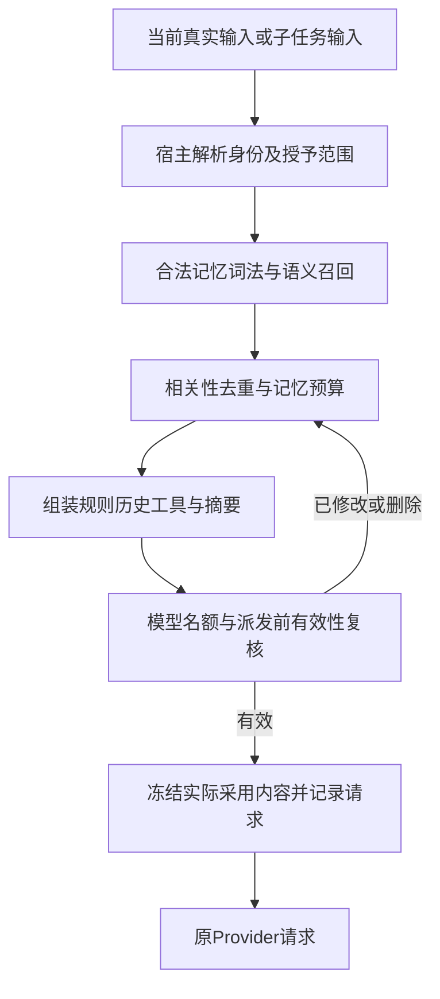

# M6 数据、检索与请求设计

本文为[Spec](spec.md)的实施建议，尚未实现。复用Pi执行、profile身份、SQLite与已有本地embedding；接口/schema变化在实现阶段同步协议，不在本轮预先改代码。

## 现有入口

| 入口                                                                                                                                                         | 当前能力与M6接入点                                                           |
| ------------------------------------------------------------------------------------------------------------------------------------------------------------ | ---------------------------------------------------------------------------- |
| [ProfileStore](../../../packages/storage/src/profile/store.ts) / [打开profile](../../../packages/storage/src/profile/open.ts)                                | 持锁、迁移、JSONL重建及中断恢复；独立记忆事实不能纳入会话投影清空列表        |
| [应用身份](../../../packages/storage/src/repositories/auth.ts)                                                                                               | profileOwner稳定AppUser.id；从认证上下文取得owner，不用昵称/邮箱推断         |
| [WorkContext](../../../packages/agent-runtime/src/context/request-context.ts) / [RunExecution](../../../packages/agent-runtime/src/runs/execution.ts)        | 每请求准备、预算、摘要和context.prepared；加入召回、最终有效性检查与私有快照 |
| [WorkRuntime](../../../packages/agent-runtime/src/work/runtime.ts) / [任务上下文](../../../packages/storage/src/sessions/model-context.ts)                   | 当前分支/Task原文读取和search_session_history，不改成跨会话扫描              |
| [工具目录搜索](../../../packages/agent-runtime/src/capabilities/search.ts)                                                                                   | MiniSearch、中文分词、精确名称优先、向量及RRF；保留冻结目录、授权和自动加载  |
| [本地embedding](../../../packages/integrations/src/search/local-embedder.ts) / [Worker](../../../packages/integrations/src/search/local-embedding-worker.ts) | 固定多语言E5、CPU/q8、384维；提取多文本用途接口，补队列及资源状态            |
| [宿主装配](../../../apps/daemon/src/application/services.ts) / [桌面资源](../../../scripts/prepare-desktop.mjs)                                              | daemon拥有者及profile模型缓存；目前没有随包权重，准备与查询需要分开          |

## 事实与派生数据

会话JSONL拥有执行事实；长期记忆独立存入profile SQLite，像独立配置一样跨会话存在。画像、FTS和向量不成为另一套事实源。下表划分职责，实际表名/字段按实现查询需求确定，不为每项各建一张表。

| 数据                 | 必要内容                                                                                       | 生命周期                                                     |
| -------------------- | ---------------------------------------------------------------------------------------------- | ------------------------------------------------------------ |
| 记忆条目             | id、scope判别联合、类别、正文、revision、有效状态、来源引用、创建/更新时间                     | 独立事实，重启/会话重建保留，人工编辑CAS，删除退出可召回集合 |
| 待确认候选           | 来源定位/hash、建议内容/作用域、冲突目标、确认状态、幂等键                                     | 不参与回忆；拒绝、源失效或确认后不能重复消费                 |
| 写操作结果与抑制标记 | 最小requestId/工具调用身份、结果ID/revision、已拒绝/忘记的旧来源指纹                           | 响应丢失时不重复写，不另存全文变更日志，不从旧来源复活       |
| 搜索文档/片段        | source kind/id、owner/workspace、Session/branch/Task/message定位、原文hash、片段范围、索引签名 | 可重建，不从live overlay或私有请求提取                       |
| FTS与向量            | 词法token、文本hash、模型/分块签名、维数及归一化向量                                           | 派生，缺失可恢复，不使业务事实失效                           |
| 索引进度             | 活跃构建代际、源水位、积压/错误计数                                                            | 可取消及重启对账，只允许本地无副作用计算自动继续             |

scope建议为user(ownerUserId)或workspace(ownerUserId, workspaceId)，由宿主解析，非任意标签。无工作区会话不能隐式读取其他workspace。revision仅用于编辑及异步回写并发控制，不引入Session或通用事件版本。

来源可引用Session/branch/Task/message/seq/hash，但不能用rebuildProjections会DELETE的消息表作记忆事实的级联外键。独立记忆可保留已不存在的出处并标记“来源不可用”；JSONL重放不重新执行记忆变更。

记忆写入和幂等结果在同一SQLite短事务完成，FTS可见性同时更新。工具操作沿用原审批及副作用记录；若记忆写成功而会话日志收尾失败，不承诺跨介质回滚，需通过操作身份确认实际结果，避免重复创建。

## 保存、学习与画像

记忆变更必须关联真实用户保存/修改/遗忘动作、确认内容及scope；ask/auto/full-access只管理工具审批，不能替代长期记忆的产品授权。设置/消息菜单直接操作由认证API落盘；自然语言请求经根工具生成预览，用户确认同一提案后才写入，不采信模型自报“用户已授权”。子任务首版只产结论，不能直接变更长期记忆。

未指定scope默认当前workspace。无workspace或需要user作用域时，预览要求用户明确选择，项目事实不能由模型自行提升为跨项目记忆。确认动作关联提案身份、正文hash和scope；内容/范围变化必须重新展示，不能拿旧确认批准新内容。

学习模式建议为“仅手动”（默认）与“自动建议”。后者允许根在当前真实Run中提出候选，不在root终态后私自创建学习Agent或收费请求。用户主动要求学习历史时是明确的新Run；请求限制、取消和失败沿原模型路径，不另建推理循环。

候选保留真实用户原话或被明确选中/认可的资料来源；引用块、附件、网页和工具数据不因为包在user消息里就成为用户声明。thinking、摘要、assistant猜测、agentMessageId通信及失败探索不自动成为事实。没有用户确认，候选不进入有效记忆或画像。

自动候选创建前重验建议开关及设置代际，停用后的迟到自动提议拒绝；关闭自动建议不删除已有记忆，也不禁止用户显式确认/手工保存。所有确认仍重验来源可见性/hash、目标revision、scope及拒绝/遗忘标记。相同来源幂等，不按模型置信度或最后写入覆盖冲突；更正显示差异。用户明确新建/更新可覆盖抑制，旧后台返回不可覆盖。

画像是有效记忆的分组视图：user展示语言/回答偏好等，workspace展示项目约定及已确认决策；每项均能定位原条目，不另存一份LLM自由总结。

## 回忆与主子权限

根根据当前输入从user及当前workspace召回；子使用自己的任务输入/历史，只能访问获准workspace及父明确转交的user记忆ID。父完整回忆包和兄弟消息不默认下放，委派记忆引用必须是父可读集合的子集。

自动回忆不搜索全部会话。普通历史经显式工具调用才进入上下文；跨会话检索默认排除本Session，当前分支原文继续使用search_session_history，避免找回编辑、reset或检查点已放弃的内容。

派发前复核需协调WorkContext.project与AgentRequestScheduler/Hooks：context.prepared早于并发名额等待，不能只在读取时检查。等待期间条目或权限改变，应释放名额、有界重新组装并重验单次上下文容量，准确记录最终输入；不暗改持久快照，不把纯本地重组算成新模型轮次。执行不再有累计token额度或预留/结算逻辑。

记忆使用明确的资料区，不冒充系统授权或用户新指令；独立预算类别计入总上下文，低相关、停用或额度不足可不注入。每请求替换上一集合，不无限叠加；不写入父子共享basePrompt，也不把注入段复制成规则/画像/摘要的另一份事实。缓存按scope、查询及有效记忆状态区分，每次发送前仍复核；子任务也不能绕过父已停用的回忆策略。

context.prepared私有快照保留实际采用ID、revision、scope、来源、冻结正文及必要截断说明，不仅保存可变ID，也不把完整私有请求公开到搜索/SSE。codec和协议实现时同步，不另造完整Trace页面。

## 检索与中文处理

记忆和会话共用持久文档/片段索引，工具目录继续按Run冻结候选用MiniSearch，不强行落成全局FTS库。只抽取多消费者确需的文本/排名计算及embedding端口；工具参数、精确名、授权和自动加载仍归工具模块。

建议普通FTS5与文档表由storage同一短事务更新，初版不加contentless/external-content触发器或原生ANN扩展。文档与查询统一Intl.Segmenter预分词，再交给unicode61；工具专用CamelCase/复数规则不直接套用人名和对话。中文短查询另外索引连续CJK的单字/相邻双字字段：明确的一字/两字查询走对应字段并核对原文，普通多词查询不把全部单字当OR条件。按Unicode码点处理，规则纳入索引签名；用真实语料检查大小/噪声，而非随机截断扫描。SQLite说明trigram全文查询不匹配不足三个Unicode字符的子串，不能只选trigram解决短词，见[FTS5官方文档](https://www.sqlite.org/fts5.html#the_trigram_tokenizer)。

FTS表达式由宿主从校验后的token构造并正确引用，SQL参数化不能代替MATCH语法处理；片段按纯文本返回，不信任索引产生的HTML。分页游标绑定查询/scope/索引代际，条件变化不能拼接旧页。

FTS与全部合法范围的语义排名独立产生候选，再按名次做RRF及去重，不直接相加不同引擎原始分数；只重排FTS命中会漏掉词法零重合的同义表达。自动回忆采用固定语料校准的相关性门槛，不照搬工具目录“最相近一批必选”的相对阈值，允许零采用。

向量先用SQLite Float32数据及有界批次精确余弦，不新增向量数据库。CPU排序/推理不长时间占daemon事件循环，扫描范围与上限可观测；超预算明确报告词法模式或语义覆盖未完成，不静默随机截断。ANN是否必要由实测规模决定。

切块保留原文hash及定位，按段落/句子和实际模型token上限处理，不用字符数冒充token。既有E5使用query/passage前缀，长输入会截断，见[模型说明](https://huggingface.co/intfloat/multilingual-e5-small)；长会话不能直接塞进16000字符接口后接受丢尾。缓存签名涵盖固定模型revision、dtype/维数、前缀/pooling与分词/切块规则。

## 增量索引与恢复

只索引持久完整正文或终态保存的部分正文；失败/取消部分可供历史搜索但标出状态，不自动学习。默认不索引思考、私有请求、原始工具大结果、任意附件或全盘文件。

启动先由JSONL恢复投影，再按稳定sourceId/hash对账并复用向量，记忆独立事实不重建。源变化及FTS提交同事务，embedding在事务外计算，回写CAS校验源存在、revision/hash及索引代际。

全量重建用新代际及变化补偿，完成后原子切换；期间仍按最新事实过滤旧结果，切换不复活已删内容。候选及被忘记来源有独立失效/抑制，迟到返回、重放旧Job和重启均不能恢复被拒绝事实。

会话当前“删除”实际是归档：历史索引立即排除，未确认候选失效。独立确认的记忆继续由用户管理，来源不可用应显示；删会话不暗示忘记所有记忆或擦除JSONL。分支改变只调整可见来源；忘记则撤去画像、命中、回忆和旧缓存，原历史及已发送请求快照保留。

## 模型资源与队列

复用固定多语言E5及profile/models缓存，不接远端embedding。daemon唯一拥有模型，前台优先，后台索引小批、有界、可暂停；现有无优先级长FIFO不足以支持历史批索引。

模型“未准备/准备中/就绪/不可用”和索引“追赶中/就绪/失败”分开显示。普通查询本地专用加载，空缓存提供词法；用户显式准备才下载固定版本。完整缓存后验证断网冷启动。官方支持关闭远程模型读取，见[Transformers.js环境配置](https://huggingface.co/docs/transformers.js/api/env)；实施仍核对当前锁定依赖，不擅自升级。

取消移除排队任务并禁止迟到写入；原生推理若不可中断，需限制最多一个有界在途批次，不把AbortSignal当硬停计算。超时/关闭由拥有者终止并等待Worker，不影响其他进程；重试本地派生计算不重放收费请求或记忆写入。

启动及首次发送不等权重下载/全历史向量化。关闭先停止新查询/索引、结算所属工作，再释放Worker和store；不向Worker传凭据或任意模型路径/可执行代码。

## 搜索入口与界面

设置新增“记忆与搜索”：user/workspace条目、候选/来源/冲突、画像、回忆/学习策略、模型准备及索引状态。消息菜单“记住这条”展示拟保存内容和scope；聊天工具结果复用轻量行。

采用记忆放入现有上下文详情，不在header、输入框或固定统计行新增占高状态。上下文比例与对话次数仍保持两项，后台学习/索引不遮住工作台。

侧栏统一搜索入口支持会话/记忆、工作区、时间。默认各Session当前可见分支根消息；显式历史分支或子任务时标来源并跳准确位置，复用任务详情及按目标定位查询，不全量拉取历史。

人类全局搜索不等于模型权限。跨会话搜索工具首版仅给根Run，默认当前workspace（无workspace则未分配会话）；跨workspace由用户显式引用命中后按精确来源转交。打开命中和读取工具再次验证范围，不仅在UI隐藏越界项。

Query拥有服务端事实，Store只保存筛选、选择和草稿；key包含身份/scope/查询，取消、失效及旧响应沿现有规则。注销清理客户端私有状态，不擅自取消原后台Run或删除记忆。

## 模块建议

| 模块                                                  | 职责                                                              |
| ----------------------------------------------------- | ----------------------------------------------------------------- |
| packages/protocol/src下memory/search领域              | 浏览器安全的记忆、来源、检索及索引schema；实际实现再声明          |
| packages/storage/src/memory、search                   | 独立事实/候选/幂等及失效、FTS/片段/向量/代际和有界源查询          |
| packages/agent-runtime/src/memory及context/work/tools | 记忆策略端口、请求召回/预算/审计、根工具及Task授予范围，不直接SQL |
| agent-runtime检索纯计算                               | 仅抽取多消费者确需的分词/排名，不建万能框架                       |
| packages/integrations/src/search                      | 本地embedding适配及Worker，不拥有用户事实/权限/数据库             |
| apps/daemon/src/memory、search                        | 认证scope、服务/路由、索引对账/队列、模型准备及生命周期           |
| apps/web/src/features/memory、search                  | 管理/候选/画像、搜索定位及上下文采用展示                          |

包间沿既有端口及依赖方向，不新建空package。实现时区分schema的独立事实/派生索引，同步协议及消费者；规划不提前升版、清库或写未使用迁移。
