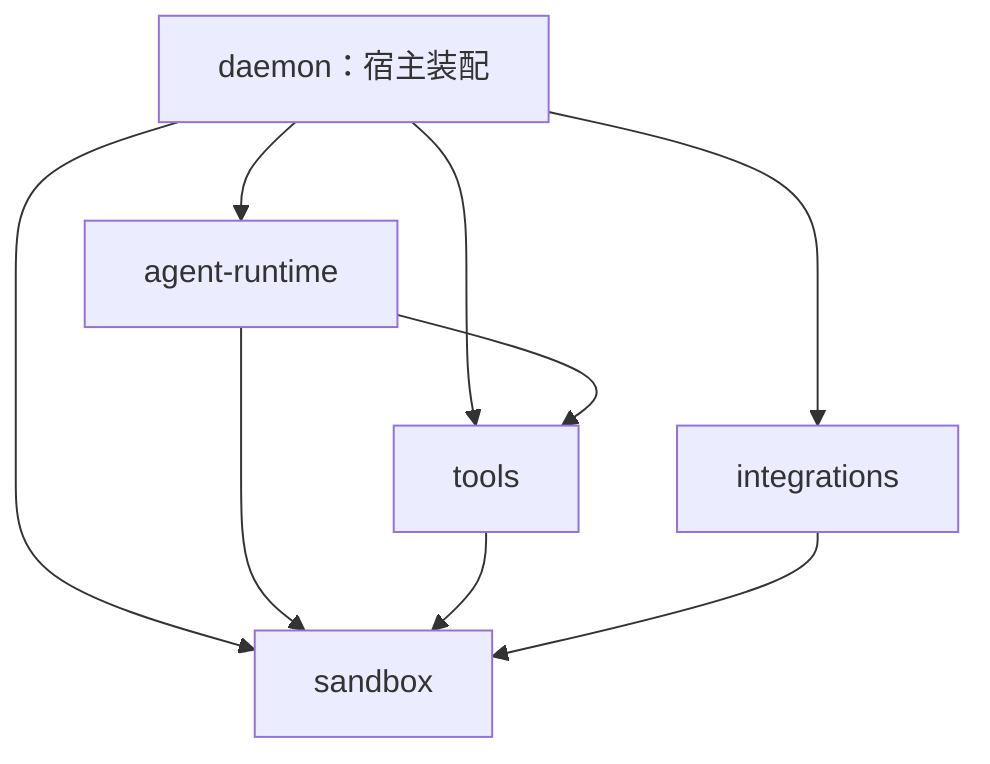

# 工具、Skill、插件与沙箱分层设计

状态：2026-11-04经用户确认后实施。本文保留本次设计与迁移约束；当前运行行为以[工具体系与沙箱](../../09_TECHNICAL/工具体系与沙箱.md)、各包README和源码为准。范围及验收由[Spec](spec.md)拥有，阶段顺序见[任务](tasks.md)。

## 1. 采用的原则

工具是模型可调用接口，Skill是指令与资源，插件是组织和分发能力的单位。三者通过统一工具注册和宿主装配连接，不等同于三个独立执行引擎。采用完整注册、领域回调、Skill驱动办公和独立隔离底座；延续本项目较强的权限代次、能力快照、持久化屏障、受控进程和产物归属，不复制参考项目源码或指令。

本次为M0及M2–M5既有能力重构；长期记忆与Computer Use仅保留独立领域贡献接口，不创建空package。最终删除execution，避免工具实现、宿主守卫和通用进程仍有第二个总入口。

## 2. 包职责与依赖

| 包                 | 目标职责                                                                                              | 不承担                                                             |
| ------------------ | ----------------------------------------------------------------------------------------------------- | ------------------------------------------------------------------ |
| tools              | 工具注册契约、内置工具及领域适配；Skill目录/解析/安装资源；插件声明和资源组合；命令任务及产物工具适配 | Pi Loop、Run接受事务、审批决定、数据库、OAuth或MCP协议实现         |
| sandbox            | 受监管进程、平台隔离、受控环境、进程组/管道回收；可复用的宿主文件守卫及出站目标/连接机制              | 工具名、Skill或插件状态、Session/Run、审批、办公格式、任意业务HTTP |
| integrations       | MCP SDK/传输/目录/租约，远端服务/OAuth及凭据访问端口                                                  | 内置工具目录、Skill正文、任务树、办公流程、物理进程回收            |
| agent-runtime      | 模型、主子Run、上下文、审批、每Run能力绑定及激活、调用事实与不确定副作用                              | 文件/HTTP/格式操作实现，插件资源管理，原生进程句柄                 |
| daemon             | 应用API、工作区注册、用户配置和安装状态、凭据装配、命令/资源/产物服务拥有者                           | 模型工具语义的第二实现、Shell或MCP协议字节循环                     |
| storage / protocol | 分别保存持久事实和定义必要跨端协议                                                                    | 执行器、进程和SDK实例                                              |

关键运行依赖如下；公共DTO按需依赖protocol，图中省略storage和浏览器。



tools与integrations不互相导入实现。daemon把MCP、插件连接等能力通过tools声明的窄端口注入；runtime提供Work、任务、上下文和激活端口。未来memory/computer-use可依赖tools注册契约并导出自己的工厂，由daemon组合；tools不反向导入这些领域。

sandbox扩大为明确的宿主访问与进程底座，使原execution公共原语有实际拥有者。包内分开process、filesystem、network：后两者是宿主API守卫，不是Seatbelt或容器。不得因为一个功能涉及安全就放进sandbox；工作区注册流程、模型路径/结果、OAuth scope、插件授权仍留上层。

## 3. 目录布局

2026-11-05用户追加确认：模型工具按名称平铺，一个工具一个文件，参数Schema、描述、加载方式、可用条件、效果策略和执行入口由该文件拥有。共享原语和领域服务按实际职责保留，不将大实现搬到另一个总文件后仅保留转发入口，也不为单个类型或转发函数机械新增文件。

```text
packages/
  tools/
    src/
      index.ts
      workspace-tool-registry.ts # 按明确顺序装配原生工具
      tools/          # 模型可调用接口：文件、命令、Web、文档、工作状态、子任务、加载、产物
        index.ts      # 各工具公开出口，不声明第二套Schema或元数据
        read-file.ts  # 每个模型工具一个同名文件，其余工具按相同方式平铺
        edit-file.ts
        run-command.ts
        ...
      lib/
        tool-registry.ts # 注册契约、绑定工厂、名称冲突检查
        tool-context.ts  # 公共执行上下文，组合各工具拥有的回调类型
        ...              # 共用文件操作、文档输入及受控传输
      utils/
        tool-search.ts   # 工具目录检索
        document-text.ts # 工具及附件共用的有界正文解析Worker适配
      skills/         # 发现、解析、安装、不可变版本与资源租约
      plugins/        # manifest、资源组合、插件贡献目录
      commands/       # 受监管命令任务状态、输出游标与拥有者
    resources/
      plugins/
        documents/    # manifest、skills/documents/{SKILL.md,references,scripts,requirements}
        pdf/
        spreadsheets/
        presentations/
        github/
        google/
        ...
      shared/office/  # 仅实际共用的本项目格式/校验支持库，由资源清单声明依赖
  sandbox/
    src/
      index.ts
      policy/         # 已授权执行范围、资源和能力描述
      process/        # 解析启动、字节句柄、预算、回收、watchdog
      platform/       # 已实现macOS后端；新增平台有真实实现后再加入
      filesystem/     # 真实根、受限打开、稳定读取、受保护路径
      network/        # 地址判定、DNS验证、固定socket目标及受限传输原语
  integrations/
    src/
      mcp/
      network/        # 领域请求适配，消费sandbox网络机制
      plugins/        # 仅插件连接/OAuth适配
      connections/
      search/         # 本地embedding适配，依赖由宿主注入检索器
  agent-runtime/
    src/
      tools/          # Pi桥接、审批、记账；没有领域family switch
      capabilities/   # 每Run候选/激活、Skill正文与模型上下文
      work/
      subagents/
      ...
```

包出口按真实消费者提供窄叶入口，例如tools/document-text、tools/skills、sandbox/filesystem，避免daemon读取工作区时加载完整工具或文档依赖。document-text直接暴露实际工具与附件共用的提取实现；不保留旧documents或registry叶出口。正式exports、源码paths、测试程序、构建、桌面deploy同步设置。具体工具的输入和回调类型随对应工具文件定义，公共执行身份和回调组合归lib/tool-context.ts，根index只组合公开出口，不建兼容转发壳。

## 4. 工具注册与运行绑定

一个ToolRegistration包含模型定义与参数schema、来源、默认/按需加载、可用条件、参数相关效果策略及执行入口。ToolRegistry拒绝重复名；ToolRuntime按已接受schema校验模型原始参数，并核对来源与权限。ToolDefinition用于模型和日志；executor、连接及回调只存在内存。序列化形式与运行注册项显式区分，但不复制同一套schema字段。

效果策略区分工作区写入、外部副作用和会话控制。计划、Todo、提问及工具加载可以变更会话事实，但不因此被当作只读工作区违规；web_fetch的GET/POST根据实际参数判断。可用条件由工具工厂声明工作区、平台、视觉模型和已装配端口，不再由中央selector按工具名猜测。

注册工厂接收ToolContext，工具调用所属的领域回调，例如proposePlan、spawn、loadSkill；不接收完整WorkRuntime、Coordinator或Host。专属回调签名及schema派生输入类型由各工具文件拥有，公共上下文只组合这些接口；关联均为类型导入，运行装配不会形成工具与注册器的值依赖循环。工具实例每Run重新绑定；主子Run可以共享不可变描述，但不能共享捕获父任务作用域的执行闭包。未来领域通过贡献注册项接入，中央注册器不新增领域分支。

ToolRuntime保留原始JSON校验、Pi AgentTool适配、只读/审批、取消关联和调用事实。授权决策在runtime，具体程序能力在sandbox。所有普通工具和tool_search/load_skill都走同一条执行链；不再存在capability/agent/work/MCP工具族第二执行入口。

外部副作用使用统一派发回调：宿主提交派发屏障后才允许写入；传输明确未写入、已可能写入、已知结果分开记录。调用已经可能生效但未获确认时保持unknown并停止自动续作，不因取消而伪称没有执行。MCP适配器不引用ToolCallLedger，协议与写入事实由明确回调连接。

## 5. 每Run目录、Skill与上下文

Registry提供完整可贡献目录；RunCapabilities只拥有本Run接受的候选、初始集合、待激活集合与revision。run.accepted记录完整已接受工具候选目录及其来源/指纹/授权版本、初始激活集、Skill候选和已激活Skill快照；搜索/加载先暂存，下一模型请求前保留新租约、提交run.tools_loaded，成功后切换active并计入上下文预算。提交失败不能让模型看到未落盘能力。

MCP配置或目录变化更新宿主目录，不原地更换已接受Run的执行器。新候选通常从下一Run接受；本Run只激活原接受范围内的工具。撤权和授权代次变化在请求及派发前重验，冻结定义不等于永久授权。普通缓存目录查询不隐式启动stdio服务。

Skill摘要、正文和资源继续保留来源、contentHash、逐资源hash、epoch/generation及租约。安装/加载不批准命令、网络或MCP调用。工具/Skill默认及按需加载沿用既有原则，不为了目录整理恢复已删除的额外Skill授权工具。

## 6. 插件与Skill资源执行

PluginCatalog拥有manifest校验、版本和贡献索引，SkillCatalog拥有指令及资源快照；daemon拥有安装/启停配置和凭据，integrations拥有外部协议。每个插件在一个资源目录中组合Skill及MCP App声明，声明本身不建立连接或授予调用权限。

当前快照位于profile，不能把profile开放给命令。激活后，由宿主把精确版本及声明的共享依赖物化到专用资源区；load_skill向模型返回只读资源根或受控引用。这些模型可见信息和版本进入现有加载事实，资源清单不接受任意宿主路径。

运行命令获得的是宿主派生的资源许可。受限及角色只读执行由OS禁止改写脚本、拒绝profile；Python字节缓存转入私有临时目录。许可不因Skill加载而开放全部安装源、插件根或凭据。full-access保持原有无OS隔离的宿主语义：宿主仍核对精确版本、撤销及新派发，但不能用目录权限或工具API守卫阻止任意获准Shell访问profile、修改同用户资源或撤回已读字节。授权撤销阻止新启动并收束依赖该许可的受管命令；命令还在使用资源时持有自己的租约，不因一次工具等待结束或模型Run结束而提前删除。

## 7. 受监管命令与隔离

sandbox提供resolveProcess(request)与startProcess(spec)这类小接口：先把程序、argv、cwd、显式环境、只读资源、访问策略与限额解析成明确启动描述，再返回受限字节句柄。句柄提供输出、write、exit/closed、close，不公开ChildProcess，也不认识MCP/Office。输入身份和权限在spawn前重验，不能声称stat检查已冻结所有程序依赖。

同一进程引擎服务短命令和MCP stdio。sandbox拥有OS资源；命令服务/MCP manager决定何时关闭；Run和Session拥有逻辑取消。MCP共享连接不能绑定第一个调用的AbortSignal。close先拒绝新写入，等待排队写入、进程组、管道、watchdog和自身临时资源，再完成；业务产物目录不由底层close删除。

审批和运行范围内部独立表达。已有UI的ask/auto默认映射受限工作区执行，full-access映射宿主执行；新会话默认选项保持用户选择。角色只读是额外上限：仅在可落实工作区禁止写入的OS策略下允许只读命令，不能继承父full-access变成宿主写权限；无法落实则拒绝。会话控制工具继续使用独立效果分类。

Shell/stdio受限模式默认断网，额外运行时/Skill资源按精确只读目录放行。进程full-access不关闭HTTP工具、远端OAuth/MCP的公网、origin及凭据目标校验。本轮不隐含加入网络代理、自动宿主重跑或任意目录授权；后续增加网络/单次许可时复用策略输入，并在派发前明确授权。禁止因命令失败自动重新执行原命令。

首个后端保持macOS并形成可验证接口；Linux/Windows后端必须分别证明文件/网络与回收语义，未实现明确拒绝，不因某个依赖声明跨平台就标完成。隔离后端可替换；使用持有全局可变配置的第三方运行库时必须有独立worker或同等实例隔离，不能让并发工作区共享全局配置。首轮不以抽包名义强制替换现有Seatbelt。

命令工具采用run_command、wait_command、stop_command；删除shell同义入口。run_command默认等待10秒、最多30秒后返回commandId/running，进程默认总时限4小时、上限24小时，允许请求更短限时；wait默认最多30秒，返回有界新增输出与游标。总时限在命令服务拥有，返回后台状态不清除它；这些不构成LLM预算或模型轮数限制。

命令服务由daemon/Session拥有，记录启动Run与task归属。主Run完成后仍运行的根命令保持可见和受监管，可由同会话后续Run查询/停止；子任务结束收束其所属命令。显式取消停止对应执行树，归档/关闭Session、撤权、超时或daemon退出回收所属工作。进程持有独立资源租约，不借用已经释放的Run引用。重启只恢复中断/未知事实，不恢复执行。

stdout/stderr分开保存有界尾部和累计字节数，明确截断；非零、取消、超时、限额及清理失败仍保留可用部分输出。进度通知与模型可见工具结果分开；每次wait返回的模型内容和重要启动/终态事实持久化，不把每个字节写入JSONL，也不把UI内存状态当事实。独立watchdog覆盖daemon自身异常退出；进程组之外的后代能力范围须由真实后端验证，不承诺任意恶意进程树完全控制。

## 8. 宿主文件与网络机制

sandbox/filesystem接收明确授权的根和受保护路径，提供规范化、真实对象核对、受限打开、稳定有界读取。daemon继续决定哪个目录能注册为工作区；工具负责模型路径语义、文本/图片格式、搜索及结果。用户输入、AGENTS、附件、产物和Skill资源按各自范围调用同一底层，不靠字段名称隐式授予路径访问。

敏感名称政策由同一声明产生文件守卫与Seatbelt规则，测试覆盖大小写、映射、链接及资源例外。stat/realpath不替代OS原子目录能力，对并发替换的保证与缺口如实记录，不因集中规则就宣称问题消失。

sandbox/network拥有公共地址判定、DNS全部结果检查及与实际socket地址绑定的共同原语。tools/web-fetch.ts决定模型请求语义，lib/web-request.ts提供工具的受控HTTP传输；integrations决定OAuth/MCP协议、精确目标和认证。重定向、大小、总时限及凭据转发由调用方明确声明；不是给所有请求同一默认模板。精确Skill网关例外保留origin、路径、method、令牌及socket约束，不用全局allowPrivateNetwork开关。

## 9. 办公Skill化

新增/整理通用工具read_document、view_image、view_pdf_page：分别提供有界正文、真实图像、指定PDF页图。read_file聚焦文本及预像hash；附件正文提取继续复用同一实现。图片工具要求视觉模型。PDF页图保留每次有界多页能力，不通过旧Office runner实现。

四个插件Skill负责依赖检查、格式策略、可组合脚本、结构复查、渲染、视觉检查及交付。普通任务可由Agent编写工作区脚本调用公开库；已有复杂格式能力迁成明确CLI/helper。删除office_inspect、office_docx、office_pdf、office_xlsx、office_pptx、office_render、pdf_read_pages及按这些名字分发的runner，不把旧JSON schema藏进一个新总入口。

| Skill         | 必须覆盖的既有能力                                                                                                   |
| ------------- | -------------------------------------------------------------------------------------------------------------------- |
| Documents     | 页面/字体/样式、段落/表格/图片、页眉页脚/真实域、精确编辑、真实修订及接受拒绝、批注/脚注尾注、受限合并与模板部件保留 |
| PDF           | 自动分页/长表、固定布局、页面操作、表单文本/checkbox/choice值与外观、受限修复/扁平化；覆盖层不视作安全脱敏           |
| Spreadsheets  | 原生数据/公式/样式/表格/图表，缓存和错误检查；真实重算需实际调用可用办公引擎                                         |
| Presentations | 原生文本/表格/图表、模板尺寸及部件保留、结构边界与逐页视觉检查                                                       |

格式限制保留在实际解析和helper中，包括有界ZIP/XML、关系检查、活动内容/宏/外链及现有PDF加密/签名/XFA限制。Skill文字不能代替这些检查。CLI默认处理副本并拒绝原地覆盖；任意获准Shell脚本仍由通用执行权限约束，不能把失去固定JSON入口后全部领域行为描述成同等强制保证。

Python、LibreOffice、字体等继续是显式准备的可选运行依赖。宿主发现并验证解释器/工具链，以通用运行时配置代替officePythonPath特例；Skill记录当前操作实际需要什么。依赖安装只走显式授权的普通命令，不静默联网安装。当前产品不承诺随包解释器或LibreOffice；未来内置运行时另有平台、许可、签名与升级验收。

## 10. 通用产物

采用按需publish_artifact工具，经宿主ArtifactPort注册工作区文件，生成通用结构化产物事实。专门注册保留了明确交付动作，避免把任意stdout或Markdown当作可信文件声明；该能力可服务文档、图片、音频、图表等领域。

注册先检查授权根、常规文件、链接、大小、类型和稳定内容，再写入受保护的不可变产物存储并计算hash；工具成功结果与artifact事实在同一终态批次提交。失败残留只能成为可清理的无引用blob，不能有公开成功记录。由storage拥有磁盘和索引，不由工具直接操作SQLite。记录session/run/task/toolCall、来源路径、MIME、字节数和hash；提供producerCommandId时必须核对同归属且已成功终止，running/failed/unknown生产命令不能发布；不提供时只证明注册当时的稳定字节，不证明生产完成或格式正确。办公Skill必须等待生成与必要验证后再发布，不由文件存在推断命令成功。

下载按artifact ID检查应用登录和归属，读取注册时的精确字节，不接受浏览器任意路径。主对话/子任务共用通用产物展示，删除office\_\*白名单和stdout JSON推断。文件快照成功、格式检查、实际重算和视觉检查分别呈现，不把模型自报验证升级为宿主证明。格式helper在工作区新建输出，发布不覆盖输入；源文件后续改动不改变已注册快照。

产物存储拥有单文件/每profile配额、引用索引及下载租约。超限拒绝注册，不淘汰仍有事实引用的文件；归档和分支切换不重写历史或隐式擦除产物。显式物理删除按既有数据政策授权后移除引用，仅在无事实引用且无活动下载租约时回收blob；重建投影不能删除独立blob。写blob后日志提交失败、崩溃、源文件修改/删除、blob损坏及容量/回收竞态均需验证。

## 11. 迁移与证据

按任务表分阶段建立真实闭环，再删除旧实现。每一步明确唯一拥有者；允许实施中的短期切换点，但最终无旧family switch、重复schema、旧Office runner、shell别名、execution转发或双份资源事实源。

同步TypeBox实际元数据与日志投影、资源manifest、CLI帮助、原生工具检索索引、主子任务展示、HTTP协议、tsconfig paths、依赖、桌面deploy/smoke及脚本定位。旧会话定义是历史事实，不重新绑定成当前执行器；开发期不维护按版本分支的兼容运行栈，也不自动删除数据。

设计审查、源码/真实进程/临时存储、浏览器、真实模型、实际办公视觉和桌面产物分别提供证据。实现时再决定必要的协议/schema增量，版本值不在本轮预先修改；M6和既有平台/账号缺口不据此关闭。
