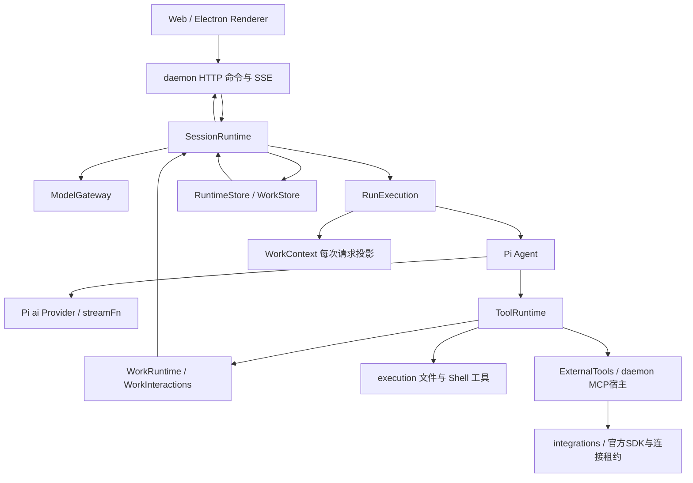
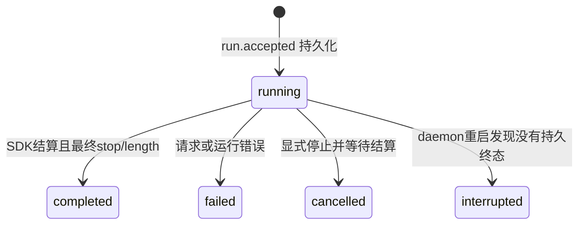
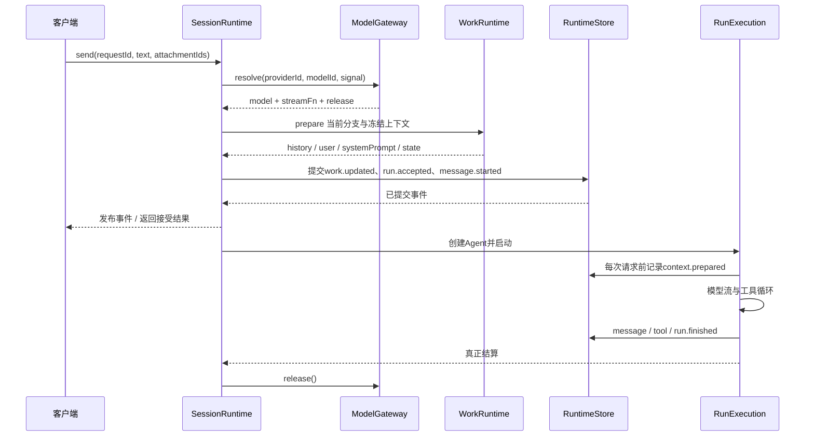

# Agent 运行时技术设计

**日期**：2026-10-20

**模块**：`packages/agent-runtime/`、`apps/daemon/src/services.ts`

**实现锚点**：`ModelGateway`、`SessionRuntime`、`RunExecution`、`ToolRuntime`、`WorkInteractions`

**状态**：已实现；本机自动化通过，真实供应商与平台验收范围见对应功能验证记录

---

## 要解决什么问题

Pi 提供模型流与工具循环，但 PC 应用还需要长期会话、可靠输入队列、本地工具审批、人工交互和进程退出管理。这些状态不能只存在于某个页面，也不能直接由 SDK 的消息数组承担。

这里有四个核心问题：

1. 用户重复发送、运行中追问或修改历史时，如何保证输入属于明确的 Run 和分支。
2. 模型、工具和等待用户的交互同时存在时，由谁负责取消、资源释放和最终状态。
3. 如何让模型 SDK 的内部事件成为可持久化、可重放的产品事实，同时隔离私有模型上下文。
4. 断线与重启后如何保留已完成的工作，又避免自动重做可能已经产生副作用的请求。

**核心思路**：daemon 装配运行时；`SessionRuntime` 拥有会话命令和事件发布，`RunExecution` 拥有一次 Pi Agent 生命周期，`ToolRuntime` 拥有每次工具调用，`WorkRuntime` 提供上下文与工作状态。所有可见变化先提交，再通知前端。

运行时通过存储和执行端口工作，不导入 React、Electron、Fastify 或 SQL 驱动。进程、传输和模块依赖见[系统架构](系统架构设计.md)，日志提交与重建见[会话存储](会话存储与恢复设计.md)。

## 一、整体架构



| 所有者             | 拥有的状态                                                     | 生命周期                         |
| ------------------ | -------------------------------------------------------------- | -------------------------------- |
| `ModelGateway`     | Provider 实例、认证流程、模型目录、使用中的 lease              | daemon                           |
| `SessionRuntime`   | 活跃 Run、会话命令尾链、启动取消器、订阅者、停用会话           | daemon                           |
| `RunExecution`     | Pi Agent、工具取消信号、本 Run 可消费队列、当前 assistant 消息 | 一个 Run                         |
| `RunToolset`       | 接受时冻结的工具定义、来源与指纹                               | 一个 Run                         |
| `ToolRuntime`      | 等待审批的单次工具调用                                         | daemon；等待项按调用/Run结算移除 |
| `WorkRuntime`      | 分支工作状态操作、手动摘要取消器、上下文与交互协调             | daemon；事实由存储保存           |
| `WorkInteractions` | 问题与计划审核的 Promise 等待者                                | daemon；等待项属于当前Run        |
| 存储实现           | 输入接受、消息、工具、队列、分支和工作状态事实                 | 跨 daemon 重启                   |

内存中的 Agent 和等待 Promise 不构成可恢复执行点。持久状态足以重建界面、后续请求和中断结论，不表示可以从任意工具指令中间继续执行。

## 二、Pi 与应用分别负责什么

### 2.1 Pi Agent core：一次模型与工具循环

`RunExecution` 创建真实 `Agent`，注入模型、消息、system prompt、工具与 `streamFn`。当前采用：

- `steeringMode: 'one-at-a-time'`；
- `followUpMode: 'one-at-a-time'`；
- `toolExecution: 'sequential'`；
- `transformContext` 在每次模型请求前选择实际输入；
- `finishTurn` 在工具循环达到 32 轮时结束运行。

应用订阅 `message_start`、`message_update` 和 `message_end`，转换为自己的事件与 DTO。页面不接收 Pi Agent、Provider 对象或 SDK 原始错误。

### 2.2 Pi ai：Provider、认证和模型传输

`ModelGateway` 通过 Pi 的公开工厂创建内置或自定义 Provider。自定义配置选择 Chat Completions、Responses 或 Anthropic Messages API，实际请求与模型流解析由 Pi 处理。

应用额外负责账户实例 ID、非秘密配置、宿主凭据适配、启用状态、显式模型能力和地址校验。它没有维护第二套模型 SSE 解析器，也没有把 OpenAI 兼容端点当作所有 Provider 的共同协议。

`resolve()` 返回 `model`、`streamFn` 和必须调用的 `release()`。lease 在认证检查前取得，直到失败清理或 SDK 真正结算后释放；期间阻止修改正在使用的 Provider 和凭据。

### 2.3 应用运行时：长期会话与副作用所有权

应用拥有 Session、Run、Branch、QueueInput 和工作状态，不把 Pi 内存队列当作持久队列。工具参数、审批、执行结果和上下文选择都经过应用自己的校验与记录。

SDK 的 `prompt()` 正常返回不代表产品 Run 成功。运行时还检查最终 assistant 的 `stopReason`、取消标记、工具循环错误及持久化状态。

## 三、Session、Run 与分支

Session 是用户长期打开的对话；Run 是某次输入触发的执行；Branch 表示被选中的消息历史。一个 Session 同时最多有一个活跃 Run，不同 Session 可以独立运行。

```text
Session
  ├─ Branch A：用户输入 → Run 1 → 后续输入 → Run 2
  └─ Branch B：继承编辑点之前的消息 → 修改后的输入 → Run 3

一个 Run
  用户消息
    → assistant / 工具调用
    → 工具结果
    → assistant / 继续工具调用
    → 最终回复或终止
```

编辑历史通过 `editAndResend()` 创建新分支，保留编辑点之前的消息 ID，再接受修改后的输入；旧分支及其后续回复仍存在。运行中禁止编辑历史或切换分支，避免把工具结果写入另一条历史。

分支继承和手动快照恢复的存储机制见[会话存储](会话存储与恢复设计.md)。摘要版本的选择属于模型输入管理，见[上下文管理](上下文管理设计.md)，不能与分支恢复混为一谈。

### 3.1 Run 状态来源



`run.cancel_requested` 记录停止意图，终态仍由拥有执行的 Run 写入。收到 `deferred`，或无工具时收到 `toolUse`，不会被报为完整成功。

会话删除是追加 `session.deleted` 进行归档，保留原日志；它不是私人数据的彻底擦除操作。

## 四、一次输入如何成为真实运行

### 4.1 接受前检查

`SessionRuntime.send()` 进入该 Session 的命令串行队列。运行时先检查输入非空、`requestId` 是否已经接受、是否存在活跃 Run，再解析并取得模型 lease。

相同 Session 中已接受的 `requestId` 返回原 `runId` 或 `inputId`。该机制避免请求重试重复创建运行，不提供任意网络副作用的全局幂等保证。

启动准备阶段同样有取消信号：停止操作不仅中断已创建的 Agent，也覆盖尚在模型解析、规则读取和上下文准备中的启动。

### 4.2 提交与执行顺序



`run.accepted` 的私有记录冻结模型、思考等级、初始 system prompt、工作区、审批模式和工具声明。公开消息与模型消息分开保存，成功消息的 Provider 签名、工具调用和结果不因 UI 文本投影而丢失。

若接受事实提交后 Agent 初始化或首次队列读取失败，运行时释放临时资源、停用 Session，并要求重启恢复，不追加虚构的成功结论。重启将已接受但未结算的 Run 标为 `interrupted`。

## 五、运行中输入与队列

运行中的普通 `send` 返回忙碌错误。`steer` 和 follow-up 则先追加持久 `queue.added`，再通过 `rebuildQueue()` 投递 Pi 对应队列。

| 行为             | 持久状态                             | Pi 内存处理               |
| ---------------- | ------------------------------------ | ------------------------- |
| 新增追问 / 引导  | 保存文本、附件、模型选择、revision   | 加入本 Run 允许集合后重建 |
| 编辑排队输入     | 校验旧 revision，再增加 revision     | 清空并按最新事实重建      |
| 删除排队输入     | 追加 `queue.deleted`                 | 清空并重建                |
| Pi 实际开始消费  | 同批写入 `queue.consumed` 与用户消息 | 使用对应冻结消息          |
| 取消、失败或重启 | 保留未消费输入                       | 内存队列清空，不自动恢复  |

`queuedMessages` 将具体 SDK 用户消息对象关联到持久输入。消费时再次核对 revision，防止把已经被用户修改的旧文本当成最新输入。

每个 Run 只激活自己的允许集合。正常完成后，尚未消费的允许输入可以启动后续 Run；旧的暂停队列不会因为普通发送或历史编辑而重新激活。

显式 `resumeQueue()` 要求当前分支与输入原分支一致，并只激活同分支、同 Provider/model 的输入。恢复动作可能再次发起收费模型请求，因此不会在 daemon 重启时自动执行。

## 六、工具与人工交互

### 6.1 工具调用由 Run 约束

`ToolRuntime.selectToolset()` 在接受 Run 前按实际启用能力与工作区选择一次，生成只读 `RunToolset`。接受审计、Pi 工具声明、上下文预算与运行时执行路由使用同一集合；定义和来源深拷贝后冻结，来源与定义指纹单独保存，不混入模型 schema。没有工作区时仍可提问、规划和管理上下文，但不会获得文件或 Shell 工具。

执行只允许集合内的工具，底层文件和会话执行器继续复核各自的固定内置目录。集合包含会话、工作区及输入明确选择的MCP工具；MCP配置/凭据/启动授权由daemon拥有，通过ExternalTools端口冻结定义与非秘密授权。模型别名只作为声明名称，实际调用按冻结Server来源和完整定义指纹路由。

每次调用校验参数 schema、对象大小与调用数量，工具公开记录 ID 由 Run ID、assistant 消息 ID 和 Provider 调用 ID 派生。Provider 在不同 assistant 轮次复用调用 ID，不会混淆两次执行。

MCP输入在接受或排队时冻结配置revision、profile身份、访问/凭据epoch、授权ID和scope。消费队列前同步检查原授权，每次模型请求和执行前复核真实工作根与启动指纹；失效输入保留并拒绝，不重绑当前选择。运行中steer/follow-up与队列合组必须保持原显式选择及授权一致；本Run内从冻结候选加载工具和Skill，按[能力扩展设计](能力扩展与授权设计.md)先持久化新的可见版本，再用于下一模型请求。

外部调用在首次tools/call写入前提交派发屏障；终态与中立私有结果同批持久化后才交回Pi。适配器区分已知结果、可证明未派发和unknown，runtime不依据SDK错误名或signal状态猜测副作用。unknown停止当前Run和后续工具，保留队列，不自动重试或用作Todo完成证据。具体事实与恢复机制见[会话存储设计](会话存储与恢复设计.md)。

所有工具声明 `replay: 'never'`。已登记调用达到64条后，ToolRuntime拒绝后续工具执行；拒绝结果仍可补写失败审计记录，因此记录总数可能超过64条。存储回放不执行工具；中断后不能据“没有完整结果”推断工具没有修改文件。

Plan 模式禁止变更工具；审批是另一项独立检查。批准计划只切换工作模式，不授权未来所有文件修改和命令。实际路径验证、三种审批策略和 Shell 隔离见[工作区与执行](工作区与执行设计.md)。

### 6.2 问题与计划等待原 Run

`ask_user` 和 `update_plan` 是真实 Pi 工具。工具调用先保存可见问题或计划，再等待 `WorkInteractions` 的 Promise，最长 24 小时。

```text
模型调用 ask_user / update_plan
  → work.updated：pending问题 / pending审核
  → 当前工具等待，Run仍然活跃
  → 用户命令校验当前等待、Session与回答
  → 保存回答 / 审核结果
  → settle原Promise
  → 原工具返回结果
  → 同一Run下一次模型请求
```

问题答案按稳定题目 ID 校验单选、多选、可用选项与自由输入权限。重复回答、其他会话的回答和已结束等待被拒绝。用户取消问题返回工具错误，模型可以继续处理该结果；停止整个 Run 则会中止等待与后续运行。

计划 `feedback` 让原 Run 取得修改意见并保持规划模式；`approve` 进入执行模式并继续原 Run；`cancel` 结束此次审核并保持规划模式。待审核计划不能通过普通工作状态补丁绕过批准。

`update_plan_steps` 只能更改已批准计划的步骤状态。Todos 的完成依据必须来自可见、成功的工具记录，或明确的文本结论；新完成项不能借用其他 Run 的工具结果冒充本轮执行。

### 6.3 交互状态与执行恢复分开

页面断开不会结束等待，重新连接后能从工作状态看到同一问题或计划。daemon 重启会失去 Promise 等待者，并把 pending 交互标为 `interrupted`，不会重建原工具调用。

这种处理保留用户可读的事实，同时避免自动续跑不再拥有的模型、审批或副作用。用户需要重新发起后续请求。

## 七、事件、取消与失败

### 7.1 先提交，再广播

`SessionRuntime.commit()` 先调用 `RuntimeStore.append()`，成功后才发布事件。订阅者异常单独报告，不阻塞模型等待 SDK idle，也不撤销已提交事实。

`RunExecution.receive()` 将文本与思考 delta 写入 `message.delta`；完整 assistant 内容写入 `message.completed`。私有模型消息保存于 `privateData`，不混入公开 SSE。

工具结果额外记录为带 assistant 锚点的 `tool.context`。后续请求通过 `completeToolHistory()` 排除中断造成的不完整工具周期，不伪造成功结果补齐配对。

### 7.2 停止必须等待资源结算

`cancel()` 先取消待启动请求和手动摘要，再串行找到当前执行并发出取消；等待 Run task 的操作在命令串行区之外进行，让重复停止可以观察并等待同一个执行。

Run 同时中止工具信号、清空 Pi 队列并调用 `agent.abort()`。模型 lease 在最终清理时释放，不能在 HTTP 停止命令返回前假装底层调用已结束。

daemon关闭先封禁新的MCP管理操作，终止WorkRuntime生命周期，再等待附件操作和运行时结算，随后关闭MCP连接/进程、模型网关，最后关闭存储。所有权和关闭依赖由 `createApplicationServices()` 装配。

### 7.3 不继续使用未提交状态

持久化失败会设置 `persistenceFailed`、中止工具和 Agent、停用 Session。运行时不会继续广播假完成，也不会将该失败当作普通模型错误自动重试。

单次文本或思考内容超过有界上限、工具轮数超限及模型异常都有明确失败结果。模型返回的内部错误只进入宿主诊断，公开 Run 使用受控错误描述。

## 八、关键实现与验证入口

| 实现                                                                            | 负责的机制                                  |
| ------------------------------------------------------------------------------- | ------------------------------------------- |
| [`session-runtime.ts`](../../packages/agent-runtime/src/session-runtime.ts)     | 串行命令、接受幂等、队列、分支、取消和发布  |
| [`run-execution.ts`](../../packages/agent-runtime/src/run-execution.ts)         | Agent配置、SDK事件映射、Run终态、请求前投影 |
| [`model-gateway.ts`](../../packages/agent-runtime/src/model-gateway.ts)         | 模型选择、Provider与认证lease               |
| [`provider-instance.ts`](../../packages/agent-runtime/src/provider-instance.ts) | Pi公开Provider工厂与自定义API装配           |
| [`tool-runtime.ts`](../../packages/agent-runtime/src/tool-runtime.ts)           | 单次工具记录、策略、审批和执行              |
| [`work-interactions.ts`](../../packages/agent-runtime/src/work-interactions.ts) | 同Run提问、计划审核与取消等待               |
| [`session-tools.ts`](../../packages/agent-runtime/src/session-tools.ts)         | 模型工具参数及Plan/Todos操作                |
| [`external-tools.ts`](../../packages/agent-runtime/src/external-tools.ts)       | 冻结外部定义/授权、恢复与执行端口           |
| [`tool-history.ts`](../../packages/agent-runtime/src/tool-history.ts)           | 工具调用/结果配对检查                       |
| [`services.ts`](../../apps/daemon/src/services.ts)                              | daemon资源装配和关闭顺序                    |

验收重点是状态所有权和可观察结果：

- [`session-runtime.test.ts`](../../packages/agent-runtime/test/session-runtime.test.ts)：提交后通知、重复输入、队列暂停恢复、分支及持久化失败。
- [`start-cancellation.test.ts`](../../packages/agent-runtime/test/start-cancellation.test.ts)：启动准备阶段的停止和资源结算。
- [`work-runtime.test.ts`](../../packages/agent-runtime/test/work-runtime.test.ts)：无工作区提问、计划反馈与批准后同 Run 执行。
- [`tool-runtime.test.ts`](../../packages/agent-runtime/test/tool-runtime.test.ts)：参数、审批、工具结果与取消。
- [`m3.spec.ts`](../../tests/e2e/m3.spec.ts)：真实页面、daemon 和受控模型间的工作交互。

这些入口使用真实 Pi Agent 与受控模型验证编排，不证明所有供应商账户、操作系统和安装方式已验收。当前功能证据由[功能文档](../04_FEATURES/overview.md)保存；未来能力以[roadmap](../00_OVERVIEW/roadmap.md)为准。
