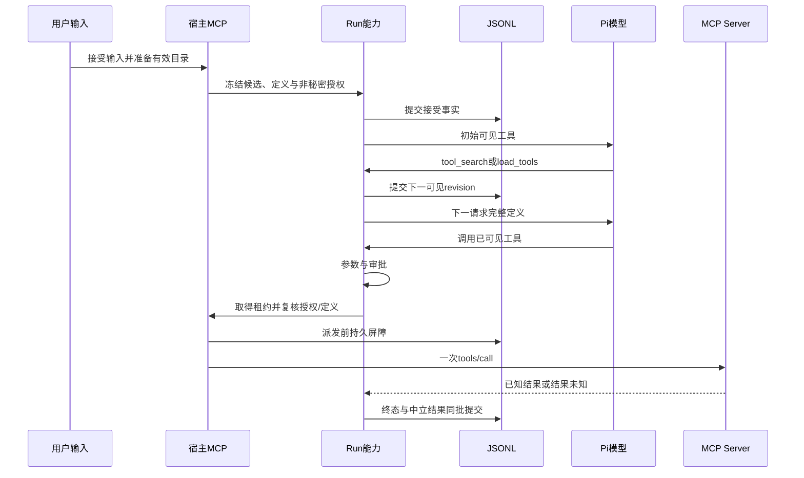

# MCP连接设计

日期：2026-10-28。模块：daemon/mcp、integrations/mcp、execution/process、agent-runtime与storage。实现锚点：[McpService](../../apps/daemon/src/mcp/service.ts)、[RemoteMcpService](../../apps/daemon/src/mcp/remote-service.ts)、[本地连接管理器](../../packages/integrations/src/mcp/manager.ts)、[远端连接管理器](../../packages/integrations/src/mcp/remote.ts)、[ExternalTools](../../apps/daemon/src/mcp/external-tools.ts)。本地受监管stdio的正向支持限macOS；HTTP/SSE、OAuth和调用链有本机fixture证据，真实第三方账号及其他平台不能由fixture代替。

## 连接不等于执行授权

MCP负责获取外部工具定义并调用工具，但连接成功不能同时表示用户信任了启动程序、模型看到了工具、或某次操作获得批准。本实现分别管理配置、凭据、启动信任、目录、Run冻结和逐次执行。

配置和授权由daemon/storage持有，官方SDK与字节传输由integrations持有，真实本地进程由execution持有，模型循环与审批由agent-runtime持有。Renderer只操作安全DTO，不持有SDK Client、进程、凭据引用或Token。

| 所有者               | 主要职责                                                      |
| -------------------- | ------------------------------------------------------------- |
| daemon/mcp           | 配置用例、信任、秘密引用、OAuth、目录准备和精确App归属        |
| integrations/mcp     | 官方SDK适配、定义校验、目录指纹、连接与调用租约               |
| integrations/network | 远端DNS、来源、重定向、正文及时间限制                         |
| execution/process    | 本地持久双向进程、隔离、管道和所属资源回收                    |
| agent-runtime        | 冻结候选、可见版本、参数校验、审批、派发屏障和终态            |
| storage              | SQLite配置及可重建目录快照，JSONL接受与调用事实，秘密存储适配 |

## 本地与远端两种连接模型

本地Server使用stdio，绑定已注册工作区，保存绝对程序、独立参数、公开环境和秘密槽位。启动不经过隐式Shell，也不继承宿主全部环境。预览解析真实工作根、程序及显式文件入口身份，构造包含参数、环境、秘密引用/epoch、隔离和资源策略的指纹，秘密字节不进入指纹或DTO。

`sandboxed`和`full-access`分别授信；用户批准一组确切启动配置后才启用Server。信任只允许启动，不替代每次工具调用审批；精确参数的只读授权也不能从Server自报的`readOnlyHint`推断。当前Windows/Linux不提供受监管本地执行，不自动退回宿主执行。

远端Server显式选择Streamable HTTP或兼容SSE，不要求本地工作区或虚构程序。固定endpoint、传输、公开头及认证来源共同参与授权，配置默认停用，授信后才参与发现。设置中的表单与JSON是同一配置的两种输入形式，草稿连接测试只临时握手和读取目录，不落配置、凭据、信任或会话事实，也不调用具体工具。

远端访问限制为HTTPS标准端口和公网来源，拒绝URL凭据、认证查询参数、私网/保留地址及重定向。IPv4-mapped IPv6按内嵌IPv4应用同一策略，不因等价AAAA形式拒绝公网目标，也不放行映射私网或其他过渡地址。每次DNS检查全部结果，并将选中地址固定到实际socket，SSE的发送目标不得跨origin。测试专用回环来源是宿主fixture注入，不是产品的“允许任意局域网”开关。API字段、限额和状态码分别见[本地协议](../03_API/local-mcp.md)与[远端协议](../03_API/remote-mcp.md)。

## 认证来源与OAuth

| 来源                             | 保存者与使用方式                                                              |
| -------------------------------- | ----------------------------------------------------------------------------- |
| 本地秘密环境、远端静态秘密Header | 系统凭据库保存字节，SQLite仅保存槽位和ref，启动或请求时精确注入               |
| 独立MCP OAuth                    | 官方SDK发现授权元数据并执行授权码/PKCE，宿主持有单次流程及系统凭据引用        |
| 插件共享OAuth                    | `plugin-oauth` App按精确插件、组件和固定目标读取插件专属Token，不复制到Server |
| 高级手动Connections              | 通过明确connectionId及允许的官方目标读取该账户凭据，与插件授权独立            |

独立MCP的服务连接、MCP OAuth和静态Authorization互斥，避免多个认证源悄悄覆盖。普通公开Header不能承载认证秘密。插件凭据文件的特例由[插件体系](插件体系设计.md)拥有，不能推广成通用系统凭据库失败后的降级方案。

独立OAuth的state绑定profile owner、身份epoch、Server revision/accessEpoch和当前流程，十分钟有效并一次性消费。回调由state验证，不依赖供应商Origin或应用Cookie。SDK负责发现、PKCE和issuer校验，宿主负责流程归属、秘密保存、取消及撤销。

交互式OAuth先将客户端和Token保存在所属流程中，成功后写候选凭据引用，再复核取消、配置和身份，最后发布；发布前取消清理候选，保留已有连接。刷新按授权串行。实际工具调用只获得解析后的Bearer，不持有交互Provider，因此401不能自动弹窗授权并重发一次操作。

浏览器通过所属独立启动页请求授权地址并自行跳转；Electron申请一次性launch ticket后交由系统浏览器，不能共享Renderer Cookie。默认插件入口只有授权与状态；高级MCP管理保留显式取消和重新打开，取消一次待完成流程不等于断开已有账户。具体窗口协议见[插件授权协议](../03_API/plugin-connections.md#窗口与桌面)。

## 目录的准备与恢复

普通GET只读配置或有效目录缓存，不因打开设置、页面聚焦而创建连接。本地目录由明确发现/测试或接受输入阶段准备；远端已启用且有效授权的目标在插件启动对账后后台预热，App开关和授权变化也调度所属准备任务。

[CatalogCache](../../apps/daemon/src/mcp/catalog-cache.ts)统一拥有并发限制、逐目标单飞任务、截止和安全诊断。接受输入等待同一准备任务，不能把正在发现的空集合当作最终目录。某个Server失败只排除该Server并记录固定诊断，不阻断其他目录或普通聊天；账号连接状态和`idle/loading/ready/error`目录状态分别保留。

目录快照保存于SQLite派生索引，绑定配置、身份、授权scope、启动指纹和凭据epoch。恢复重新校验官方SDK原始定义、数量、唯一性和可执行schema，再重建TypeBox及定义指纹；不信任落盘的运行时对象，不启动连接，不恢复已失效授权。损坏缓存删除后重新发现，不以缓存修复信任。

调用者取消只结束自己的准备等待，不能取消其他Run共享的任务；服务或授权所有者负责取消实际工作并等待结算。无法中断的本地文件前置检查仍被追踪，取消后返回不得继续启动协议连接。配置、秘密、身份或信任变化会取消旧准备并清除快照，迟到结果发布前再次复核，不能复活旧目录。

SDK按Server能力读取tools、resources和prompts元数据。工具目录冻结完整原始定义，受支持的输入schema编译为真实TypeBox；不支持的定义仍展示但不可选择。Resources/Prompts仅发现元数据，不自动读取正文、订阅或执行Prompt。

## 从用户选择到模型调用

输入接受时保存原选择、完整候选、定义指纹及非秘密授权，而不是执行时读取当前界面选择。排队也冻结相同事实；消费前重新验证原授权，失效则保留输入并拒绝，重新授信不能修复旧输入。steer/follow-up和队列合组要求完整冻结集合与授权一致。

初始选择立即进入模型可见工具集，`tool_search`命中或`load_tools`只暂存下一请求的新定义。先持久化`run.tools_loaded`，再更新Pi入口、预算、system声明和执行路由；同一assistant不能调用尚未出现的工具。候选、检索、Skill与工具数量限制由[运行时能力协议](../03_API/capability-runtime.md)拥有。

实际调用通过新租约核对原完整定义指纹；本地新进程重新发现定义，不能用相同工具名替换已接受的schema或目标。授权在租约和派发前后复核，读取秘密仅发生于宿主，模型别名不反向解析为执行目标。

## 租约、派发与结果未知

本地管理器在任何异步初始化前登记租约，相同冻结授权可复用连接；目录发现也占租约，最后一个释放等待进程组、管道和临时资源退出。回收未结束仍视为忙碌，不能提前允许普通配置修改。stdio适配只管理有界LF分帧、严格UTF-8、一次写入许可及受监管通道，协议校验与请求配对交给SDK；坏帧、stdout污染或输出超限会使连接失效。

远端每个租约建立独立SDK连接，结束等待Transport关闭。Streamable HTTP关闭自动重连，每个attempt只允许一次`tools/call` POST；认证重试、握手重试或断线不能重复已派发操作。

首次可能发送之前，runtime将`may_have_started`屏障持久化，传输才得到该attempt的一次发送许可。屏障不证明上游收到或完成，只有能证明没有实际写入时才报告未派发。已发送后超时、取消、撤销、断线或坏响应且无法取得可靠结果时记录`unknown`，停止Run并保留队列，不自动重试。

合法`isError`响应属于已知失败，不承诺副作用回滚。远端取消通知和本地进程退出都不能证明此前操作未生效。终态与模型中立结果同批落盘，再发布公开事件；晚结果不能覆盖终态，重建会话不自动连接上游或重新执行工具。持久细节见[会话存储](会话存储与恢复设计.md)。

## 撤销、关闭和状态归属

配置用revision进行CAS；停用、撤销和凭据删除还推进访问epoch。普通编辑及秘密轮换拒绝活动租约，秘密先写新ref再CAS，失败回滚新ref。撤销先持久封禁旧授权，再取消目录准备、阻止新租约和写入并收束连接；强制关闭共享连接时，每个已派发未完成调用独立结算unknown。

插件App还必须满足已安装、插件和组件均启用、referenceId精确指向该Server。启动对账不恢复被撤销信任，手动MCP管理也不能绕过插件开关。普通浏览器退出只撤销该浏览器应用会话，保留profile级授权和已接受Run；显式profile身份撤销使用独立身份epoch。

关闭时先拒绝新操作、停止Run并结算调用，再收束目录任务和连接，最后关闭模型、凭据及存储依赖。SQLite保存配置与有效派生目录，JSONL保存冻结定义、可见版本、审批、派发和终态；SDK实例、连接、进程及Token不进入Renderer或会话公开事件。
