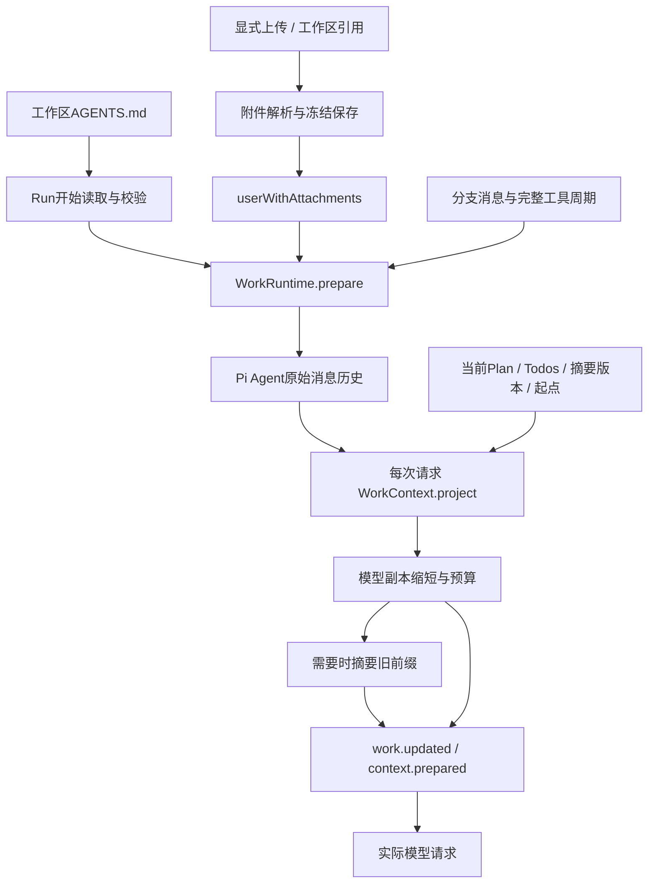

# Agent 上下文管理技术设计

**日期**：2026-10-16

**模块**：`packages/agent-runtime/src/context/`、`work-context.ts`、`work-runtime.ts`、daemon 附件服务

**实现锚点**：`loadWorkspaceRules`、`userWithAttachments`、`WorkContext.project`、`summarizeContext`、`restoreCompaction`

**状态**：已实现；本机自动化通过，模型用量与摘要质量仍受所选 Provider 影响

---

## 要解决什么问题

长会话的模型输入由项目规则、用户消息、附件、工具结果、计划和历史摘要共同组成。直接把全部历史交给模型，会在长工具循环中超过窗口；直接删旧消息，又会丢失用户修正、失败结果和未完成任务。

这里需要同时解决四件事：

1. 输入来源必须明确，规则与附件不能因下一次磁盘读取发生变化而改写历史。
2. 每次模型调用都要计算预算，包括同一 Run 中不断增长的工具结果。
3. 摘要失败后仍应保守保留事实，不能把计划或工具报错总结为成功。
4. 缩短模型输入不能删除原始会话；用户和模型仍需检索旧资料、选择旧摘要或重置上下文。

**核心思路**：保留完整会话事实，为每次模型请求单独生成有预算的投影。规则按 Run 冻结、附件在导入时冻结；工作状态按请求读取。旧资料先做有界缩短，接近预算时再生成语义摘要，最终请求先记录再发送。

Run 与工具生命周期见[Agent 运行时](Agent-Runtime.md)，事实日志与分支恢复见[会话存储](会话存储与恢复设计.md)。本文只解释模型实际看见哪些内容及其来源。

## 一、整体架构



以下对象的保存时机不同：

| 内容                        | 冻结或更新时机                              | 用途                                       |
| --------------------------- | ------------------------------------------- | ------------------------------------------ |
| `RuleSource`                | 每次 Run 开始重新读取，保存路径、hash、文本 | 解释该 Run 使用了哪些项目指令              |
| `AttachmentContent`         | 上传或引用时解析并保存                      | 后续输入不再重读源文件                     |
| `WorkState`                 | 用户命令、会话工具与请求准备时更新          | 维护当前分支的计划、任务、摘要和上下文起点 |
| `context.prepared` 私有请求 | 每次真实模型请求前                          | 记录实际 system 和消息投影                 |

规则正文随公开WorkState.rules提供给已授权客户端，work.updated事件也包含这些规则。附件完整正文与图片base64、模型codec及context.prepared的privateData不随普通快照或SSE公开；附件预览通过受保护接口按需读取。

## 二、规则发现与冻结

### 2.1 只发现本次有关的规则

`WorkRuntime.prepare()` 从本次输入与当前有效历史的附件中收集工作区引用路径，再调用 `loadWorkspaceRules()`。没有工作区时不读取项目规则。

发现范围是工作区根 `AGENTS.md`，以及显式引用文件祖先目录中的 `AGENTS.md`。历史引用必须属于当前工作区；普通上传没有工作区来源，不借文件名触发目录规则发现。

```text
workspace/
  AGENTS.md                 ← 根规则
  src/
    AGENTS.md               ← 引用src/feature/file.ts时发现
    feature/
      AGENTS.md             ← 同上
      file.ts               ← 显式引用
  other/
    AGENTS.md               ← 不递归扫描，不主动发现
```

规则按目录深度、路径稳定排序，较深规则在所属目录覆盖祖先规则；应用策略与工具权限仍优先。规则不是扩大文件访问范围的授权。

### 2.2 读到什么，就保存什么

每个 `RuleSource` 保存工作区相对 `path`、原始字节 SHA-256、UTF-8 `content` 和 `byteLength`。Run 接受时，规则进入工作状态和初始上下文；同一 Run 不在工具循环之间重新读取磁盘规则。

下次 Run 会重新发现并读取，先前快照保持原样。源引用文件后来删除不影响已冻结附件；规则发现仍检查存在的祖先目录，缺失目录不提供规则。

读取复用 execution 的真实路径检查和普通文件句柄：越界、敏感路径、符号链接、硬链接、非 UTF-8、空字节、读取期间改变或取消都明确失败。最多 16 个规则文件、合计 64 KiB，不静默截断规则。

父目录并发改名的完整安全条件由底层文件策略和 OS 隔离共同承担，见[工作区与执行](工作区与执行设计.md)，不能仅凭应用字符串路径校验宣称完全隔离。

## 三、附件进入模型之前

### 3.1 导入与引用共用冻结流程

`AttachmentService` 接受用户上传，或在注册工作区内读取显式引用。两者最终进入 `freeze()`，保存附件元数据和解析结果，返回不可变附件 ID。

| 资料                              | 处理方式                                 | 模型输入                 |
| --------------------------------- | ---------------------------------------- | ------------------------ |
| UTF-8文本                         | 校验编码与大小                           | 标记为用户附加资料的文本 |
| PNG / JPEG / GIF / WebP           | 校验文件签名、MIME与大小                 | 图片块及资料标题         |
| PDF                               | 检查PDF签名，隔离解析提取文本            | 提取文本                 |
| 支持的Office / OpenDocument等文档 | 扩展名、MIME和归档内容检查，再解析       | 提取文本                 |
| 工作区引用                        | 检查真实路径和文件稳定性，可选文本行范围 | 冻结的相对来源与所选内容 |

格式和尺寸的完整协议由[上下文接口](../03_API/context-interaction.md)与导入实现拥有；界面不必常驻展示全部限制，上传时返回具体错误。

源文件路径只是来源说明，不是后续模型请求的读取地址。源文件修改或删除后，同一附件 ID 仍使用已保存内容。

### 3.2 消息冻结与能力检查

`userWithAttachments()` 根据附件 ID 创建 Pi `UserMessage`，拒绝重复 ID 和缺失附件。图片需要当前模型声明支持 `image`；不支持时拒绝输入，不擅自改用其他模型或丢弃图片。

文本资料带有明确的引用资料标记；图片 base64 只进入私有模型消息。消息保存了附件 ID，实际提交的完整模型用户消息另经 codec 保存，因此 UI 预览文本不能替代模型输入。

正在排队的附件输入也会先校验；真正消费时建立其用户消息。附件正文冻结于导入，消息与队列归属则由运行时接受与消费事实决定。

附件文件与会话 JSONL 是两个保存对象，日志引用附件 ID 不代表日志包含全部附件字节。备份和缺失附件边界见[会话存储](会话存储与恢复设计.md)。

## 四、每次请求重建上下文

### 4.1 不只在 Run 开始计算

`RunExecution` 将 `WorkContext.project()` 接到 Pi 的 `transformContext`。每次请求，包括工具结果返回后的下一轮，都执行同一条准备路径：

1. 将 SDK 消息关联到当前分支中已保存的消息 ID；工具结果继承其 assistant 消息锚点。
2. 根据上下文起点与当前摘要覆盖位置选择有效消息。
3. 校验工具调用和结果完整配对。
4. 读取最新工作状态，用冻结规则、当前摘要、Plan 和 Todos 重建 system 内容。
5. 缩短模型副本，计算预算，必要时摘要旧前缀。
6. 最终预算检查，再保存用量及实际请求。

`buildSystemContext()` 明确区分项目指令与工作数据。Plan、Todos 和历史摘要不是应用政策，也不是行动成功的证据；计划批准不能覆盖工具审批。

当前 Run 的用户任务如果已经从保留消息中移出，会额外放入 system 的当前任务段，避免同一个长任务连续压缩后失去目标。

### 4.2 原始历史与投影分开

`pruneContext()` 仅创建模型可见副本：

- 长工具文本超过 8192 字符时保留首 4096 与尾 1024，并说明完整结果仍在历史。
- 早于最后一条用户消息的长附件文本保留前 16000 字符。
- 早先图片变为“附件仍保留”的文本提示，最新用户消息的图片不在此步移除。

完整消息、工具结果和附件不被这些操作改写。`prunedMessages` 统计被缩短的消息数，不意味着消息已经从持久会话删除。

工具调用与结果必须作为完整周期进入模型。请求投影拒绝孤立、重复或名称不匹配的结果；重启后历史准备会跳过未完成周期，不构造虚假结果补齐。

## 五、预算与用量

### 5.1 估算口径

预算包含 system、规则、工具声明、消息、附件、摘要、工作状态和协议开销：

```text
inputBudget = contextWindow - maxTokens
estimatedTokens = system + tool definitions + messages + protocol overhead
```

这里的 `maxTokens` 完整保留为输出预算，不为了放下输入而静默调小。无效窗口或输出预留配置直接拒绝。

`textTokens()` 使用保守的 ASCII / UTF-8 启发式；图片按每张 4096 tokens 估算，不把 base64 长度当作 token 数。签名、工具参数和额外 Provider 上下文也参与估算。

`ContextUsage.categories` 拆分 system、rules、tools、messages、attachments、summary 和 workingState。它是解释输入构成的估算，不是供应商计费凭据。

### 5.2 使用 Provider 反馈校准

`WorkContext` 保存本 Run 上次请求的估算基线。下一次有有效 assistant 使用量时，以 `input + cacheRead + cacheWrite` 校准总量，使本次新增内容仍按启发式累加。

只有基线标记一致、上次回复有效且反馈数值合理时使用该反馈。摘要版本或上下文起点改变后标记变化，旧基线不再沿用；Run 结束时清理基线。

即便总量的 `source` 变成 `provider`，类别拆分仍是估算。该值反映前次请求反馈对当前预估的校准，不保证当前请求与 Provider tokenizer 完全一致。

### 5.3 达到阈值后的选择

估算达到输入预算 80% 时尝试自动摘要。`selectRequestPrefix()` 以用户消息或完整 assistant/tool 组为单位选择旧前缀，保留约输入预算 16% 的近期内容，因此同一用户任务内部也能压缩。

这个近期目标不是硬性截断长度：完整消息组可能超过目标，至少保留尾部组。无法选择旧前缀时不摘要；最终依然超过输入预算就返回 `CONTEXT_LIMIT`，不发送一个已知超预算的主请求。

手动压缩则按用户轮次选择前缀，保留最近两轮，需要足够历史。它和自动压缩共用摘要及版本保存机制，但前缀选择不相同。

## 六、结构摘要与保守降级

### 6.1 摘要不是再次执行历史

`summarizeContext()` 使用独立、无工具的 Pi Agent，输入是上一份结构摘要和历史记录文本。历史明确标记为资料，不能通过摘要请求重新执行工具。

结构字段固定为：

| 字段          | 记录内容                                   |
| ------------- | ------------------------------------------ |
| `objective`   | 当前目标                                   |
| `constraints` | 已确认约束                                 |
| `decisions`   | 需要延续的决定                             |
| `completed`   | 已观察结果与完成记录，不等于全部工具都成功 |
| `pending`     | 未完成事项                                 |
| `blockers`    | 错误、阻塞与不确定性                       |
| `nextAction`  | 下一步                                     |

`summaryRecord()` 不传递图片 base64 或 Provider 签名，私有思考替换为省略标记，工具调用参数片段有界。模型返回必须是通过 `ContextSummarySchema` 的 JSON。

### 6.2 总预算与取消

历史文本按块增量汇总，每块根据摘要模型窗口再次检查预算，最多 32 块；模型摘要输出最多预留 2048 tokens，总等待 90 秒。

全部结构字段共同受序列化 JSON 24000 字符和渲染文本 30000 字符限制。`boundSummary()` 同时收缩字段，避免多次 fallback 累积后写不进工作状态。

摘要模型失败、无效 JSON、schema 不符、自身超时或无法容纳输入时，采用本地 `fallbackSummary()`，保留近期观察、既有关键字段、待办与工具失败，不虚构工具成功或批准。

调用者取消必须继续抛出，不能转为一份“成功 fallback”。摘要请求的审计保存发生在模型错误捕获区之外，持久化失败同样直接传播，不发布降级摘要掩盖存储故障。

### 6.3 摘要版本保存

`WorkContext.compact()` 为新版本生成 ID，并保存 `parentId`、`throughMessageId`、结构内容、渲染摘要、`reason`、`strategy`、来源消息数及同口径前后 token 估算。

`reason` 区分 automatic / manual，`strategy` 区分 model / fallback。`afterTokens` 是采用新摘要与保留消息后的请求估算，不保证每次压缩都会减少足够空间；最终预算检查仍然执行。

摘要先保存到分支工作状态，再用于后续请求。此前版本保留，原始历史不删除。新版本的父节点是生成时选中的摘要，因此版本关系允许从较早摘要继续形成另一条后继链。

## 七、检索、选择与重置

这些动作修改的对象不同，不能统一理解为“清空对话”：

| 动作                                  | 模型下一次看见什么                      | 保留什么                        |
| ------------------------------------- | --------------------------------------- | ------------------------------- |
| 自动 / 手动压缩                       | 新摘要加未覆盖的近期消息                | 原始历史、附件、Plan/Todos      |
| 选择旧摘要                            | 旧摘要加选择后新增消息                  | 当前Session、全部已存历史与版本 |
| `reset-context`                       | 重置点之后的新消息，下一Run重新读取规则 | 模式、Plan/Todos、历史与附件    |
| `reset-tasks` / `reset_working_state` | 原上下文与摘要，去掉Plan/Todos          | 消息、规则、附件、用量及摘要    |
| 恢复手动会话快照                      | 新分支中的快照消息前缀与工作状态        | 原分支和后续历史                |

### 7.1 摘要选择是输入切换

`restoreCompaction()` 只选择当前分支可见的摘要，并把 `contextStartAfterMessageId` 设为选择时的最新消息。这样旧摘要之后、选择之前的上下文尾部不再自动重新注入；选择后新增的消息仍可进入模型。

模型工具 `restore_context_checkpoint` 支持显式摘要 ID，或沿 `parentId` 回退 1–10 步。它不删除消息、不恢复旧 Plan/Todos、不创建会话分支，也不撤销文件或外部请求。

### 7.2 原始资料检索仍然可用

`search_session_history` 搜索当前 Session 所选分支的原始用户 / assistant 消息、工具文本和可见消息关联的文本附件，包括已经摘要或被投影缩短的内容。

检索按有界候选和字符预算执行，返回匹配片段与扫描信息。它不会遍历其他 Session、整个工作区或长期记忆，也不能保证扫描预算之外的旧资料一定被检出。

### 7.3 重置与快照不回滚磁盘

`reset-context` 记录新的历史起点，清空当前规则快照、摘要、用量、问题和未消费队列；保留模式、Plan 与 Todos。原始历史继续可读，不做物理删除。

手动会话快照冻结消息前缀及工作状态，恢复时创建新分支；它与摘要版本是两个机制。详细恢复与分支继承见[会话存储](会话存储与恢复设计.md)。任何上下文操作都不承诺撤销工具副作用。

## 八、实际请求记录与失败边界

投影完成后先保存 `work.updated`，再追加 `context.prepared`：公开部分记录分支、用量、消息 ID 与附件 ID，私有部分保存实际 system prompt 与编码后的消息。随后才返回给 Pi 发起请求。

摘要请求也先记录其模型输入。模型可见来源因此可以从保存事实解释，而不是只剩一个无法核查的 token 数。

以下情况必须明确失败：规则无效、附件缺失、模型不支持图片、上下文锚点不属于当前历史、工具周期不完整、最终超预算、调用取消及持久化故障。不能通过忽略规则、偷换模型、删除未配对结果或补写假成功绕过。

摘要是有损信息，fallback 也只是保守延续，不能替代原始证据。项目规则和附件可能含不可信内容；标记和结构有助于提示来源，实际权限仍由工具层执行，不能依赖模型自觉承担安全隔离。

## 九、关键实现与验收入口

| 实现                                                                              | 负责的机制                              |
| --------------------------------------------------------------------------------- | --------------------------------------- |
| [`rules.ts`](../../packages/agent-runtime/src/context/rules.ts)                   | 有界规则发现、读取、来源hash与取消      |
| [`service.ts`](../../apps/daemon/src/features/attachments/service.ts)             | 附件冻结、引用、解析与服务关闭          |
| [`attachment-context.ts`](../../packages/agent-runtime/src/attachment-context.ts) | 附件ID转私有模型用户消息                |
| [`work-runtime.ts`](../../packages/agent-runtime/src/work-runtime.ts)             | Run准备、有效起点、手动压缩、检索与重置 |
| [`work-context.ts`](../../packages/agent-runtime/src/work-context.ts)             | 每次请求投影、校准、自动摘要与保存      |
| [`projection.ts`](../../packages/agent-runtime/src/context/projection.ts)         | 模型副本缩短、自动前缀与类别估算        |
| [`budget.ts`](../../packages/agent-runtime/src/context/budget.ts)                 | token启发式、完整工具周期与预算检查     |
| [`summary.ts`](../../packages/agent-runtime/src/context/summary.ts)               | 结构摘要、fallback与全局大小限制        |
| [`system-context.ts`](../../packages/agent-runtime/src/context/system-context.ts) | 项目指令和工作数据的分层表达            |

验收关注输入可解释、原始事实不丢失和失败传播：

- [`context-rules.test.ts`](../../packages/agent-runtime/test/context-rules.test.ts)：按引用发现、冻结hash、范围与规则拒绝场景。
- [`attachments.test.ts`](../../apps/daemon/test/attachments.test.ts)：格式校验、冻结引用、解析取消与受保护内容。
- [`context-pipeline.test.ts`](../../packages/agent-runtime/test/context-pipeline.test.ts)：同Run连续压缩、Provider反馈校准、摘要选择、检索及审计失败。
- [`context-review-regressions.test.ts`](../../packages/agent-runtime/test/context-review-regressions.test.ts)：连续fallback全局限制、可见附件尾部检索与完成证据继承。
- [`work-runtime.test.ts`](../../packages/agent-runtime/test/work-runtime.test.ts)：规则重读、手动压缩取消、重置与快照区别。

测试覆盖受控模型下的机制，不把摘要语义准确率、真实供应商 token 计算或跨平台解析质量当作已保证属性。阶段范围与后续长期记忆能力见[roadmap](../00_OVERVIEW/roadmap.md)。
