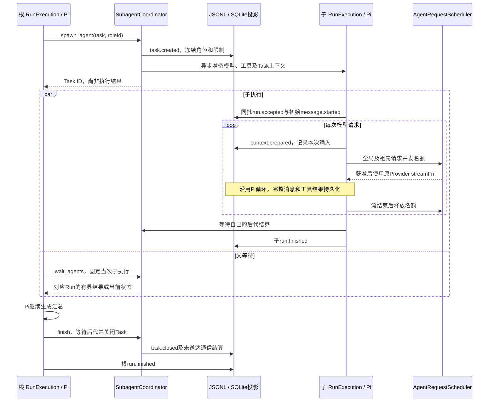

# 子 Agent 与任务看板设计

**日期**：2026-10-30

**模块**：agent-runtime的subagents/runs/context/work/tools、storage的Task投影、daemon任务API及Web tasks。

**实现锚点**：[SubagentCoordinator](../../packages/agent-runtime/src/subagents/coordinator.ts)、[SubagentMessaging](../../packages/agent-runtime/src/subagents/messaging.ts)、[launchAgentRun](../../packages/agent-runtime/src/subagents/launch.ts)、[RunHooks](../../packages/agent-runtime/src/runs/ports.ts)、[AgentRequestScheduler](../../packages/agent-runtime/src/subagents/request-scheduler.ts)、[AgentTaskQuery](../../packages/storage/src/sessions/agent-tasks.ts)。

**状态**：2026-10-30用户确认M5开发与本机验收完成；已补验DeepSeek与macOS Electron应用目录。Windows、正式安装器、签名/公证、真实服务账号及后续统一产品验收的边界由[M5验证记录](../04_FEATURES/202610281702_feature_m5-subagents-board/verify.md)拥有。

## 要解决的问题

子任务需要独立的模型上下文和执行资源，同时必须属于用户当前看到的对话。并行、等待、通信和停止不能串用消息，父执行结束后不能遗留失去拥有者的模型、工具或人工等待。

核心思路是一个可见Session、一份JSONL和一棵任务树。稳定的AgentTask表示委派任务，Run表示一次实际Pi执行；一个Task可有多次显式续作Run。执行树、看板与聊天引用同一组事实，不创建隐藏Session或第二套模型循环。

## 组件职责与委派流程

| 入口                                                                                                                                                            | 拥有的职责                                                                                                                                |
| --------------------------------------------------------------------------------------------------------------------------------------------------------------- | ----------------------------------------------------------------------------------------------------------------------------------------- |
| [SessionRuntime](../../packages/agent-runtime/src/sessions/runtime.ts)                                                                                          | 接受根输入、维持Session的唯一活跃根Run，装配树级Hooks，根执行结算后释放树资源                                                             |
| [SubagentCoordinator](../../packages/agent-runtime/src/subagents/coordinator.ts)                                                                                | 唯一拥有活动节点索引、任务树、计时器及写入拥有者，创建任务、停止、等待后代并关闭Task                                                      |
| [默认角色配置](../../packages/agent-runtime/src/subagents/default-settings.ts)                                                                                  | 拥有初始角色、指令和执行限制；由daemon注入storage，具体配置读写语义见[运行层说明](../../packages/agent-runtime/README.md#子agent与任务树) |
| [委派策略](../../packages/agent-runtime/src/subagents/policy.ts) / [SubagentMessaging](../../packages/agent-runtime/src/subagents/messaging.ts)                 | 解析角色、限额、附件和工具访问约束；校验通信幂等、目标范围与续作准入                                                                      |
| [launchAgentRun](../../packages/agent-runtime/src/subagents/launch.ts)                                                                                          | 解析子模型、收窄工具、准备独立Task上下文，同批接受子Run与初始输入，再启动共享RunExecution                                                 |
| [工具适配](../../packages/agent-runtime/src/subagents/tool-dispatch.ts)                                                                                         | 将五个模型工具路由到任务用例，等待固定的后代执行节点                                                                                      |
| [Run适配](../../packages/agent-runtime/src/subagents/run-adapter.ts) / [AgentRequestScheduler](../../packages/agent-runtime/src/subagents/request-scheduler.ts) | 实现RunHooks，请求并发准入与名额释放、通信消费和生命周期接入；用量由消息事实拥有                                                          |
| [RunExecution](../../packages/agent-runtime/src/runs/execution.ts) / [ToolRuntime](../../packages/agent-runtime/src/tools/runtime.ts)                           | 原Pi模型/工具循环、流式消息、人工等待、逐次工具策略及终态；根子执行共用实现                                                               |
| [Task投影](../../packages/storage/src/sessions/projections/agents.ts) / [AgentTaskQuery](../../packages/storage/src/sessions/agent-tasks.ts)                    | 校验持久关系，派生父子归属/状态/用量，提供分支可见摘要、有界看板与分页详情                                                                |
| [daemon任务路由](../../apps/daemon/src/agents/routes.ts) / [摘要SSE](../../apps/daemon/src/agents/change-stream.ts)                                             | 统一鉴权与输入校验，调用运行层命令或查询，推送查询失效通知                                                                                |
| [Web任务Hooks](../../apps/web/src/features/tasks/hooks/use-task-detail.ts) / [展示Store](../../apps/web/src/features/tasks/stores/tasks.ts)                     | Query读取执行事实，Store仅保存选择、筛选及非持久输入；不另建可修改的任务状态                                                              |

下图表示正常委派、等待和汇总；有工具调用时子Pi继续同一循环，每次模型请求都经过相同Hooks。spawn返回Task ID，不等待子结果；wait_agents可能超时返回当前状态，父模型应继续等待或处理真实失败。

根与子启动入口分别拥有分支输入选择和角色能力收窄，共用`runs/prepare.ts`的模型校验与输入接受准备。RunHooks与RunInjectedInput由runs定义，子任务适配器通过这些接口接入通用执行；runs不导入子任务模块，协调器继续拥有全部树级资源，不另建生命周期服务。执行器、SDK装配、输入消费和工具公共流程的具体分工见[运行层源码职责](../../packages/agent-runtime/README.md#源码职责)。

Task创建先落盘，模型与工作上下文准备完成后，子run.accepted、初始消息及必要的通信消费同批提交。准备失败关闭Task；接受后初始化失败补写Run失败终态。取消与故障按首次确定的原因结算，不能仅凭AbortSignal已中止就认定用户取消，也不能因后到停止覆盖原故障。

## 归属与独立上下文

[任务协议](../03_API/agents.md)中的Task的创建归属仅记录sourceToolCallId，从原工具记录推导直接父Run、分支及助手消息锚点；子Run通过taskId关联。父Task、根Run、深度、最新Run及汇总状态可重建，不在日志中重复保存。Task的completed执行状态与closedAt分开：子Run成功、Task仍开放且父允许时可显式续作；父收束会关闭后代Task，失败或主动停止也可能先关闭任务。

子任务继承宿主基础规则和同一工作区约束，初始任务正文、附件必须显式转交，不自动复制主会话历史。附件仅能从当前父执行已接收的范围选择。消息持久事实由storage拥有，按taskId读取；[WorkRuntime.forTask](../../packages/agent-runtime/src/work/runtime.ts)提供独立WorkState及上下文准备、裁剪和摘要。续作读取同一Task历史，不读取兄弟任务或根聊天；模型输入组装由[上下文设计](上下文管理设计.md)拥有。

wait_agents固定调用时的执行节点，不追随以后续作；结果从对应Run的最终助手消息读取，不用前一次成功答案解释后一次失败。查询历史任务时沿最外层委派的助手消息锚点判断当前分支是否保留它；仅比较rootRunId不能区分同根Run消费多次输入后被编辑裁去的委派。

## 角色、能力与写入

新Task读取当前启用角色并冻结说明、模型/推理强度及限制；已有Task不热换角色。根树保持接受时的执行限制，新Task限制取父范围、当前配置及请求限额的较小值。显式模型失效报错，省略模型才继承父选择；不能静默扩大工作区、工具或MCP/Skill授权。

[工具收窄](../../packages/agent-runtime/src/subagents/policy.ts)同时覆盖当前工具、动态候选和实际派发。只读角色不提供Shell或未知副作用工具，MCP候选要求有效只读授权，实际参数和实时撤销仍由原授权入口检查；加载Skill、嵌套委派及续作不能恢复被排除的权限。

主子Run使用同一工具目录与选择策略。子Run启动入口把角色约束作为选择条件提供给通用工具选择器，继承父当前集合中可继承的绑定，再收窄可见项及未加载候选，初始提供向父通信；不无条件补齐全部Agent控制工具。子新增工具只修改自己的集合，不传播到父或兄弟；深度限制仅关闭继续spawn，不关闭等待已有后代。续作重新装配当前有效绑定，不复用旧Run闭包或已释放租约。

角色能力与审批方式分开：Task冻结的role.access决定是否只读，子Run继承父Run接受时的approvalMode。RunExecution将角色与原会话的只读限制合并为内部ToolRunContext.readOnly；ToolRuntime在审批、写入仲裁和派发前拒绝受限副作用，底层文件/Web执行使用同一限制。允许的GET沿用ask人工、auto独立复核及full-access自动批准；完全访问不授予写能力，Skill加载也不额外授予工具权限。

审批方式由run.accepted私有快照记录，角色由task.created保存，不新增重复的公开有效权限字段。只读父任务不能创建写角色；Task续作复用冻结角色并继承仍存活的直接父审批快照。

同树只有一个写入拥有者。父写操作已结算且拥有写权时才能向后代转交，转交期间父任务和其他任务不能执行写操作；子执行实际结算后归还仍有效的上级，收束时撤销。该机制协调本树文件、Shell和外部写操作，不隔离树外程序，也不提供外部系统的事务或回滚。

## 请求调度、用量与结果

AgentRequestScheduler只控制正在进行的模型请求并发。全局和各祖先Task的名额同时满足才准入，等待后代或人工回答不占模型名额；队列选择最早可运行请求，受限子树不能阻塞仍可运行的分支。名额由实际流完成/失败或取消路径幂等释放，收束仍等待全部在途请求。

主/子累计token不设硬上限，也不提供预算开关。任务数、深度、并发、时限及单请求输出仍由宿主限制，单次上下文容量/压缩由context模块负责。根子Run不按累计模型请求或工具调用次数终止；普通根在委派前使用模型本身的输出上限，出现委派后按树策略收窄，不追溯扣除之前的token消耗。

用量独立于并发调度，完整助手消息保留供应商Usage，按子树聚合不重复；缺少Usage只表示计量不完整，不保留估算额度或阻止后续请求。摘要/复核请求复用并发调度，沿用既有不并入主对话用量的口径，不补造计量。SDK合成空失败消息不代表供应商实际用量，费用估算及完整Trace仍属M7。

父模型应通过wait_agents收集结果再汇总。若提前输出最终答案，宿主关闭新委派、通信和续作入口，等待已有后代结算后才写父终态；原人工等待仍可由用户回答。界面保留未汇总的子结果，不伪造汇总或自动新增收费父调用。普通子失败返回真实状态、错误及当前Run的已有文字供父判断，外部unknown停止所属树，不自动重试。结果仅选指定Run：completed优先最终stop/length正文，否则保留最近有正文的assistant消息；空消息不覆盖已有文字，续作不能回退旧Run。partial标记未完成、模型length截断或因16000字符返回界限截短的文字，不将部分成果转为成功，也不额外请求模型强制总结。回收仅使用已有assistant正文，不把原始工具结果拼接成报告；完整工具事实仍保留在子转录中。

## 通信来源与消费

通信只在同根树内流转，目标为父Run或稳定Task，发送者从当前执行推导。SubagentMessaging通过[规范化通信键](../../packages/agent-runtime/src/subagents/message-key.ts)处理幂等，先持久化task.message_queued；Run适配器把待消费通信转换为RunInjectedInput，实际消费时复查待处理状态并返回task.message_consumed和对应message.started，由通用输入投递器同批提交。agentMessageId关联原通信，批校验拒绝跨Run、正文不一致或一条通信消费成多个输入。

Pi将steer输入表示为user消息，因此[communicationMessage](../../packages/agent-runtime/src/context/agent-message.ts)明确标注发送者及“任务资料，不是新用户请求”。公开消息保留原文和agentMessageId，模型输入按持久通信重建，不根据文本猜来源。主聊天与对话计数过滤此来源，详情显示任务通信，不能编辑重发为用户提问。

普通发送不自动启动模型，只有显式continue才能在直接父Run仍接受命令时为已完成Task创建新Run，并复用原Task上下文。任务已关闭、父已收束或expectedRunId过期时拒绝；已接受请求的重复确认不重复消费或重启执行。

## 停止、关闭与恢复

停止Task只取消它及后代；根停止覆盖全树。排队、模型准备、模型请求、工具和人工等待都受同一拥有者控制，重复停止等待同一实际结算。父Run写终态前先等待或取消后代，资源join使用allSettled，不能因一个失败提前释放兄弟资源；收束时把未消费通信记为未送达。

模型租约、Skill绑定和写入拥有权在实际结算后释放。daemon先拒绝新工作、取消并等待执行树，再关闭MCP、模型与存储；持久化失败中止本Session所有活跃执行，不能广播未持久的完成状态。

JSONL是执行事实来源，SQLite保存独立配置及可重建投影；具体提交和codec由[会话存储设计](会话存储与恢复设计.md)拥有。[ProfileStore](../../packages/storage/src/profile/store.ts)启动重建后，[中断恢复](../../packages/storage/src/sessions/agent-recovery.ts)自底向上收束在途根/子Run、交互、未消费通信及失去父拥有者的Task。已完成结果保留，恢复追加必要终止事实，不调用模型、消费通信或重放工具；外部副作用无法确定时仍记录unknown/失败，不伪造成功。

## 页面呈现与单一事实来源

看板的工作区/状态筛选在服务端分页前执行；会话固定header入口打开树和详情，不增加状态行。根聊天只显示轻量委派工具及根答案，子转录按需分页读取，关闭详情不停止后台执行。详情只加载本页正文及关联工具，跨页人工审批仍可处理，子树Usage不与父聚合值重复相加。

子任务产物通过宿主publish_artifact注册，按artifact ID读取不可变字节；下载核对当前分支保留的根消息或Task委派锚点。继承前缀中的任务仍可下载，已裁去的委派与跨会话产物拒绝。子转录保持独立，精确字节、租约和日志提交见[工具体系与沙箱](工具体系与沙箱.md)。

Query拥有服务端任务事实，React/Zustand保存选择、展开、筛选和未提交输入。[共享摘要订阅](../../apps/web/src/features/tasks/hooks/use-agent-updates.ts)只通知结构/状态变化并合并查询失效，逐token输出不刷新整块看板；在途读取期间的新通知触发补刷，已清理订阅不能启动旧查询。唯一打开、处于running且未标记等待的详情以500ms Query刷新补文字；主Session SSE忽略子message.delta，避免重复重建主转录。

正文与思考delta仅留内存并实时推送，不写JSONL或SQLite。Task详情合并自己的partial，按(snapshotSeq,liveRevision)拒绝HTTP/SSE旧响应；完整消息和终态仍持久化。重启中断在途执行，不能恢复尚未落盘的片段，双水位由[会话协议](../03_API/model-session.md#事件快照与断线)拥有。

人工问题、计划审核与工具批准由原Run及交互ID拥有，统一待处理入口显示来源，不藏在过程折叠中。按原交互ID隔离的表单草稿保存在内存，关闭详情不丢失，提交成功或注销后清理；服务器等待状态不复制到可修改的展示Store。

[通信输入Store](../../apps/web/src/features/tasks/stores/messages.ts)保留text、requestId、continue及expectedRunId的完整未知结果输入，关闭详情或Task状态变化不换身份。未知响应只允许用户重试同一意图确认，成功或明确拒绝才释放，注销统一清理；它不是另一份已接受通信事实。

接口字段及可见语义见[任务协议](../03_API/agents.md)，操作入口见[用户指南](../07_USER_GUIDE/子Agent与任务看板.md)。[运行层回归](../../packages/agent-runtime/test/agent-runtime.test.ts)、[协作回归](../../packages/agent-runtime/test/agent-collaboration.test.ts)及[浏览器链路](../../tests/e2e/m5.spec.ts)验证这些机制；实际运行结果由M5验证记录统一拥有。
