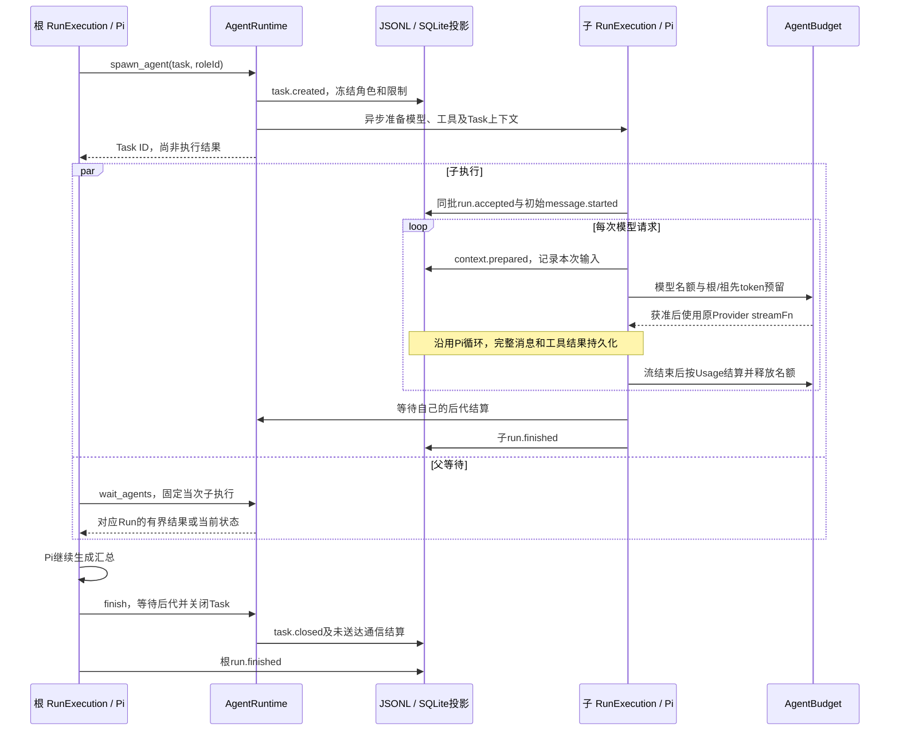

# 子 Agent 与任务看板设计

**日期**：2026-10-30

**模块**：agent-runtime的agents/runs/context/work/tools、storage的Task投影、daemon任务API及Web tasks。

**实现锚点**：[AgentRuntime](../../packages/agent-runtime/src/agents/runtime.ts)、[launchAgentRun](../../packages/agent-runtime/src/agents/launch.ts)、[AgentRunHooks](../../packages/agent-runtime/src/agents/run-hooks.ts)、[AgentBudget](../../packages/agent-runtime/src/agents/budget.ts)、[AgentTaskQuery](../../packages/storage/src/sessions/agent-tasks.ts)。

**状态**：2026-10-30用户确认M5开发与本机验收完成；已补验DeepSeek与macOS Electron应用目录。Windows、正式安装器、签名/公证、真实服务账号及后续统一产品验收的边界由[M5验证记录](../04_FEATURES/202610281702_feature_m5-subagents-board/verify.md)拥有。

## 要解决的问题

子任务需要独立的模型上下文和执行资源，同时必须属于用户当前看到的对话。并行、等待、通信和停止不能串用消息，父执行结束后不能遗留失去拥有者的模型、工具或人工等待。

核心思路是一个可见Session、一份JSONL和一棵任务树。稳定的AgentTask表示委派任务，Run表示一次实际Pi执行；一个Task可有多次显式续作Run。执行树、看板与聊天引用同一组事实，不创建隐藏Session或第二套模型循环。

## 组件职责与委派流程

| 入口                                                                                                                                         | 拥有的职责                                                                                |
| -------------------------------------------------------------------------------------------------------------------------------------------- | ----------------------------------------------------------------------------------------- |
| [SessionRuntime](../../packages/agent-runtime/src/sessions/runtime.ts)                                                                       | 接受根输入、维持Session的唯一活跃根Run，装配树级Hooks，根执行结算后释放树资源             |
| [AgentRuntime](../../packages/agent-runtime/src/agents/runtime.ts)                                                                           | 创建任务、维护活跃父子节点、同树通信与停止、写入拥有权、等待后代及关闭Task                |
| [launchAgentRun](../../packages/agent-runtime/src/agents/launch.ts)                                                                          | 解析子模型、收窄工具、准备独立Task上下文，同批接受子Run与初始输入，再启动共享RunExecution |
| [AgentRunHooks](../../packages/agent-runtime/src/agents/run-hooks.ts) / [AgentBudget](../../packages/agent-runtime/src/agents/budget.ts)     | 委派工具路由、等待与通信消费、请求并发/token准入、实际Usage结算与资源释放                 |
| [RunExecution](../../packages/agent-runtime/src/runs/execution.ts) / [ToolRuntime](../../packages/agent-runtime/src/tools/runtime.ts)        | 原Pi模型/工具循环、流式消息、人工等待、逐次工具策略及终态；根子执行共用实现               |
| [Task投影](../../packages/storage/src/sessions/projections/agents.ts) / [AgentTaskQuery](../../packages/storage/src/sessions/agent-tasks.ts) | 校验持久关系，派生父子归属/状态/用量，提供分支可见摘要、有界看板与分页详情                |
| [daemon任务路由](../../apps/daemon/src/agents/routes.ts) / [摘要SSE](../../apps/daemon/src/agents/change-stream.ts)                          | 统一鉴权与输入校验，调用运行层命令或查询，推送查询失效通知                                |
| [Web任务Hooks](../../apps/web/src/features/tasks/hooks/use-task-detail.ts) / [展示Store](../../apps/web/src/features/tasks/stores/tasks.ts)  | Query读取执行事实，Store仅保存选择、筛选及非持久输入；不另建可修改的任务状态              |

下图表示正常委派、等待和汇总；有工具调用时子Pi继续同一循环，每次模型请求都经过相同Hooks。spawn返回Task ID，不等待子结果；wait_agents可能超时返回当前状态，父模型应继续等待或处理真实失败。

Task创建先落盘，模型与工作上下文准备完成后，子run.accepted、初始消息及必要的通信消费同批提交。准备失败关闭Task；接受后初始化失败补写Run失败终态。取消与故障按首次确定的原因结算，不能仅凭AbortSignal已中止就认定用户取消，也不能因后到停止覆盖原故障。

## 归属与独立上下文

[任务协议](../03_API/agents.md)中的Task的创建归属仅记录sourceToolCallId，从原工具记录推导直接父Run、分支及助手消息锚点；子Run通过taskId关联。父Task、根Run、深度、最新Run及汇总状态可重建，不在日志中重复保存。Task的completed执行状态与closedAt分开：子Run成功、Task仍开放且父允许时可显式续作；父收束会关闭后代Task，失败或主动停止也可能先关闭任务。

子任务继承宿主基础规则和同一工作区约束，初始任务正文、附件必须显式转交，不自动复制主会话历史。附件仅能从当前父执行已接收的范围选择。消息持久事实由storage拥有，按taskId读取；[WorkRuntime.forTask](../../packages/agent-runtime/src/work/runtime.ts)提供独立WorkState及上下文准备、裁剪和摘要。续作读取同一Task历史，不读取兄弟任务或根聊天；模型输入组装由[上下文设计](上下文管理设计.md)拥有。

wait_agents固定调用时的执行节点，不追随以后续作；结果从对应Run的最终助手消息读取，不用前一次成功答案解释后一次失败。查询历史任务时沿最外层委派的助手消息锚点判断当前分支是否保留它；仅比较rootRunId不能区分同根Run消费多次输入后被编辑裁去的委派。

## 角色、能力与写入

新Task读取当前启用角色并冻结说明、模型/推理强度及限制；已有Task不热换角色。根树保持接受时的预算上限，新Task限制取父范围、当前配置及请求限额的较小值。显式模型失效报错，省略模型才继承父选择；不能静默扩大工作区、工具或MCP/Skill授权。

[工具收窄](../../packages/agent-runtime/src/tools/task-toolset.ts)同时覆盖当前工具、动态候选和实际派发。只读角色不提供Shell或未知副作用工具，MCP候选要求有效只读授权，实际参数和实时撤销仍由原授权入口检查；加载Skill、嵌套委派及续作不能恢复被排除的权限。

角色能力与审批方式分开：Task冻结的role.access决定是否只读，子Run继承父Run接受时的approvalMode。RunExecution将角色与原会话的只读限制合并为内部ToolRunContext.readOnly；ToolRuntime在审批、写入仲裁和派发前拒绝受限副作用，底层文件/Web执行使用同一限制。允许的GET沿用ask人工、auto独立复核及full-access自动批准；完全访问不授予写能力，request_skill_tools的显式人工授权仍独立生效。

审批方式由run.accepted私有快照记录，角色由task.created保存，不新增重复的公开有效权限字段。只读父任务不能创建写角色；Task续作复用冻结角色并继承仍存活的直接父审批快照。

同树只有一个写入拥有者。父写操作已结算且拥有写权时才能向后代转交，转交期间父任务和其他任务不能执行写操作；子执行实际结算后归还仍有效的上级，收束时撤销。该机制协调本树文件、Shell和外部写操作，不隔离树外程序，也不提供外部系统的事务或回滚。

## 调度、预算与结果

AgentBudget限制模型请求而非Task数量，等待后代或人工回答不占模型名额。准入同时检查根与各祖先Task，队列选择最早可运行请求，某个受限子树不阻塞仍有额度的其他分支；任务数、深度、Run请求轮数、时限和单请求输出另由宿主检查。委派出现前的根请求保持普通会话轮数/输出策略，已发生的计量仍参与后续共享预算；出现委派后根与子请求执行树级限额。

根预算只有一份共享余额，子Task限额不是再次分配额度。请求前原子预留输入估算及输出额度，流结束后按实际Usage结算并释放名额，同一请求只记账一次，祖先计量派生。系统提示和工具声明已进入规范化TranscriptContext的system消息，估算复用messageTokens，不再加一份工具目录；根/子主请求、自动摘要与独立AI审批均使用同一模型Hooks。

缺少供应商Usage时保守保留预留估算，界面不宣称精确用量或账单；SDK合成失败终止消息不构成一笔有Usage的供应商请求。取消和终态持久化不受剩余额度阻断，费用估算与完整主子Trace仍属M7。

父模型应通过wait_agents收集结果再汇总。若提前输出最终答案，宿主关闭新委派、通信和续作入口，等待已有后代结算后才写父终态；原人工等待仍可由用户回答。界面保留未汇总的子结果，不伪造汇总或自动新增收费父调用。普通子失败返回真实结果供父判断，外部unknown停止所属树，不自动重试。

## 通信来源与消费

通信只在同根树内流转，目标为父Run或稳定Task，发送者从当前执行推导。[规范化通信键](../../packages/agent-runtime/src/agents/message-key.ts)处理幂等，先持久化task.message_queued，再在安全输入边界把消费与对应message.started同批提交。agentMessageId关联原通信，批校验拒绝跨Run、正文不一致或一条通信消费成多个输入。

Pi将steer输入表示为user消息，因此[communicationMessage](../../packages/agent-runtime/src/context/agent-message.ts)明确标注发送者及“任务资料，不是新用户请求”。公开消息保留原文和agentMessageId，模型输入按持久通信重建，不根据文本猜来源。主聊天与对话计数过滤此来源，详情显示任务通信，不能编辑重发为用户提问。

普通发送不自动启动模型，只有显式continue才能在直接父Run仍接受命令时为已完成Task创建新Run，并复用原Task上下文。任务已关闭、父已收束或expectedRunId过期时拒绝；已接受请求的重复确认不重复消费或重启执行。

## 停止、关闭与恢复

停止Task只取消它及后代；根停止覆盖全树。排队、模型准备、模型请求、工具和人工等待都受同一拥有者控制，重复停止等待同一实际结算。父Run写终态前先等待或取消后代，资源join使用allSettled，不能因一个失败提前释放兄弟资源；收束时把未消费通信记为未送达。

模型租约、Skill绑定和写入拥有权在实际结算后释放。daemon先拒绝新工作、取消并等待执行树，再关闭MCP、模型与存储；持久化失败中止本Session所有活跃执行，不能广播未持久的完成状态。

JSONL是执行事实来源，SQLite保存独立配置及可重建投影；具体提交和codec由[会话存储设计](会话存储与恢复设计.md)拥有。[ProfileStore](../../packages/storage/src/profile/store.ts)启动重建后，[中断恢复](../../packages/storage/src/sessions/agent-recovery.ts)自底向上收束在途根/子Run、交互、未消费通信及失去父拥有者的Task。已完成结果保留，恢复追加必要终止事实，不调用模型、消费通信或重放工具；外部副作用无法确定时仍记录unknown/失败，不伪造成功。

## 页面呈现与单一事实来源

看板的工作区/状态筛选在服务端分页前执行；会话固定header入口打开树和详情，不增加状态行。根聊天只显示轻量委派工具及根答案，子转录按需分页读取，关闭详情不停止后台执行。详情只加载本页正文及关联工具，跨页人工审批仍可处理，子树Usage不与父聚合值重复相加。

子任务Office产物沿用[原下载接口](../03_API/capability-runtime.md)：宿主按会话和工具ID查询当前分支可见的根/子工具，继承前缀中的任务仍可下载，已裁去的委派与跨会话工具拒绝。原生工具来源、真实路径及字节摘要校验继续生效，不把子转录并入根快照。

Query拥有服务端任务事实，React/Zustand保存选择、展开、筛选和未提交输入。[共享摘要订阅](../../apps/web/src/features/tasks/hooks/use-agent-updates.ts)只通知结构/状态变化并合并查询失效，逐token输出不刷新整块看板；在途读取期间的新通知触发补刷，已清理订阅不能启动旧查询。唯一打开、处于running且未标记等待的详情以500ms Query刷新补文字；主Session SSE忽略子message.delta，避免重复重建主转录。

正文与思考delta仅留内存并实时推送，不写JSONL或SQLite。Task详情合并自己的partial，按(snapshotSeq,liveRevision)拒绝HTTP/SSE旧响应；完整消息和终态仍持久化。重启中断在途执行，不能恢复尚未落盘的片段，双水位由[会话协议](../03_API/model-session.md#事件快照与断线)拥有。

人工问题、计划审核与工具批准由原Run及交互ID拥有，统一待处理入口显示来源，不藏在过程折叠中。按原交互ID隔离的表单草稿保存在内存，关闭详情不丢失，提交成功或注销后清理；服务器等待状态不复制到可修改的展示Store。

[通信输入Store](../../apps/web/src/features/tasks/stores/messages.ts)保留text、requestId、continue及expectedRunId的完整未知结果输入，关闭详情或Task状态变化不换身份。未知响应只允许用户重试同一意图确认，成功或明确拒绝才释放，注销统一清理；它不是另一份已接受通信事实。

接口字段及可见语义见[任务协议](../03_API/agents.md)，操作入口见[用户指南](../07_USER_GUIDE/子Agent与任务看板.md)。[运行层回归](../../packages/agent-runtime/test/agent-runtime.test.ts)、[协作回归](../../packages/agent-runtime/test/agent-collaboration.test.ts)及[浏览器链路](../../tests/e2e/m5.spec.ts)验证这些机制；实际运行结果由M5验证记录统一拥有。
