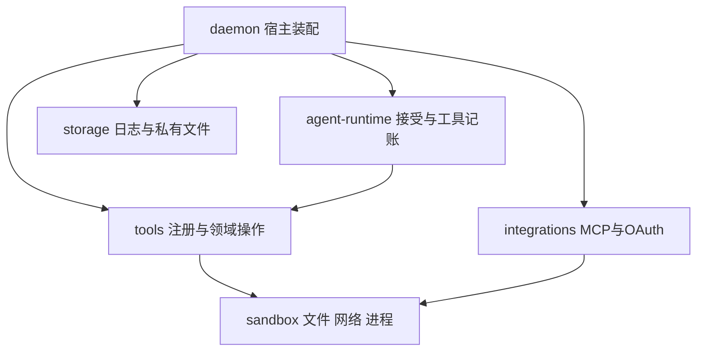

# 工具体系与沙箱

日期：2026-11-05。模块：tools、sandbox、agent-runtime、integrations、daemon与storage。实现锚点：[工具注册](../../packages/tools/src/lib/tool-registry.ts)、[Run绑定](../../packages/agent-runtime/src/tools/bindings.ts)、[命令拥有者](../../packages/tools/src/commands/manager.ts)、[受监管进程](../../packages/sandbox/src/process/persistent.ts)、[Skill资源租约](../../packages/tools/src/skills/materialization.ts)、[产物存储](../../packages/storage/src/artifacts/blobs.ts)。工程检查、主子任务浏览器闭环及独立部署已有[验证记录](../04_FEATURES/202611041712_refactor_tools-skills-sandbox/verify.md)；真实模型、办公转换与重算、正式桌面安装包及其他目标平台保持各自未验证状态。

## 能力由谁拥有

模型通过工具请求一次操作，Skill为任务提供指令与精确资源，插件组织和分发相关能力。daemon把实际服务装配为每个Run使用的窄端口；agent-runtime保存接受、审批、激活和执行事实；sandbox负责已经获准操作的宿主访问与进程回收。



| 所有者                           | 负责的内容                                                   | 注入的实际服务                      |
| -------------------------------- | ------------------------------------------------------------ | ----------------------------------- |
| tools/tools                      | 每个工具的模型参数、描述、加载方式、可用条件、策略与执行入口 | 每Run的领域端口                     |
| tools/lib                        | 注册契约、公共执行上下文及共用的文件操作、输入和传输支持     | 已授权的上下文及sandbox原语         |
| tools/workspace-tool-registry.ts | 原生目录装配与冲突检查                                       | 独立工具注册项                      |
| tools/utils                      | 目录检索及工具、附件共用的正文提取                           | 工具描述、检索器和已授权字节        |
| tools/skills、tools/plugins      | 发现、解析、不可变资源、共享依赖、声明和贡献索引             | 授权代次复核与宿主资源目录          |
| tools/commands                   | 命令ID、会话与任务归属、等待和输出游标、命令租约             | 工作区解析、有效执行范围、Skill资源 |
| sandbox                          | 稳定文件读取、公网地址判定、程序身份、OS隔离与字节进程回收   | 已授权的路径、程序、环境与限额      |
| integrations                     | MCP协议、连接租约、服务OAuth与凭据消费                       | 宿主配置、凭据端口和sandbox原语     |
| daemon                           | 安装及启停状态、工作区配置、服务生命周期与产物注册           | storage与各领域实现                 |
| agent-runtime                    | 主子Run、角色权限、审批、能力持久屏障与工具结果              | 绑定后的工具及领域服务              |

tools不导入具体Run、任务协调器或数据库；独立领域可以实现工具注册工厂，由宿主组合。sandbox接收明确的执行输入，保持与工具名称、插件安装状态和业务协议独立。文件与网络模块提供宿主API守卫，OS进程隔离由平台模块实现。

## 一次工具注册与调用

`ToolRegistration`把definition、source、loading、readOnly、available、policy和bind放在同一声明。参数相关的修改分类由policy给出，例如只读命令仍使用OS禁止工作区写入的执行范围；来源用于日志及授权核对，实际执行通过已绑定入口完成。

27个原生工具按名称直接平铺在tools/src/tools，每个文件只拥有一个模型工具。例如read-file.ts负责文本读取，edit-file.ts负责精确替换，run-command.ts负责命令启动接口，load-skill.ts负责Skill激活接口。schema、描述、可用性、效果策略和执行逻辑在所属文件内完整定位；tools/index.ts只聚合导出，根workspace-tool-registry.ts按明确顺序组合目录。lib/tool-registry.ts拥有注册契约和注册器，lib/tool-context.ts拥有公共执行上下文，具体工具回调类型随对应工具定义。目录检索与正文提取分别归utils/tool-search.ts和utils/document-text.ts；命令生命周期、Skill资源及插件贡献继续由各自领域拥有，不保留工具族schema/registration文件或具名通用执行总线。

接受Run时，候选由真实服务能力、工作区、平台、视觉能力和角色筛选。模型可见定义与来源指纹克隆后冻结；执行函数只保存在内存。主Run和子Run分别创建端口，Work、Task、命令归属与权限均取当前Run的数据。子任务采用自己的角色上限，不继承父Run的执行闭包。

```text
模型原始JSON参数
  → schema和大小校验
  → 保存tool.requested与接受时的来源/指纹
  → 角色、当前授权与逐次审批
  → 调用当前Run绑定的领域端口
  → 工具终态与canonical结果同批持久化
  → 将实际结果交给Pi和客户端
```

`tool_search`和`load_skill`暂存新能力，`run.tools_loaded`提交其精确定义、来源及Skill版本后，再将新集合交给下一模型请求。候选或搜索命中本身不授予执行权限。工具结果的私有模型内容与公开卡片分别投影，任何模型可见输入都由持久事实重建；具体接受与日志机制见[Agent运行时](Agent-Runtime.md)和[会话存储](会话存储与恢复设计.md)。

## Skill资源如何供命令读取

Skill发现计算正文、元数据和资源索引的contentHash。冻结时重新读取源树并核对同一hash，再发布不可变快照。授权绑定另外记录Skill epoch、插件epoch及安装generation；内容相同的重装也需要新的授权代次。

共享格式库位于`tools/resources/shared/`。每个Skill的`resource-manifest.json`声明version及dependencies，每项包含相对于`tools/resources`的source、Skill内target和SHA-256。解析只接受shared/来源及无遍历的唯一目标；发现和冻结复核依赖hash，将精确字节复制到快照的target。运行和历史资源读取使用快照，不重新读取可能已升级的共享源文件。

`load_skill`向模型返回`resourceDirectory`。这个目录是profile以外的独立物化副本，内容只来自已接受快照；文件模式为0400、目录为0500。宿主在物化和新命令派发前复核激活状态、代次、快照和物化内容hash，并把精确只读根传入sandbox。profile和安装目录不因Skill加载而成为进程读取根。

Run持有一个资源租约，命令通过retain取得独立引用。根Run成功结束可释放自己的引用，仍在执行的命令继续持有原字节；最后一个引用释放后才回收物化目录。撤销和服务关闭拒绝新引用，宿主收束正在使用资源的命令后释放其引用。full-access具有原有宿主文件访问能力，资源代次校验约束受管理的新派发，不能限制任意宿主Shell自行访问其他路径。

## 命令与进程的不同生命周期

`run_command`创建受监管命令，默认等待10秒，单次最多等待30秒；超出等待时间返回commandId及running状态。`wait_command`按游标读取有界新增stdout/stderr，`stop_command`等待所属进程关闭。输出记录累计字节、截断情况、退出码与错误，短等待超时仍保留在途事实。

命令总时限由命令拥有者保留，默认4小时，允许请求更短限时，上限24小时。stdout与stderr分别受进程预算约束。返回running不清除总时限，也不表示生产成功；带producerCommandId发布产物时，宿主核对该命令属于同一会话和任务并已成功结束。

命令保存启动Run、sessionId和taskId。根命令可以跨同会话后续Run查询或停止；子任务结束收束所属命令。显式停止、会话归档或关闭、撤权、总时限和daemon退出均进入回收。重启保留中断或未知事实，不重新启动历史命令。LLM累计token与工具调用次数不作为这些进程时限的替代。

sandbox的ManagedProcess仅暴露有限write、诊断、exit和closed。程序、入口文件、工作根及只读资源身份在解析和启动前核对；取消在排队写入和实际stdin.write前重新检查。leader退出与完整关闭分别表达，工具拥有者等到进程组、管道和临时启动资源收束后才采用最终状态。

独立watchdog持有命令进程组并观察daemon控制管道，宿主控制端消失时也执行TERM、必要的KILL及有界关闭。当前回收针对所属POSIX组，主动脱组的后代需要更强的平台后端；进程名扫描不作为任意终止其他进程的依据。MCP连接层仍拥有SDK请求和连接租约，复用同一字节进程而不直接持有ChildProcess，详见[MCP连接](MCP连接设计.md)。

## 审批与隔离范围

用户选择的ask、auto和full-access决定需要批准的调用怎样获准，执行范围另由宿主明确表达。ask与auto使用workspace-write，角色只读进一步收窄为read-only；full-access使用宿主用户权限。只读角色的命令要求平台实际禁止工作区写入，不能借父Run的full-access扩大权限。

macOS后端用Seatbelt生成每进程规则：workspace-write允许工作区和独占临时目录写入，read-only只保留临时写入；额外Skill目录精确允许读取并禁止写入。profile及共享敏感名称政策继续拒绝，受限本地Shell和stdio默认断网。环境由明确白名单构造，秘密只由获准领域注入；隔离初始化失败直接失败，不自动转宿主执行。

full-access仍保留工作区解析、角色、参数、停止、限时和资源撤销检查。HTTP工具、OAuth和远端MCP继续执行各自的公网、精确origin、目标和凭据规则。sandbox/network提供公共地址判定，协议、重定向和认证策略由调用领域拥有。当前正向OS隔离支持以macOS实际后端和运行证据为准，Linux/Windows未实现的隔离明确拒绝。

## 办公流程与可信交付

Documents、PDF、Spreadsheets和Presentations各自的Skill提供依赖准备、格式策略、脚本入口、结构检查及视觉复验。模型使用通用命令运行本地CLI或编写工作区脚本；正文由read_document读取，图像和PDF指定页由view_image、view_pdf_page检查。Python、LibreOffice和字体等为显式可选依赖，安装走获准的普通命令，缺少运行时明确诊断。

高级格式检查保留在实际helper中，包括有界ZIP/XML、关系与活动内容限制、PDF表单与不支持特性；脚本默认写副本并拒绝原地覆盖。结构通过、真实办公引擎重算、页面渲染和模型视觉检查分别记录，任一步成功都不替代其余证据。

publish_artifact经宿主稳定读取工作区文件，验证归属和类型，再把注册字节写入私有不可变blob。返回的Artifact包含session/run/task/toolCall、来源相对路径、媒体类型、大小和hash；artifact.published与带同一元数据的成功工具终态、canonical结果同批提交。脚本stdout和模型自报路径不构成注册，外部MCP自报产物拒绝进入宿主索引。

下载使用artifact ID核对会话和当前分支可见的根或子任务委派事实，读取注册时的精确字节；源文件之后变化不影响交付。未提供producerCommandId时，只证明注册时的稳定内容，不证明生产命令完成或格式正确。私有blob配额、发布及下载租约、恢复校验和无引用回收由[storage](../../packages/storage/README.md)拥有。

## 验证入口与实现限制

资源解析、快照及租约测试在[tools/test/skills](../../packages/tools/test/skills)，声明与贡献索引在[tools/test/plugins](../../packages/tools/test/plugins)。产物的真实临时SQLite/JSONL测试在[storage/test/artifacts.test.ts](../../packages/storage/test/artifacts.test.ts)，子任务归属、稳定字节下载和宿主注册的HTTP用例在[daemon/test/artifacts.test.ts](../../apps/daemon/test/artifacts.test.ts)。平台进程测试由[sandbox/test](../../packages/sandbox/test)拥有。

文件守卫使用真实路径和已打开句柄检测可观察变化；当前Node实现缺少完整openat目录能力，不能承诺防御同用户恶意进程的全部父目录替换竞争。full-access、未实现的OS后端、主动脱组后代及外部副作用同样保持各自明确限制。单元测试、真实进程、模型流程、办公视觉、浏览器和独立桌面产物分别提供证据，平台或账号未执行项继续记为Not verified。

后台写命令另持有执行期写租约，工具yield不提前释放；新Run也核对同Session尚未回收的写命令，避免另建任务树绕过写入归属。资源和写租约释放后才公开成功终态。查询缓存保留最近128个终态，最多16个命令并发或收束，不设置累计命令次数限制。
