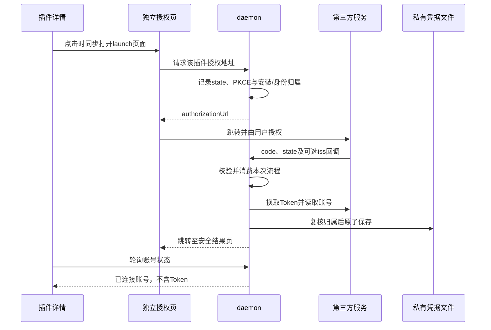

# 插件体系设计

日期：2026-11-06。模块：plugins、tools、integrations、daemon、agent-runtime、storage与Web。实现锚点：[内置清单](../../packages/plugins/src/plugins/catalog.ts)、[PluginService](../../packages/plugins/src/lifecycle/service.ts)、[插件授权](../../packages/plugins/src/auth/service.ts)、[RunCapabilities](../../packages/agent-runtime/src/capabilities/run.ts)。M4工程实现与macOS自动化验证已完成，真实账号、Office视觉和Windows验收范围仍由[M4验证](../04_FEATURES/202610201932_feature_m4-capabilities/m4-completion-verify.md)及[插件流程验证](../04_FEATURES/202610201932_feature_m4-capabilities/plugin-completion-verify.md)拥有。

## 插件是什么

插件是随应用发布的一组声明和资源，将面向同一任务的Skills、服务授权及MCP Apps组织在一个管理入口中。它不是任意JavaScript扩展或远程npm安装器，不参与替换Agent Loop，也不运行安装脚本。

服务类插件包括GitHub、Google、Vercel、Notion和Supabase；本地办公类包括Documents、PDF、Spreadsheets和Presentations。办公插件提供Skill与辅助资源，操作由工作区执行器完成，不需要伪造一个远端MCP服务。

必须区分以下状态：

| 状态              | 代表的事实                          | 不代表的事实                     |
| ----------------- | ----------------------------------- | -------------------------------- |
| 已安装            | 本地资源和精确组件引用已登记        | 第三方账号已授权                 |
| 插件或Skill已启用 | 组件可参与目录发现和选择            | Skill正文已经进入模型            |
| 插件账号已连接    | 宿主持有当前安装代与身份所属的凭据  | 所有MCP Apps都已开启或工具已就绪 |
| App已开启         | 用户允许启动该插件声明的固定MCP目标 | 本次工具调用已经批准             |
| 目录已就绪        | 发现了可供冻结的工具定义            | 模型已经加载这些工具             |
| Run内已加载       | 下一模型请求可见对应定义或Skill正文 | 可以绕过工作区或执行审批         |

## 声明、状态与代码所有者

每个插件资源目录位于`packages/plugins/src/plugins/<id>/`。`catalog.ts`拥有有限内置清单；`.app.json`同时提供公开App简介及宿主私有的传输、目标和凭据来源，不再维护第二份端点表。服务插件的`manifest.yaml`声明OAuth、API来源、账号展示字段和只读网关路径；它不保存Token或部署Secret。Skills由各自`SKILL.md`和有界相对资源组成。

| 所有者                     | 职责与状态来源                                        |
| -------------------------- | ----------------------------------------------------- |
| plugins/plugins            | 声明、贡献索引、随包资源和只读预览                    |
| plugins/lifecycle          | 安装、开关、启动对账、更新、卸载与资源归属            |
| plugins/auth、gateway      | 插件账号授权、刷新、撤销和只读网关规则                |
| integrations/oauth         | 插件和高级账户复用的授权码、PKCE、Token交换及刷新机制 |
| tools/skills               | 通用Skill解析、发现、安装、不可变版本与资源租约       |
| daemon                     | HTTP与回调、身份配置、存储/Skill/MCP适配和应用装配    |
| agent-runtime/capabilities | 接受时冻结选择、请求前加载及Skill指令连续性           |
| storage                    | SQLite组件配置、私有凭据文件、JSONL接受与执行事实     |
| Web                        | Query展示宿主事实，页面层级与未提交选择               |

插件详情按“市场 → 插件 → Skill正文”进入下一级；已安装详情读取安装副本，未安装详情读取随包预览，避免界面展示新版正文而Agent仍读取旧副本。默认服务连接只有授权与连接状态，不需要用户添加账户或手动绑定；高级手动Connections保持独立用途。

## 安装、更新与卸载

安装先在profile专属暂存目录读取和校验资源，创建所属App配置，再原子发布目录并登记独立安装`generation`。每个Skill与App都记录稳定组件ID和实际`referenceId`，不能用用户可修改的名称查找或删除MCP配置。安装完成默认启用Skills，App保持关闭；失败清理本次创建的配置和暂存内容，不触碰用户或其他插件资源。

整体开关控制全部组件；单项开启会激活插件，最后一个组件关闭后插件停用。配置操作使用`revision`防止旧页面覆盖新状态。开启App是用户对已安装固定目标的明确动作，由MCP所有者核对组件、目标和身份后授予启动信任，再调度后台发现；接口返回不等待上游目录就绪。

启动在接受Run和远端目录预热之前执行[synchronize](../../packages/plugins/src/lifecycle/service.ts)，核对Skill内容与资源hash、组件引用和官方App目标。未变化的安装不递增revision；更新保留同名组件开关和账号凭据，不处理用户或项目Skill。对账不会恢复已撤销的启动信任，缺失或失效配置需要用户重新开启App。

[资源更新](../../packages/plugins/src/lifecycle/sync.ts)先拒绝活动Skill租约，暂时停用插件，交换目录后发布配置；普通失败回滚并推进revision。文件目录与SQLite不是一个全局事务，硬退出可能留下停用状态或隐藏备份，不能宣称自动恢复全部偏好。卸载同样先检查活动资源，撤销当前安装代授权，再按精确引用删除所属App和目录。插件管理操作由服务追踪，关闭时拒绝新操作并等待在途清理。

## 插件OAuth

浏览器授权流程如下，桌面窗口的差异是通过一次性启动ticket在系统浏览器打开同一个启动页：

通用授权码与刷新机制由integrations/oauth统一实现；plugins/auth保留账号展示解析策略和插件归属，高级账户保留独立权限与凭据记录。供应商端点由插件manifest单独声明，高级账户复用端点并保留自身scope及客户端认证策略。

客户端信息从manifest和daemon专用`MY_PI_HARNESS_SKILL_*`配置解析，不接受页面填写，不回退应用登录Client。GitHub使用授权码与PKCE；各供应商的认证格式、PKCE、scope和账号来源由各自manifest声明，不能将GitHub的参数硬套给所有插件。发行者使用明确的`oauth.issuer`，不能从授权端点截断推测。环境变量、回调和HTTP定义见[插件授权协议](../03_API/plugin-connections.md)。

state和PKCE verifier只在宿主内存保存十分钟，绑定插件安装generation、profile用户、身份epoch及当前流程，一次性消费。重新开始、断开、卸载或关闭会取消所属工作；旧授权回调不能恢复已被撤销或重新安装的插件。授权码交换及账号读取有明确截止和取消，失败只返回固定阶段诊断，不输出供应商正文或Secret。

凭据由[PluginCredentialStore](../../packages/storage/src/credentials/plugin-credentials.ts)独占写入profile的`skill-credentials.json`，采用0600和原子替换；不进入SQLite、会话日志、HTTP DTO或模型上下文。每份凭据保存安装代与身份归属，和应用登录、Provider认证及高级手动账户分别管理。

到期前六十秒按插件单飞刷新，明确失效的refresh grant清除对应旧凭据；临时上游失败不伪装为未授权。刷新发布前重新核对原凭据和归属，不能覆盖或删除后完成的新授权。授权变化使所属旧MCP目录和连接失效，仅重新调度已开启的Apps；账号已连接和工具已就绪分别展示。

## Skills、网关与MCP如何协作

[SkillsService](../../apps/daemon/src/skills/service.ts)只扫描注册的profile、项目和已安装插件目录。启用且未被更高优先级遮蔽的元数据在接受时成为SkillCandidate，包含预期内容和来源/授权代次，不创建正文快照或活动租约。模型从摘要目录选ID并调用`load_skill({id})`，宿主校验原候选再加载；picker及`$skill-name`仍可显式冻结正文。实际激活的正文和资源保存为不可变快照，活动Run持有租约；新磁盘正文不改写旧Run，停用、同内容重装及授权变化不能复活原绑定。

激活正文跨本分支后续Run和上下文压缩保留，每次请求从冻结版本重建。继承时失效的Skill被省略并写入安全诊断，新的显式选择仍严格校验。附加资源索引非空时直接提供受限reader，不要求模型搜索已知入口。`allowed-tools`只表达需求，只能预选本Run已有的本地工作区候选，不能按任意名称取得MCP权限。Skill没有独立grant/revoke流程；真实执行权限与资源读取规则由[运行时能力协议](../03_API/capability-runtime.md)拥有。

服务Skill冻结时额外记录公开`gatewayUrl`，同时进入接受事实和实际system上下文，不修改磁盘正文/hash。会话级`web_fetch`的raw GET模式无需工作区；宿主仅对精确daemon origin及所属网关路径附加内部能力头，模型不能提供认证头。普通应用Cookie不能调用网关，内部能力不写入Skill或Run日志。

[只读网关](../../packages/plugins/src/gateway.ts)核对manifest的固定上游、允许路径和查询，附加插件Token后读取有界响应，禁止重定向；仅声明的查询端点可转换为受限POST。它不提供任意REST写入。需要写操作或更完整工具能力时，使用单独开启的MCP App，继续执行逐次工具审批。

GitHub与Google Apps声明`plugin-oauth`，按精确插件、组件和官方目标读取同一份Token，不复制到Server配置。声明`mcp-oauth`的App使用MCP自身授权，区别见[MCP连接设计](MCP连接设计.md)。高级手动Connections同样保留独立凭据归属，默认插件流程没有手动账户绑定、固定REST操作目录或逐Run服务grant。

模型调用`tool_search`时检索本Run获准的原生及MCP候选，精确名字优先，词法与可选本地语义结果融合；新增命中自动暂存，已可用项明确返回且不重复激活。新定义、来源和Skill正文先随`run.tools_loaded`持久化，再用于下一Pi请求、预算与执行；同一assistant不能调用尚未提供的工具。动态工具在Run内保留，结束后新Run重选；Skill正文的有效历史继承与工具激活是两种生命周期。

## 本地办公与当前边界

Documents、PDF、Spreadsheets和Presentations的Skill组织本地CLI、格式检查及视觉复验，资源由精确hash冻结并物化到profile外只读目录。模型通过通用命令和读取工具执行流程，经publish_artifact注册不可变字节后按artifact ID下载。共享资源清单、命令拥有者、依赖准备及产物机制见[工具体系与沙箱](工具体系与沙箱.md)。

插件资源不会自动执行其中脚本；模型若通过Shell调用参考脚本，仍经过原执行策略。插件授权不等于应用登录，不赋予工作区外文件权限；目录预热不等于工具执行，unknown不等于操作回滚。调用与恢复语义统一见[MCP连接](MCP连接设计.md)、[工作区与执行](工作区与执行设计.md)及[会话存储](会话存储与恢复设计.md)。
