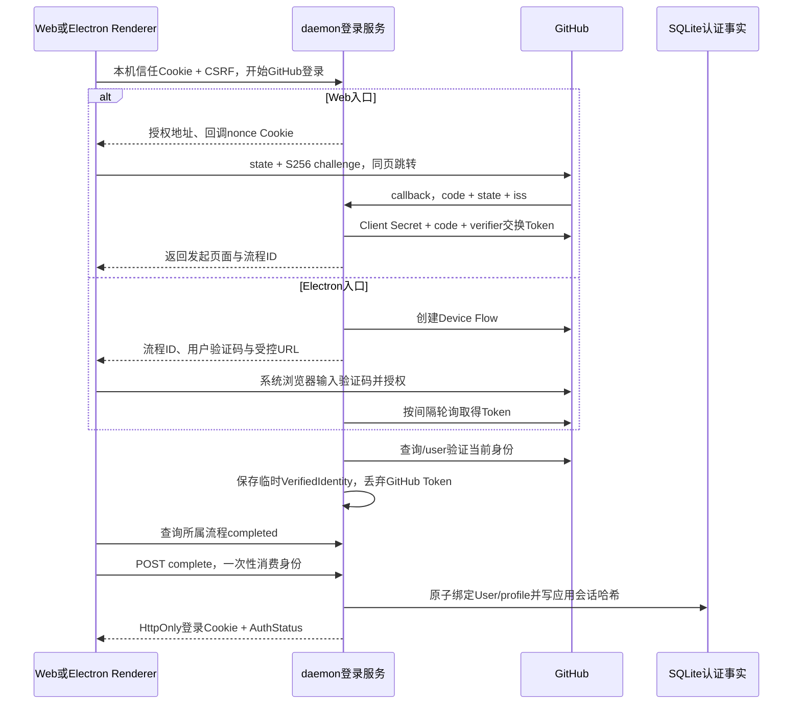

# 用户身份与本地登录设计

**日期**：2026-10-16

**模块**：daemon/auth、storage/auth、Web登录状态与Electron授权适配

**实现锚点**：`IdentityProvider`、`LoginService`、`LocalAuth`、`AuthRepository`、`useAuthorization`

**状态**：已实现；自动化、原生平台与真实账号的验证范围以[专项验收](../04_FEATURES/202610161500_feature_application-login/verify.md)为准。

---

## 要解决什么问题

本机服务需要回答两个不同的问题：当前浏览器是否获准连接这个daemon，以及当前用户是否已经通过应用登录。桌面父进程可以证明自己拥有启动链，配对码可以授予另一个浏览器访问资格，但二者都不能证明GitHub身份。只有头像或昵称也不能组成可恢复、可撤销的登录。

同时，GitHub只是首个身份来源。内部用户不能以GitHub用户名作为主键；模型Provider与外部工具的Token也不能被当作应用登录。系统采用内部User、外部身份关联和独立应用会话，并将本机客户端信任保留为额外条件。

## 一、状态与所有者

| 对象                              | 所有者                     | 保存与有效性                                                     |
| --------------------------------- | -------------------------- | ---------------------------------------------------------------- |
| IdentityProvider                  | daemon适配器               | 解释上游协议，返回已验证的provider/issuer/subject与展示资料      |
| LoginFlow                         | LoginService               | 内存、限时、绑定clientId；仅用户码公开，身份验证完成也不自动登录 |
| User/ExternalIdentity/profile归属 | AuthRepository             | SQLite独立事实；不进入会话投影重建                               |
| 本机客户端                        | AuthRepository + LocalAuth | SQLite保存信任token哈希、CSRF、绝对期限；Cookie持有原始token     |
| AuthSession                       | AuthRepository + LocalAuth | SQLite保存登录token哈希、User/clientId/期限；Cookie持有原始token |
| 页面登录快照                      | useAuthorization           | Query服务器快照；不将bearer或身份事实写入浏览器持久状态          |

会话JSONL仍只拥有Agent会话执行事实；认证配置不因重建会话投影丢失。Cookie本身不是数据库事实，只有哈希、所属客户端、用户与期限全部匹配时才有效。公开会话ID不具备bearer权限。

## 二、从GitHub身份到应用会话

首版保持纯本地部署，Web授权码与桌面Device Flow共享内部身份和应用会话。网页授权URL显式设置 `prompt=select_account`，让GitHub展示账号选择；账号选择不改变当前profile归属约束。仓库根`.env`拥有开发配置，daemon加载它，显式进程环境优先；Web的Client Secret只用于daemon侧授权码交换。桌面打包以白名单提取公开Client ID生成`desktop-oauth.env`，不复制根配置或分发Secret。登录方式在Provider的methods中声明可用性，缺少Web配置明确拒绝，不自动降级。

Web临时流程保存state、S256 verifier、callback nonce哈希和发起页面origin；回调专用短命Lax Cookie允许从GitHub返回时关联流程，不开放Strict业务Cookie。callback一次性消费校验信息，验证身份后回到原页面，再由同源POST complete创建应用Cookie。回调地址只允许与发起页面同hostname的本机回环端点，端口可不同；显式重开Web授权取消旧Web流程，使返回/刷新后可以重新登录。查询参数不写请求日志；错误来源、错配、重放和晚到取消不会改变应用登录。

授权服务器标识与外部身份issuer分别管理。Web挑战中的 `authorizationIssuer` 供回调校验，GitHub固定为 `https://github.com/login/oauth`；响应含 `iss` 时必须精确匹配后才兑换授权码，缺省则继续当前流程的state/nonce/PKCE检查。持久GitHub身份issuer仍为 `https://github.com`，不因OAuth端点路径改变账号归属。OAuth规范允许响应扩展，因此只在这个查询入口忽略未知字段，已知字段仍校验类型、长度及重复值。

GitHub适配器以稳定数值ID作为subject，用户名和姓名只用于展示。验证接口使用固定HTTPS目的地、拒绝重定向，响应大小与时间有界；用户码与私有device_code分开。pending继续轮询，slow_down增加间隔，拒绝、超时或取消结束验证。GitHub Token仅用于本次身份查询，不写业务库或作为仓库工具授权复用。

## 三、单profile归属与身份扩展

首次完成登录在同一SQLite事务内创建User、关联ExternalIdentity、写profile归属并签发AuthSession。网络身份查询在事务外完成。事务失败不留下部分绑定；并发首次登录由profile独占与SQLite事务串行处理。

当前profile已有User时，仅允许外部provider/issuer/subject准确关联该User。资料更名更新展示信息，内部userId保持稳定。另一账号被拒绝，不能通过相同昵称或邮箱继承。现有本机业务数据由首次绑定账号使用，不逐表复制或移动工作区文件。

未来增加登录方式时，适配器返回同一VerifiedIdentity接口；账号绑定必须在已登录用户内显式验证，再添加关联。目前没有自动合并、解绑、转移profile或多用户隔离功能，不能把注册另一个Provider等同于允许任意账号读取已有数据。

## 四、本机信任与统一鉴权

桌面main持有私有启动secret，通过bootstrap建立或复用本机客户端；普通浏览器通过一次性配对码建立自己的客户端。本机资格只允许进入登录流程。所有业务API由daemon检查应用会话，前端路由和组件卸载只负责呈现。

应用会话还绑定原本机clientId，复制其中一份Cookie不能与另一个客户端混用。写入继续校验准确Origin与CSRF，读取也检查实际Host和已有Origin。公开例外只包括脱敏进程状态及必要授权端点，附件下载、模型OAuth和私有SSE不会因属于只读路径而跳过登录。

Electron每次打开授权页面都读取当前Renderer的两份Cookie，通过流程ID向daemon查询所属授权URL。它不缓存最初的bootstrapCookie用于后续模型OAuth，也不接受Renderer传入任意外链。桌面启动复用仍有效的本机客户端，不签发应用登录或覆盖其Cookie。

## 五、持久恢复、撤销与在途工作

有效应用会话只检查本地记录与期限，因此网络不可用时可恢复；它不表示GitHub侧权限仍有效，也不持续检查上游撤销。绝对期限不因GET或应用重启延长。临时登录流程不持久化，重启后重新授权。

退出先同步撤销当前客户端全部应用会话，然后中止其在途登录并等待任务收束。临时流程与活动任务分别跟踪，过期目录项被清理也不能丢失关闭时应等待的任务。验证完成和身份消费均检查取消与期限，迟到结果不能恢复已撤销会话。一次性完成不可盲目重试；页面先读取实际登录状态，再让用户明确选择恢复或重新登录。

私有SSE注册撤销观察与到期计时器，退出立即结束，正常关闭注销观察与计时器；daemon关闭也主动释放它们。页面在401、到期或重新检查确认未登录时，取消并删除私有Query、重置附件和会话草稿，再回到登录界面。单纯网络失败保持已有有效身份下的离线视图，不能被误判为退出。

Renderer的授权所有者统一管理状态读取与发布代际。退出或撤销先使旧读取失效并取消其请求，写入Query和发布已授权状态前核对代际，已取消的状态读取不能安装CSRF；退出进行中禁止被动检查重新放行私有页面。显式重连、配对和登录完成经过同一所有者，新登录可以建立新代际。私有缓存清理复用真实查询key，保留应用授权及公开健康诊断，不将其他runtime数据一并视为公共。

已接受的后台Run归daemon而非页面登录会话，退出不自动取消或重执行。用户重新登录后继续查看或处理审批；未登录期间不能读结果或发送响应。其他客户端会话不随本客户端退出而失效。

## 六、模块与边界

| 位置                                                 | 维护重点                                              |
| ---------------------------------------------------- | ----------------------------------------------------- |
| `apps/daemon/src/features/auth/identity-provider.ts` | 上游身份适配接口                                      |
| `apps/daemon/src/features/auth/github-provider.ts`   | GitHub授权码/PKCE与Device Flow、网络限制、稳定subject |
| `apps/daemon/src/features/auth/login-service.ts`     | 流程归属、一次性消费、取消和任务收束                  |
| `apps/daemon/src/features/auth/local-auth.ts`        | Cookie、客户端、应用会话、CSRF及撤销观察              |
| `packages/storage/src/auth.ts`                       | 身份/归属/登录事务与持久查询                          |
| `apps/web/src/features/auth/`                        | 登录呈现、恢复、私有缓存清理                          |
| `apps/desktop/src/main/authorization.ts`             | 桌面Cookie复用与系统浏览器授权                        |

HTTP字段、Cookie期限和错误语义由[应用登录协议](../03_API/application-auth.md)拥有；配置和用户操作见[登录指南](../07_USER_GUIDE/application-login.md)。M4中的MCP与GitHub服务连接将使用独立的授权与凭据机制，当前应用身份不授予这些能力。
