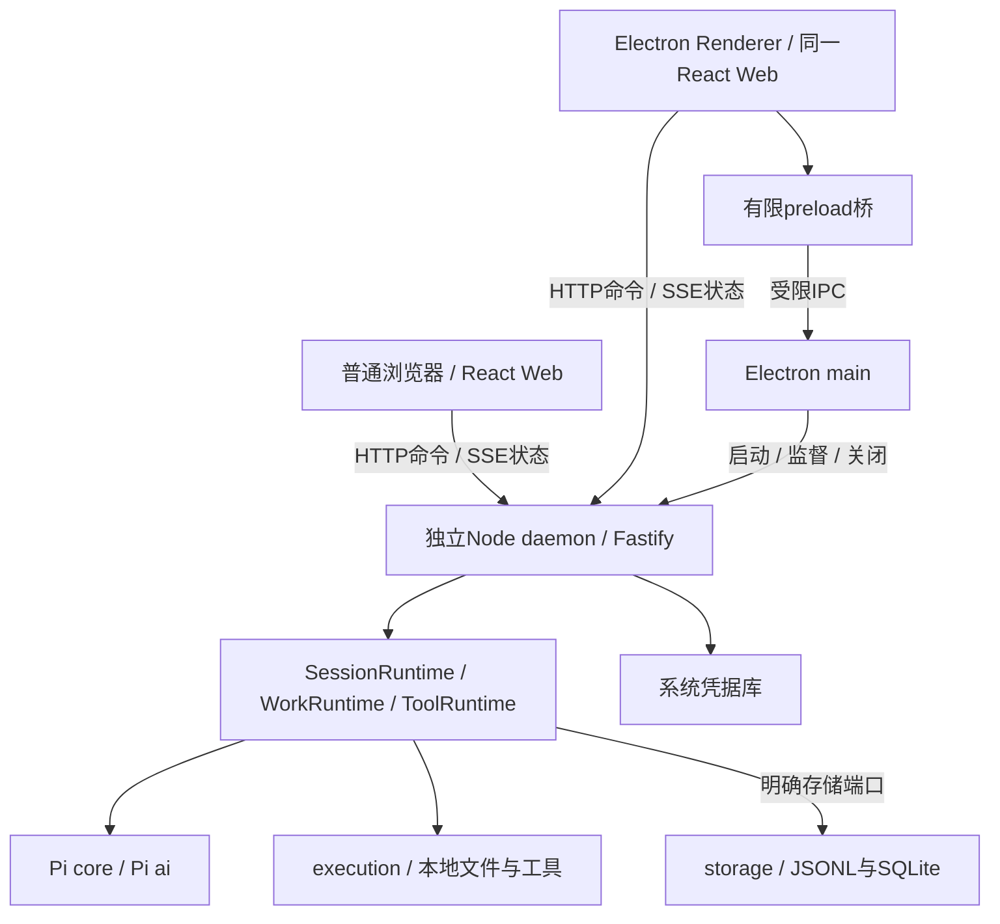
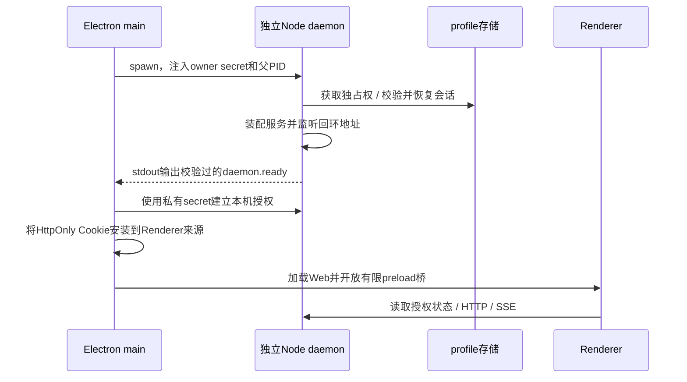

# 本地Agent系统架构设计

**日期**：2026-10-16

**模块**：`apps/web`、`apps/desktop`、`apps/daemon`及共享packages

**实现锚点**：`DesktopApplication`、`createApplicationServices`、`SessionRuntime`、`useSession`

**状态**：M1–M3已实现，macOS本机自动化通过；体验和平台验收见[roadmap](../00_OVERVIEW/roadmap.md)

---

## 要解决什么问题

一个运行在用户电脑上的Agent，需要同时接入模型、读取本地资料、执行命令和保存长期会话。浏览器页面与Electron窗口都要能够操作同一套业务，但页面刷新、网络断开和窗口关闭分别具有不同含义。

这带来三个核心问题：

1. **特权放在哪里**：文件、凭据和模型执行需要宿主权限，界面代码不应直接获得这些权限。
2. **谁拥有执行状态**：Agent任务可能长于一次HTTP请求，不能由组件或SSE连接的生命周期决定任务生死。
3. **发生失败后相信什么**：内存、浏览器缓存和SQLite都可能丢失或落后，需要明确持久事实、查询投影与页面状态的关系。

**核心思路**：Web统一呈现，Electron管理桌面能力和所属进程，独立Node daemon拥有业务资源。命令经HTTP提交，提交后的状态经SSE同步；会话执行事实先写JSONL，再更新SQLite查询投影。

---

## 一、整体架构



这里有两条通信通路：业务命令使用HTTP/SSE；本机目录选择等桌面能力使用有限IPC。消息发送不需要经过main转发，Agent也不运行在preload里。

Electron内置Node负责桌面壳；daemon使用独立Node。这样Pi、SQLite原生模块和工具适配器的运行环境可以独立于Electron ABI管理，代价是发布时必须装配Node、daemon及其生产依赖，并监督额外进程。

仓库目录、依赖方向、启动参数和技术栈的权威列表见[架构](../01_ARCHITECTURE/overview.md)，本篇关注这些模块如何组成运行中的应用。

## 二、进程与资源归属

| 所有者         | 持有的资源                                          | 结束条件                                          |
| -------------- | --------------------------------------------------- | ------------------------------------------------- |
| Electron main  | 窗口、目录对话框、所属daemon子进程                  | 应用退出或启动失败，等待所属资源回收              |
| daemon         | profile独占权、HTTP/SSE、运行时、数据库与凭据适配器 | 显式关闭、所有者失联或进程终止                    |
| SessionRuntime | 活跃Run、Session内串行操作、已提交事件订阅          | 实例存活daemon；Run终态清理活跃项，订阅由连接清理 |
| ToolRuntime    | 工具装配及当前等待审批的调用                        | 实例存活daemon；等待项按调用/Run结算移除          |
| 页面订阅       | EventSource、定时刷新、Query缓存和草稿              | 页面卸载、切换会话或授权失效                      |

普通浏览器连接一个已经启动的daemon，不拥有该进程。Electron拥有自己启动的daemon，因此桌面退出会请求它停止；关闭某条SSE连接只清理该连接，不取消Run。

`createApplicationServices`先获取profile所有权并恢复存储，再装配Gateway、工作区、WorkRuntime、附件、工具和SessionRuntime。启动没有完成时不会先接受业务请求。

关闭操作共享幂等结果。服务先结束工作等待与附件解析，再关闭运行时、模型授权和存储；单项清理失败仍尝试其余清理，最后报告错误。

## 三、桌面启动与本机授权



`daemon.ready`只表达服务身份和实际监听地址，不携带秘密。桌面secret只走main到daemon的私有启动链，Renderer得到Cookie授权，不获得secret。

普通浏览器通过一次性配对码获得本机客户端Cookie。它和桌面启动授权仅授予本机信任；GitHub验证身份后另行签发绑定客户端的持久应用Cookie，业务HTTP/SSE同时要求两者。HTTP写请求还需要当前本机客户端的CSRF token。身份归属、期限、恢复和撤销见[用户身份与登录](用户身份与登录设计.md)。模型API Key和OAuth Token由daemon的凭据适配器管理，公开Provider DTO只返回认证状态和允许的掩码。

健康检查和`runtime.ready`用于确认页面连接的是哪一个daemon实例；它们不授予会话读取或工具执行权限。业务路由仍检查来源、Cookie及写请求的CSRF。

桌面窗口启用context isolation和sandbox，关闭Node integration。main逐次校验IPC来自指定窗口、主frame和受信来源，不提供任意channel、任意URL或Shell接口。

## 四、一次输入的完整数据流

```text
用户输入或附件
  → Web冻结本次发送意图与requestId
  → HTTP schema / 来源 / 授权校验
  → SessionRuntime按Session串行处理命令
  → 创建或继续Run，冻结模型和执行策略
  → Pi开始模型与工具循环
  → 每次模型请求前重建有效上下文
  → 工具按当前Run策略审批并执行
  → storage验证完整事件批
  → JSONL写入并fsync
  → SQLite投影提交
  → runtime发布已提交通知
  → SSE发送初始SessionSnapshot及后续增量批次
  → Query按snapshotSeq合并，页面重新呈现
```

HTTP输入返回可观察的会话快照，表示输入已被接受，不代表模型已经完成。文本增量、工具状态、等待问题和终态由后续提交推进。

`requestId`让同一会话的输入重试能够识别已接受请求。网络超时只说明页面没有拿到结果，不能推断后台未执行；页面保留待确认输入，不自动换ID再次运行。新建Session阶段的结果未知也单独保留状态，不宣称所有创建操作都有跨请求幂等保证。

Agent循环和同Run交互见[Agent运行时](Agent-Runtime.md)，每请求投影见[上下文管理](上下文管理设计.md)，持久提交见[会话存储](会话存储与恢复设计.md)。

## 五、前端状态与SSE同步

### 5.1 每类状态只有一个业务所有者

| 状态                         | 权威来源                  | 前端保存方式                       |
| ---------------------------- | ------------------------- | ---------------------------------- |
| 消息、Run、分支、队列        | daemon公开SessionSnapshot | TanStack Query缓存                 |
| 计划、任务、摘要版本         | 分支WorkSnapshot          | 按Session/分支缓存的Query          |
| 工作区和Provider配置         | daemon持久配置            | Query缓存                          |
| 当前选中项、弹窗、未提交草稿 | 页面交互                  | Zustand或局部Hook                  |
| 活跃模型请求、审批等待       | daemon内存及已提交记录    | 展示公开状态，不建立第二个执行实例 |

Zustand不复制一份可写的消息历史。页面导航与草稿当前属于易失状态，不能把它们描述为跨刷新恢复最后激活会话的持久索引。

### 5.2 HTTP与SSE共享单调快照

已登录界面先校验健康响应中的协议版本，成功才挂载工作台；健康Query按协议版本区分缓存。前端热更新不会重载独立daemon，版本不一致时阻止继续发送并提示重启，不能让HTTP接受输入后静默忽略旧版SSE。

服务端先订阅Session提交通知，再同步读取已提交快照，避免订阅和首次读取之间漏变化。`session.update`以snapshot建立基线，后续patch声明baseSeq和snapshotSeq，仅传变化的消息、工具及其他公开状态；正文/思考的追加携带增量文本，非追加内容显式替换。分支变化或增量超界使用完整快照校准，客户端不重放私有执行事实。

`useSession`把HTTP读取和SSE结果交给同一个缓存合并函数：

```text
不同Session → 拒绝合并
incoming.snapshotSeq <= current.snapshotSeq → 保留current
更新序号 → 合并结构共享后的incoming
```

patch必须接续当前流基线，重复或过期更新忽略，缺口关闭当前连接并重建快照。流状态与HTTP查询缓存分别保持单调，HTTP较新响应不能使后续合法流patch丢失；未变化对象继续结构共享。SSE和页面各自短时间批合并；工作状态Query另外刷新，不能把一次文本更新误当作WorkSnapshot已经同步。

### 5.3 断线、刷新与切换

| 场景                  | 当前处理                                                                  |
| --------------------- | ------------------------------------------------------------------------- |
| EventSource断线       | 浏览器原生重连并检查授权，新连接以完整基线恢复状态                        |
| SSE打开后没有基线     | 按[协议](../03_API/model-session.md#事件快照与断线)超时重连，显示同步错误 |
| 重建订阅且缓存仍在    | 保留单调Query缓存，新连接重新接收完整基线                                 |
| 原EventSource自动重连 | 连接重新建立完整基线，后续patch从该基线接续                               |
| 刷新后缓存丢失        | 重新读取Session并建立订阅，不相信旧页面内存                               |
| 切换会话              | 关闭旧连接、清理定时器并丢弃未发布批次，保留已提交缓存                    |
| daemon重启            | 有效本机/登录Cookie恢复，从持久化历史恢复展示，不自动重跑模型             |

当前订阅不依赖浏览器的Last-Event-ID恢复增量；每条新连接都从权威快照开始。因此断线期间无需在前端猜测遗漏的delta，单调缓存也阻止较旧结果覆盖新状态。

SSE没有调用Agent的abort权限。用户显式停止才进入Run取消流程；刷新和切换页面不会隐式停止后台任务。

时间线根据当前activeRunId派生临时等待行，覆盖助手首段内容到达前及工具结束后的间隙。已有streaming助手、执行中工具或审批接替等待；Run结束后移除。该行不写JSONL或SQLite，不冒充助手消息，刷新后从当前运行事实重新计算。

### 5.4 原文事实与Markdown展示

Query中的消息仍是后端提交的原始正文和思考；Markdown语法树、未完成语法补全和高亮结果只属于展示，不写回JSONL、SQLite或用户输入。用户输入采用纯文本气泡，助手正文和思考复用共享Markdown组件；工具参数、Diff与结果保持精确原文，审批状态独立呈现。

共享组件基于Streamdown的分块缓存和未完成语法容错，生成结束后切换完整静态渲染。官方CJK插件通过稳定的plugins配置接入，处理中文引号/标点相邻的强调和裸链接边界；插件顺序由Streamdown协调，不改写持久原文，代码和转义文本保持字面内容。库仍会扫描累计文本，不能将其描述为仅解析新增字符的持久增量AST。代码高亮由Shiki的JavaScript引擎按需加载，未闭合围栏、未知语言、超过20000字符或400行的代码保留纯文本；失败同样保留阅读和复制。高亮输出映射为语义CSS类，不执行模型HTML或生成内联颜色样式。

消息列表使用TanStack Virtual，消息、工具、等待行与回答操作栏按稳定业务ID作为key。只挂载当前视区与overscan 5内的条目，容器通过containerRef、行通过measureElement注册，使用库默认动态测高；directDomUpdates由虚拟库更新数值height与transform，anchorTo:end提供底部锚定。应用不自管虚拟总高或行位置，不写JSX style，也不放宽CSP。稳定消息和工具组件通过memo复用，Streamdown继续复用稳定内容块，SSE增量合批仍由订阅层负责。虚拟化减少已挂载DOM，完整公开快照仍由Query持有，历史分页按实际需要后续评估。

时间线Hook协调虚拟测高、视口变化和底部跟随。跟随开启时写入scrollTop=scrollHeight，记录浏览器接受的位置；useLayoutEffect同步初始布局与条目提交，ResizeObserver观察内容和视口尺寸。用户上滑后暂停，滚回底部或点击“回到最新消息”恢复。历史条目在滚入视区时挂载并测量，首尾均可访问；卸载时清理观察资源。真实行高与滚动量化仍有浏览器和缩放边界，采样端点稳定不能证明所有实际呈现帧无抖动，具体证据见[专项验证](../04_FEATURES/202610191647_feature_conversation-rendering/verify.md)。

Markdown固定排版长度使用整数px：正文16/28px，H1至H6的字号/行高分别为28/40、24/36、20/32、18/28、16/28、16/28px，代码正文与表格14/24px。块间距由本地CSS拥有，Streamdown根使用space-y-0避免默认spacing与本地规则竞争；松散列表的li > p保持block，保留独立段落。Tailwind通过`@source '../../node_modules/streamdown/dist/*.js'`生成Streamdown使用的utility。

一次回答由当前分支消息序列中的相邻用户输入划分，同一Run可包含多个回答。工具前后助手正文分别保留持久消息与工具锚点，展示层将各次回答的正文复制和统计聚合到末尾；操作栏锚定本组最后一条助手消息，在其全部工具之后插入独立虚拟条目，使用输入消息ID作为稳定key。空final、停止和失败后的部分正文沿用该收尾位置，生成及工具等待期间不提前展示最终操作栏。复制按序连接非空助手正文，保留Markdown，排除思考、工具结果和其他输入；用户/代码块复制仍由各自组件拥有。

输入框下方常驻占比与总对话次数，工作状态Query提供上下文估算，当前分支快照中的用户消息数提供次数，未消费队列不计数。上下文文字打开工作Dialog，人工提问和计划审核继续在输入框上方展示，运行中输入默认follow-up排队。

Streamdown的公开components接口承载安全链接、图片引用及代码/表格行为。rehype插件列表从defaultRehypePlugins仅过滤raw，保留sanitize和harden；同时保留skipHtml与受限HTTP(S)地址处理，列表使用模块级稳定引用。原始HTML解析关闭，默认清洗与自定义URL限制共同保护展示内容。

表格和代码局部滚动。图片引用展示替代文字和链接，附件走原有授权预览。外链只接受绝对HTTP(S)，桌面经独立受限桥打开；工作区文件操作不由Markdown地址隐式授权。

工具默认只呈现图标、名称与单行摘要，展开后显示原始参数、差异、结果与审批审计。工具图标和箭头共享同一位置，hover/键盘焦点只改变展示；待批准内容不能被折叠隐藏。正文、工具与输入区共用896px内容列，工具展开和折叠参与所属虚拟行的重新测量。

### 5.5 每次回答的统计

统计以持久消息序列中的一次用户输入划分，而非以Run划分：排队输入可以在同一Run中继续，直接累计Run会混入多个问题。每个助手模型步骤记录供应商用量和完成时间，字段及缺失语义由[会话协议](../03_API/model-session.md#事件快照与断线)拥有。Web累计本次输入后的步骤，仅在最后有正文的完成回答下显示统计；中间工具轮保留用量但不增加重复统计行。

每次回答从本次用户消息时间开始计时。当前分支最后一轮以终态Run的结束时间结算，包含最后一次工具执行或审批等待；同Run更早的排队回答及继承分支使用各自助手完成时间，避免混入其他问题或原分支隐藏尾部。当前仍运行的末回答不提前展示最终结果，历史记录只使用已有事实。显示口径与缺失提示见[阅读与消息操作](../07_USER_GUIDE/model-session.md#阅读与消息操作)，不会为展示重新请求模型或改写旧日志。

## 六、失败处理与恢复

| 失败               | 处理原则                               | 用户可依赖的结果                                 |
| ------------------ | -------------------------------------- | ------------------------------------------------ |
| schema或来源不合法 | 进入业务前拒绝                         | 不创建对应副作用                                 |
| 授权失效           | 清理传输层CSRF并回到授权流程           | 按实际失效项重新登录或配对，不使用旧秘密继续     |
| 慢SSE客户端        | 记录超限或背压时断开连接               | 不阻塞模型和持久化，可重新读取快照               |
| 存储提交失败       | 冻结后续写入并停止相关执行             | 结果需重启校验，不能无条件重试工具               |
| daemon异常退出     | 下次启动校验JSONL并重建投影            | 已提交历史保留；遗留Run标记interrupted           |
| main退出或IPC失联  | daemon接收关闭请求，父进程监测提供补充 | 所属服务和工具进入清理，不将进程遗留作为正常状态 |

JSONL与SQLite的跨资源提交不具备一个共同的原子事务。日志先成功而投影失败时，不能将这段历史当成未发生；下次恢复按日志重建投影，并且不重执行外部副作用。细节由[存储设计](会话存储与恢复设计.md)解释。

## 七、源码与发布运行

```text
开发：
  Vite托管Web → 同源/api代理 → 独立Node源码daemon
  Electron可加载同一Web入口，并拥有自己的daemon启动链

发布：
  Electron资源
    ├─ 独立Node
    ├─ 编译后的daemon + 生产依赖
    └─ 编译后的Web
  daemon动态监听 → 托管Web → Electron加载实际地址
```

开发和发布共用业务协议，发布不依赖Vite或源码路径别名。独立Node还需要与随包SQLite原生依赖一起验证，开发workspace能解析依赖不能证明发布资源完整。

profile数据库目录、会话JSONL根与Agent工作区是三类目录：应用配置/查询索引、会话执行历史、用户文件操作范围。它们不因名字相似自动合并；具体路径及安装包覆盖要求见[架构启动配置](../01_ARCHITECTURE/overview.md#启动配置)和[工作区设计](工作区与执行设计.md)。

## 八、关键模块

| 模块         | 实现锚点                                                                                           | 职责                                |
| ------------ | -------------------------------------------------------------------------------------------------- | ----------------------------------- |
| 桌面生命周期 | [application.ts](../../apps/desktop/src/main/application.ts) `DesktopApplication`                  | 顺序启动、窗口和幂等停止            |
| daemon监督   | [daemon.ts](../../apps/desktop/src/main/daemon.ts) `startDaemon`                                   | 独立Node、就绪校验、授权和关闭      |
| 有限桌面权限 | [security.ts](../../apps/desktop/src/main/security.ts) `secureWindow`                              | 主frame来源、目录与授权IPC          |
| daemon入口   | [bootstrap.ts](../../apps/daemon/src/bootstrap.ts) `main`                                          | 配置、就绪记录、信号/IPC/父进程退出 |
| 业务装配     | [services.ts](../../apps/daemon/src/services.ts) `createApplicationServices`                       | 端口注入、资源归属和清理            |
| HTTP保护     | [routes.ts](../../apps/daemon/src/features/routes.ts) `registerM1Routes`                           | 来源、Cookie、CSRF及领域错误映射    |
| 会话SSE      | [sessions/routes.ts](../../apps/daemon/src/features/sessions/routes.ts) `registerSessionRoutes`    | 订阅、快照/增量与连接清理           |
| 页面订阅     | [use-session.ts](../../apps/web/src/features/sessions/hooks/use-session.ts) `useSession`           | 快照批合并、断线和Query刷新         |
| 单调缓存     | [projection.ts](../../apps/web/src/features/sessions/queries/projection.ts) `retainNewestSnapshot` | HTTP/SSE序号统一                    |

## 九、设计取舍与扩展位置

- **独立daemon**增加了进程装配与生命周期成本，使浏览器和桌面共用运行时，业务依赖不跟随窗口进程创建销毁。
- **自有DTO加HTTP/SSE**只公开产品需要的状态。Pi消息和工具对象留在宿主，不把Pi事件或AG-UI作为前后端协议直接透传。
- **完整快照同步**让页面无需重建事件投影，代价是传输和合并较大；当前批发送与背压限制控制连接成本。
- **JSONL事实与SQLite投影**支持直接核查历史和重建查询，但应用必须承担日志校验、提交顺序和失败冻结。
- **按真实职责扩展**：M4的MCP/Skill接入需要接上能力声明、工具审批、执行与持久化记录，不能只在菜单启用占位按钮；详细范围仍以roadmap为准。

## 十、验收要点与适用范围

- HTTP与SSE同时返回时，旧快照不能覆盖新状态；重放不重复执行输入或工具。
- 页面刷新、断线与显式停止有不同后果；停止/重启后的队列需要用户明确继续。
- Renderer不能读取原生数据库、模型秘密或任意IPC；普通浏览器必须先完成本机授权。
- 启动失败、重复退出和父进程失联都回收所属资源；profile不能被两个daemon同时写入。
- 构建后的daemon、浏览器和macOS桌面产物分别提供证据，不能由源码测试互相替代。

测试入口包括[会话API](../../apps/daemon/test/m1-api.test.ts)、[前端投影](../../apps/web/test/projection.test.ts)、[桌面安全](../../apps/desktop/test/security.test.ts)及[M1浏览器](../../tests/e2e/m1.spec.ts)。里程碑的实际执行记录和未验证平台见[M3验证](../04_FEATURES/202610151655_feature_m3-context-interaction/verify.md)，不在本篇维护第二份测试计数。
