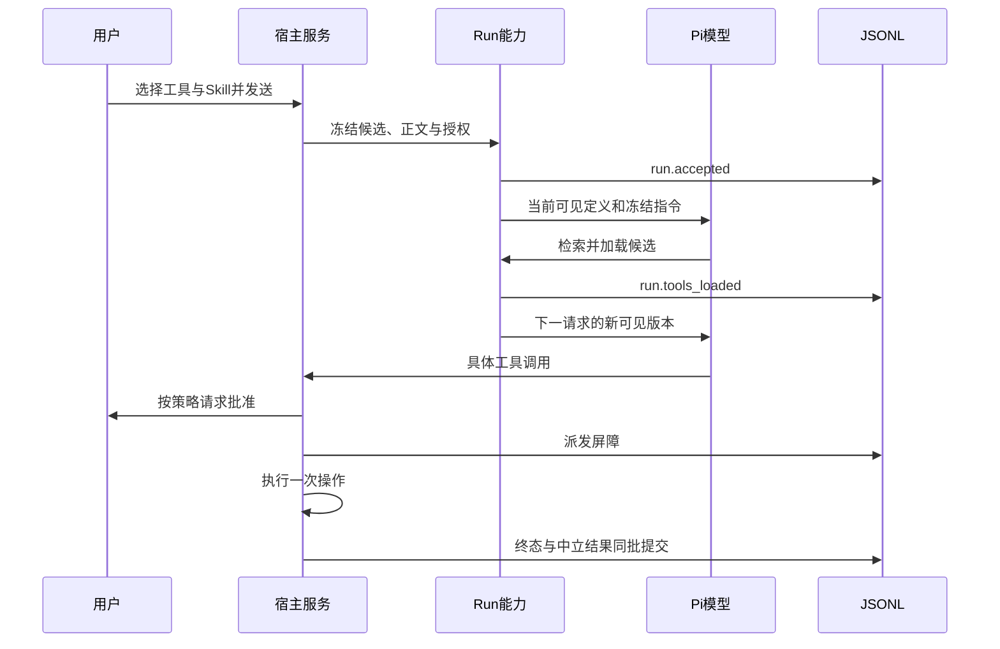

# 能力扩展与授权设计

日期：2026-10-22。模块：integrations、agent-runtime、daemon与storage。实现锚点：[RunCapabilities](../../packages/agent-runtime/src/run-capabilities.ts)、[ConnectionCapabilities](../../packages/agent-runtime/src/connection-capabilities.ts)、[宿主装配](../../apps/daemon/src/services.ts)。当前实现本地/远端MCP、Skills、内置插件和有限服务网关；具体供应商账号、Office外部依赖及平台验收由M4功能验证记录拥有。

## 要解决的问题

扩展能力有四种不同事实：用户安装了什么、连接了哪个账户、当前模型看到了哪些工具、某次具体操作是否获准。将它们合成一个“已启用”开关，会使插件安装隐式得到全账户权限、旧队列使用新配置，或模型声明与实际执行错位。

系统分别管理配置、账户、Run内可见内容和逐次工具调用。模型只接收需要的元数据及已加载定义，秘密始终留宿主；所有执行沿用统一审批和会话日志。

## 模块与状态来源

| 所有者          | 拥有的内容                                                                                  |
| --------------- | ------------------------------------------------------------------------------------------- |
| integrations    | 官方MCP协议适配、连接租约、外部schema校验、Skill文件/安装、插件manifest和固定供应商操作目录 |
| daemon服务      | MCP配置/信任/凭据引用，Skill发现和版本，插件所属组件，外部账户/OAuth和受限网关              |
| RunCapabilities | 接受时的不可变候选、当前可见工具版本、冻结Skill及资源lease                                  |
| ToolRuntime     | 参数验证、Plan与审批、派发屏障、具体执行、已知/未知结果                                     |
| storage         | SQLite配置事实、不可变资源文件和JSONL执行事实及可重建投影                                   |

插件按精确组件引用装配Skill及MCP App；卸载只清所属资源，不能按名称删除手动Server。安装默认不连接账户，也不授予Server启动信任。Google五个App可引用同一Google账户连接，凭据仍由连接服务独占。

## 从目录到执行

目录在接受时冻结，普通搜索不启动Server。初始只加载用户选择的MCP与当前内置能力；Office可由激活Skill声明或按需加载。`load_tools`和`load_skill`暂存变更，只有新可见版本持久化后才进入下一模型请求。同一assistant不能一边请求加载，一边调用尚未出现的工具。

WorkContext每次从当前版本重建工具声明、预算和冻结Skill指令，`context.prepared`记录实际输入及capabilityRevision。压缩保留Skill正文，不用摘要替代；新磁盘版本不会改写旧Run。队列保留原输入授权，消费前再次验证，失效则保留消息。

## 连接与有限服务权限

应用登录、模型供应商授权和插件服务连接相互独立。ConnectionService使用单独系统凭据引用保存Token与刷新Token；模型、Shell、通用页面状态和会话导出不接收这些秘密。

激活的服务Skill通过`request_service_access`申请有限操作。用户确认后，grant绑定Run、Skill版本/插件epoch、具体账户、配置revision/访问epoch、操作列表及期限。随后只提供这些操作的schema，并以连接ID派生独立工具名，多个同类账户不会同名错路由。每次具体请求仍受Plan、逐次审批和参数校验约束。

网关目录固定供应商、HTTP方法和路径构造，模型不能传任意URL、认证头或执行代码来获取凭据。宿主在实际请求前验证grant并临时附加Token。MCP App共享连接时只允许对应官方端点；断开账户推进epoch并回收关联wire，旧绑定不能因重新连接而复活。

## 失败与资源回收

外部调用在首次可能发送前持久化派发屏障。已派发后中断且没有可靠结果时保存unknown，停止Run并保留队列；HTTP错误响应是已知失败，不代表副作用回滚。终态与模型中立结果同批提交，不能先公开成功再补日志。

Skill安装先暂存、校验和同步文件，再原子发布并登记；资源按版本/hash保存，活动Run持有lease。服务关闭先拒绝新安装/连接/调用，再取消并等待所属请求和进程，最后关闭存储。Run结束释放Skill资源及服务grant。重建JSONL不恢复上游连接或自动重做操作。

## 当前边界

内置插件是独立编写的有限manifest和资源，不执行远程npm包生命周期脚本，也没有任意JS插件加载器。Resources/Prompts目录只发现展示，不扩张成订阅或任意读取。办公能力在工作区内完成有界格式操作；Python和LibreOffice依赖需实际可用，缺失明确失败。真实账户权限、正式安装器、Windows执行隔离及跨会话记忆分别属于独立验收或后续里程碑。
