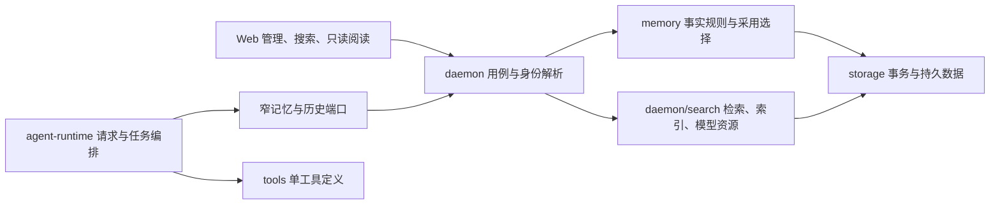

# 长期记忆与搜索设计

2026-11-12，M6直接写入与学习；实际模块为memory、storage/memory与search、agent-runtime/runs及daemon/search。当前验证状态按[M6验证记录](../04_FEATURES/202610301722_feature_m6-memory-search/verify.md)区分，不由本文代替平台证据。

长期记忆保存用户认可、可在后续请求沿用的事实；会话历史保存过去执行；检索索引帮助找到两者。三个对象有不同的修改、删除和授权语义，不以搜索命中、摘要或模型猜测当作用户稳定偏好。字段及HTTP参数见[记忆与搜索协议](../03_API/memory-search.md)，实际交付证据见[M6验证](../04_FEATURES/202610301722_feature_m6-memory-search/verify.md)。

## 职责与依赖

`packages/memory`拥有scope、正文规范、revision、直接写入及选择规则；repository由storage实现。它不启动模型、不认识Fastify或Pi。`storage/memory`持有独立事实及事务，`storage/search`持有派生来源、成员、分块、FTS与向量。`agent-runtime`在真实请求时读取、预算和复核；`tools`按一工具一文件声明七个记忆/历史操作。daemon解析当前身份、会话/任务范围，唯一拥有本地推理资源、后台索引及HTTP生命周期。人工、模型历史和记忆查询共用SearchService.queryScoped，记忆召回不再单独实例化查询引擎；查询取消和关闭归同一拥有者。

Web使用Query保存服务器事实，Zustand保存筛选、所选来源、虚拟定位与待发引用。历史阅读保持主对话组件挂载，不取得执行分支写权限，不将数据库或Pi对象放入Renderer。

## 独立事实与派生记录

同一profile SQLite保存记忆条目、设置、幂等receipt及无正文的来源/遗忘指纹。这些是独立事实，不列入Session JSONL投影重建删除清单，不以会话投影为级联外键。用户画像由当前有效条目分类并分页显示，不保存第二份画像摘要。

Session JSONL仍是执行事实的权威。实际输入、模型准备、工具写入意图和结果沿原批提交/fsync机制记录，没有memory专用日志或第二套消息类型。搜索来源、FTS、向量和最近请求的记忆采用记录是派生数据；重建不能以索引反向恢复遗忘正文。

事实写入使用expectedRevision和requestId。幂等receipt记录执行结果所需标识，读取时以当前事实返回entry；后来遗忘后，旧调用重试只能得到entry:null，不得从旧回执复活条目。人工编辑与遗忘不依赖原会话仍可读。

直接更新正文时同步更新来源。`memory_entry_sources`只记录条目实际保存过的来源指纹；条目先来自A、后来改为B再遗忘，A/B都不能被旧任务换一个正文恢复。该账本不保存正文版本，用户新的手工保存不受旧来源抑制。

## 请求准备与最终交接

固定条目表示必须在合法范围沿用的约定，相关条目表示需要本次查询匹配的资料。allowUse控制自动采用与模型记忆搜索；管理不受其关闭影响。根请求可用user及当前workspace；子任务仅自动用当前获准workspace，user条目必须由父显式转交精确ID，嵌套委派不能扩大父权限。

PreparedContext统一承载实际消息、采用快照、当前性与提交动作；派发直接消费这一对象，不另包一份memory引用。记忆操作的取消信号只由请求context提供，宿主合并Run与工具信号后再传入。

每次请求使用实际已消费的人类输入作为查询，follow-up/steer消费后更新；任务目标和通信保持其来源，不因role=user就成为人类陈述。快照一次读取合法固定正文、候选元数据及设置，指纹涵盖全部合法ID/revision/mode/enabled、设置和精确授权，新增未命中条目也会使旧准备失效。

请求顺序为：准备草稿及必要压缩→获取模型名额→复核来源、记忆和指纹→同批提交最终usage/context.prepared→立即交给Provider。等待期间变化先释放名额再重组，最多三次本地重备，不能占着唯一名额请求摘要，也不能重发已经交给Provider的请求。取消等待真实流settled后释放资源。

记忆预算为输入预算5%与2048估算tokens的较小值。固定内容超限明确失败并给出处理入口，不按相关性丢弃；相关条目完整放入剩余额度，最多8项，不截断单条正文。这里限制的是请求中记忆资料的大小，不是任务累计token或循环次数额度。

正文只进入最终system prompt的单个结构化记忆块。私有codec保存整块UTF-16范围，采用元数据与选择诊断分开；恢复校验范围、内容与任务授权，不能以当前记忆正文填补过去。最近每Run/Task采用投影显示当时内容及当前是否修改、停用或遗忘，不建立M7完整Trace平台。

## 对话保存与自动学习

save_memory和update_memory用于用户明确要求的保存与纠正，直接改变事实；learn_memory用于普通对话里的稳定偏好、长期指令与事实，要求allowUse与allowLearning均开启。这两个设置默认true，自动学习在写入事务内再次检查，不能只依赖模型看见的旧设置。save/learn/update真实标记为修改，但不增加一次审批；delete_memory沿既有通用审批，完全访问可跳过该审批。

模型负责识别明确意图与稳定信息，工具说明排除秘密、临时状态及未经用户认可的Agent结论。宿主负责可执行校验：根Run、已消费的直接人类来源、精确hash、早于工具意图、合法scope及目标revision。引用资料不会作为learn来源；明确保存选中资料仍可使用save。带附件的直接用户文字仍可学习，宿主绑定其文字hash，不把附件字节加入来源；哪些信息稳定、是否来自附件或属于秘密由模型规则判断，来源校验不声称能证明正文语义。子任务不自动获得写入能力，不能通过父闭包写入user记忆。

工具调用ID作为幂等身份，事务内执行来源/设置/CAS、事实变更和receipt提交。固定/相关默认值只由memory领域确定：明确保存固定，学习的偏好/指令固定、事实相关；更新未指定方式则保留现值。不同来源对同scope/category/body且启用、mode一致的事实复用原ID并记录当前调用receipt；已停用或方式不同明确冲突，不返回假成功或暗中重新启用。来源账本保持遗忘抑制所需指纹。

没有pending候选、确认/拒绝或单消息学习grant/TTL，输入队列也不冻结学习授权。工具在正常Agent循环完成，不在终态之后隐藏增加提取模型请求。Web只管理已保存事实，聊天采用普通折叠工具行；真实成功完成事件使管理Query失效刷新，历史采用快照仍保持当时内容。

## 持久来源与混合检索

索引只读取有界的持久MessageView.text和已启用记忆。它排除streaming片段、thinking、system、私有provider codec、凭据、原始工具大结果及附件字节。相同消息的多个分支共享一份来源正文，以成员关系表示归属；不同消息即使正文和hash相同也有独立source.id。

正文按最多480个UTF-16字符切块，保持Unicode边界与原偏移；实际tokenizer再次检查包含前缀/特殊token的512上限，必要时递归无损拆分。中文使用单字/双字，标识符经过规范化；FTS参数经编码生成安全MATCH，不向客户端输出FTS HTML。

合法scope先于词法TopK与独立语义候选。词法最多100候选，语义以精确余弦扫描合法向量、最多20000片段并保留100候选，RRF融合后按来源去重。达到限额或索引未追平时显式truncated，不随机抽样语料冒充完整搜索。命中最后从当前来源重验hash、原偏移及正文。

向量页以generation和chunk ID定位，有匹配该顺序的SQLite索引；当前事实直接连接当前chunk.source_id并核对source修订，完整scope继续先于LIMIT。queryReadiness与界面status共用真实水位、pending、FTS及状态完整性规则；只有混合查询另外检查是否存在缺失模型向量，不计算界面条目总数。查询结束只读取活动代际和合法scope水位。索引由schema15正常迁移建立，已存在的消息、记忆和向量保留。

索引按签名、代际和水位增量建立，批次有界；重启复用有效向量，只补新来源或缺失项。新的代际全部追平后才激活，异步向量回写以source/hash/signature做CAS。忘记在事实事务中清掉所有代际副本，迟到索引不能复活正文。临时语义不可用可有界保留一份有效旧缓存，损坏FTS只重建派生数据。

索引器对未变化的水位和模型签名先做相同的窄完整性复核，不为每次后台健康轮询计算界面总数；缺FTS、缺向量、重建或事实变化仍进入实际索引恢复路径。

检索质量和自动采用质量分开。人工搜索可以显示相近候选；相关记忆自动采用必须再通过本地cross-encoder复核，完整query/passage对的sigmoid分数至少0.5，过长、未准备、缺失或失败项不自动采用。不能用双编码器余弦阈值或强词法命中代替可靠相关性判断，零采用是合法结果但仍需验证正例覆盖。

## 本地模型资源所有权

daemon/search的`LocalSearchModelResource`唯一拥有一个Worker、等待队列和关闭流程，提供独立embedding/reranker视图。模型/修订固定在`embedding-model.ts`和`reranker-model.ts`，现有工具目录检索也使用同一embedding视图，不再另开首次查询下载入口。

资源只在显式prepare时下载；普通加载使用绝对cache和local-only。两个模型分别显示准备状态，共享队列按foreground、tool、background排序并有公平性；推理批有界，后台更小。不可抢占prepare期间前台快速得到BUSY并保留词法能力，不排在下载后无限等待。

排队取消移除等待项；已开始推理的调用方可结束等待，但容量直到真实Worker结果settled才可复用。prepare取消终止并等待所属Worker，清理其两个模型的驻留状态；崩溃不接受迟到回复。服务关闭先停止Runtime消费者，再取消并等待查询/准备/索引，最后退出模型Worker和数据库。

## 历史阅读、定位及引用

搜索返回稳定来源和精确target。只读sourceWindow在同一存储读取事务中验证hash、session/branch/message/task成员，返回目标周围有限片段及前后messageId游标；长正文页以textOffset在宿主按真实Unicode切点读取，客户端不猜测尚未读取的字符边界。Task从目标上下文读，不从cursor0遍历、不把兄弟或Root正文混入。归档和历史分支可以由人类显式阅读，读取不写branch.selected。

当前已打开的主时间线按message ID找到所属virtual entry，包括已折叠的回答过程；退出自动跟随后展开过程、scrollToIndex，再用实际测高作有界校准。未挂载的行不查询DOM，不为定位改成全量渲染。其他分支、归档和Task使用独立只读窗口，当前SSE、活动Run和输入草稿继续由原拥有者管理。

模型默认只能搜索当前workspace的其他可见Root会话，当前Session被整体排除，避免通过搜索重新引入编辑/reset丢弃的内容。`RunSourceAccess`保管本Run真实搜索命中及实际消费的人类引用；模型精读参数仅sourceId/start/end，宿主补齐hash和target，不接受模型自报grant。

人类跨workspace/历史Task引用在接受和消费时复核当前原文，作为可见、低信任、有界资料进入实际user消息；私有队列与codec只保留精确引用，不存第二份引用正文。引用只授权所选范围的子区间，不能联合不连续引用扩大范围，也不能因此搜索整个其他workspace。子任务不自动继承Root跨会话能力。注销和关闭清理客户端Query私有正文及迟到响应，不停止仍属于daemon的运行。
